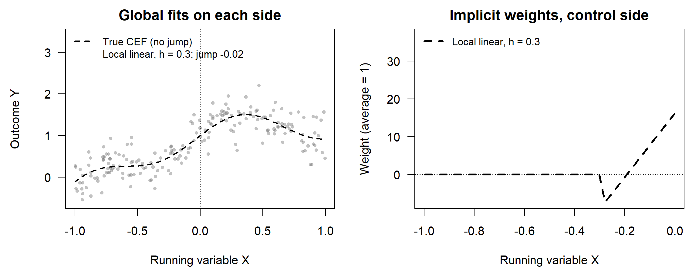
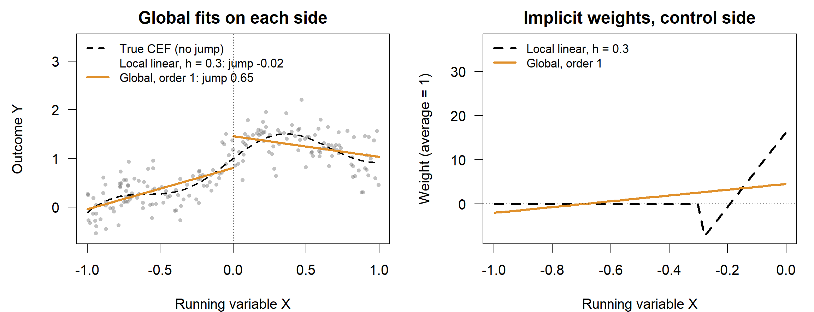
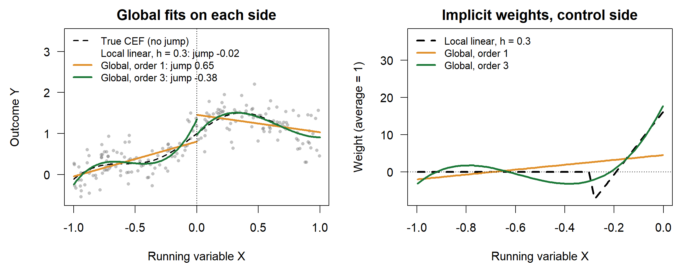
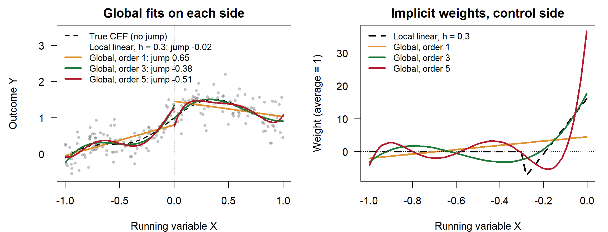

```{r}
#| include: false
blue <- "#4a7fb5"; amber <- "#e0902b"; red <- "#b2182b"; green <- "#1b7837"; grey <- "grey40"

# One simulated sharp RD used throughout: cutoff at 0, effect 0.5 at c, and different
# curvature on each side (so local linear fits are biased at wide bandwidths)
cut <- 0
m0 <- function(x) 1 + 0.8 * x - 0.6 * x^2
m1 <- function(x) m0(x) + 0.5 + 0.3 * x + 1.5 * x^2
tau <- m1(cut) - m0(cut)
simulate_rd <- function(n = 1000) {
  df <- data.frame(x = runif(n, -1, 1))
  df$d <- as.numeric(df$x >= cut)
  df$y <- ifelse(df$d == 1, m1(df$x), m0(df$x)) + rnorm(n, sd = 0.3)
  df
}
set.seed(38)
rd <- simulate_rd()

# Binned means, binned separately on each side of the cutoff
binmeans <- function(df, nb = 20) {
  brk <- c(seq(-1, cut, length.out = nb + 1), seq(cut, 1, length.out = nb + 1)[-1])
  b <- cut(df$x, brk, include.lowest = TRUE, right = FALSE)
  data.frame(x = tapply(df$x, b, mean), y = tapply(df$y, b, mean))
}

# Difference in means within [c - h, c + h], with its standard error
diffmeans <- function(df, h) {
  w <- df[abs(df$x - cut) <= h, ]
  y1 <- w$y[w$d == 1]; y0 <- w$y[w$d == 0]
  c(est = mean(y1) - mean(y0), se = sqrt(var(y1) / length(y1) + var(y0) / length(y0)))
}

# Local linear (uniform kernel) fit on each side within h; returns the jump and the fits
loclin <- function(df, h) {
  w <- df[abs(df$x - cut) <= h, ]
  fl <- lm(y ~ x, data = w[w$d == 0, ]); fr <- lm(y ~ x, data = w[w$d == 1, ])
  pl <- predict(fl, data.frame(x = cut), se.fit = TRUE)
  pr <- predict(fr, data.frame(x = cut), se.fit = TRUE)
  list(est = unname(pr$fit - pl$fit), se = sqrt(pr$se.fit^2 + pl$se.fit^2), fl = fl, fr = fr)
}

# Local polynomial of order p (uniform kernel) on each side within h: jump and its SE
rd_est <- function(df, h, p) {
  side <- function(s) {
    f <- lm(y ~ poly(x, p, raw = TRUE), data = df[abs(df$x - cut) <= h & df$d == s, ])
    c(coef(f)[1], vcov(f)[1, 1])
  }
  r <- side(1); l <- side(0)
  c(est = unname(r[1] - l[1]), se = sqrt(r[2] + l[2]))
}

# Local linear (uniform kernel) jump at an arbitrary cutoff c0, using x in [c0 - h, c0 + h]
ll_at <- function(x, y, c0, h) {
  side <- function(k) {
    f <- lm(y ~ I(x - c0), subset = k)
    c(coef(f)[1], vcov(f)[1, 1])
  }
  r <- side(x >= c0 & x <= c0 + h); l <- side(x >= c0 - h & x < c0)
  c(est = unname(r[1] - l[1]), se = sqrt(r[2] + l[2]))
}

xl <- seq(-1, cut, length.out = 200); xr <- seq(cut, 1, length.out = 200)
```

## Plan for today

What does an RD identify, and how do we do inference on it that has correct coverage?

1. Identification: randomization, then continuity
2. Fuzzy designs
3. Estimation and inference: bias, variance, and coverage at the boundary
4. Extensions

# Block 1: Identification

## Setup

- Running variable $X_i$, cutoff $c$, treatment $D_i = \mathbf{1}\{X_i \ge c\}$ (sharp)
- Potential outcomes $Y_i(0), Y_i(1)$
- Estimand: $\tau_{SRD} = E[Y_i(1) - Y_i(0) \mid X_i = c]$

```{r}
#| fig-width: 11
#| fig-height: 4.6
par(mar = c(4, 4.5, 1, 1), cex = 1.3)
plot(rd$x, rd$y, pch = 16, cex = 0.5, col = adjustcolor(grey, 0.15), las = 1,
     xlab = "Running variable X", ylab = "Outcome Y")
b <- binmeans(rd)
points(b$x, b$y, pch = 19, col = ifelse(b$x < cut, amber, blue))
gl <- lm(y ~ x + I(x^2), data = rd[rd$d == 0, ]); gr <- lm(y ~ x + I(x^2), data = rd[rd$d == 1, ])
lines(xl, predict(gl, data.frame(x = xl)), col = amber, lwd = 3)
lines(xr, predict(gr, data.frame(x = xr)), col = blue, lwd = 3)
abline(v = cut, lty = 3)
yl <- predict(gl, data.frame(x = cut)); yr <- predict(gr, data.frame(x = cut))
segments(cut, yl, cut, yr, col = red, lwd = 4)
text(cut + 0.02, (yl + yr) / 2, expression(hat(tau)[SRD]), col = red, pos = 4, cex = 1.2)
legend("topleft", c("Control (X < c)", "Treated (X ≥ c)"), col = c(amber, blue),
       pch = 19, bty = "n")
```

## Intuition: as good as random

Near the cutoff, units on either side are comparable, as if a coin flip assigned them.

. . .

Formally (local randomization): in a window $W = [c-h, c+h]$,

- assignment is independent of potential outcomes
- potential outcomes do not depend on $X_i$ within $W$ (exclusion)

. . .

Then a difference in means in $W$ identifies the effect, and randomization inference gives exact finite-sample tests (Cattaneo, Frandsen, Titiunik 2015).

. . .

- Under the sharp null ($Y_i(1) = Y_i(0)$ for all $i$), every potential outcome in $W$ is known
- Re-randomize treatment in $W$ and recompute the difference in means; the $p$-value is the share at least as extreme as observed

## How strong is local randomization?

- Requires no sorting within $W$
- Requires potential outcomes flat in $X$ within $W$

. . .

Independence alone is not enough: treatment is a deterministic function of $X$, so if $X$ predicts outcomes, treatment is mechanically correlated with them.

## Relaxing local randomization

- A tiny window around $c$ has few observations when $X$ is continuous, so the variance of the difference in means is high
- Widening the window adds power, but if $E[Y(d) \mid X]$ has a slope, the difference in means now includes (gap in mean $X$ across sides) $\times$ slope

```{r}
#| include: false
window_panel <- function(h, main, df = rd, ylim = c(-1, 4.6), tau_true = tau) {
  inw <- abs(df$x - cut) <= h
  plot(df$x, df$y, pch = 16, cex = 0.5, las = 1, main = main, ylim = ylim,
       col = ifelse(inw, adjustcolor(ifelse(df$d == 1, blue, amber), 0.6), adjustcolor(grey, 0.08)),
       xlab = "Running variable X", ylab = "Outcome Y")
  rect(cut - h, par("usr")[3], cut + h, par("usr")[4], col = adjustcolor(grey, 0.06), border = NA)
  dm <- diffmeans(df, h)
  w <- df[inw, ]
  segments(cut - h, mean(w$y[w$d == 0]), cut, mean(w$y[w$d == 0]), col = amber, lwd = 4)
  segments(cut, mean(w$y[w$d == 1]), cut + h, mean(w$y[w$d == 1]), col = blue, lwd = 4)
  abline(v = cut, lty = 3)
  legend("topleft", bty = "n", cex = 1,
         c(sprintf("Difference in means: %.2f (SE %.2f)", dm["est"], dm["se"]),
           sprintf("True effect at c: %.2f", tau_true), sprintf("Observations in window: %d", sum(inw))))
}
# Negative-slope version: same positive effect (0.5) at c, outcomes decline in X
set.seed(32)
rd_neg <-data.frame(x = runif(1000, -1, 1))
rd_neg$d <- as.numeric(rd_neg$x >= cut)
rd_neg$y <- 1.5 - 1.5 * rd_neg$x + 0.5 * rd_neg$d + rnorm(1000, sd = 0.3)
```

::: {.columns}
::: {.column width="50%"}
::: {.r-stack}
```{r}
#| fig-width: 6
#| fig-height: 4.2
par(mar = c(4, 4.5, 2, 1), cex = 1.25)
window_panel(0.05, "Narrow window (h = 0.05)")
```

::: {.fragment fragment-index=1}
```{r}
#| fig-width: 6
#| fig-height: 4.2
par(mar = c(4, 4.5, 2, 1), cex = 1.25)
window_panel(0.05, "Narrow window, negative slope", df = rd_neg, tau_true = 0.5)
```
:::
:::
:::
::: {.column width="50%"}
::: {.r-stack}
```{r}
#| fig-width: 6
#| fig-height: 4.2
par(mar = c(4, 4.5, 2, 1), cex = 1.25)
window_panel(0.6, "Wide window (h = 0.6)")
```

::: {.fragment fragment-index=1}
```{r}
#| fig-width: 6
#| fig-height: 4.2
par(mar = c(4, 4.5, 2, 1), cex = 1.25)
window_panel(0.6, "Wide window, negative slope", df = rd_neg, ylim = c(-1, 4.6), tau_true = 0.5)
```
:::
:::
:::
:::

## From randomization to continuity

- Slopes in $X$ violate exclusion, so as-good-as-random fails at any useful window width
- Allow slopes, but assume $E[Y_i(d) \mid X_i = x]$ is continuous at $c$

. . .

```{r}
#| fig-width: 11
#| fig-height: 4
h <- 0.3
ll <- loclin(rd, h)
inw <- abs(rd$x - cut) <= h
par(mar = c(4, 4.5, 1, 1), cex = 1.3)
plot(rd$x, rd$y, pch = 16, cex = 0.5, las = 1,
     col = ifelse(inw, adjustcolor(ifelse(rd$d == 1, blue, amber), 0.6), adjustcolor(grey, 0.08)),
     xlab = "Running variable X", ylab = "Outcome Y")
xwl <- seq(cut - h, cut, length.out = 50); xwr <- seq(cut, cut + h, length.out = 50)
lines(xwl, predict(ll$fl, data.frame(x = xwl)), col = amber, lwd = 4)
lines(xwr, predict(ll$fr, data.frame(x = xwr)), col = blue, lwd = 4)
abline(v = cut, lty = 3)
segments(cut, predict(ll$fl, data.frame(x = cut)), cut, predict(ll$fr, data.frame(x = cut)),
         col = red, lwd = 4)
dm <- diffmeans(rd, h)
legend("topleft", bty = "n", cex = 1,
       c(sprintf("Local linear estimate: %.2f (SE %.2f)", ll$est, ll$se),
         sprintf("Difference in means, same window: %.2f", dm["est"]),
         sprintf("True effect at c: %.2f", tau)))
```

## Continuity

**Assumption (sharp).** $E[Y_i(0) \mid X_i = x]$ is continuous in $x$ at $c$.

```{r}
#| fig-width: 11
#| fig-height: 4.6
par(mar = c(4, 4.5, 1, 1), cex = 1.3)
plot(NA, xlim = c(-1, 1), ylim = range(m0(xl), m1(xr), m1(xl)), las = 1,
     xlab = "Running variable X", ylab = "Conditional expectation")
rect(cut, par("usr")[3], 1, par("usr")[4], col = adjustcolor(blue, 0.05), border = NA)
lines(xl, m0(xl), col = amber, lwd = 4); lines(xr, m0(xr), col = amber, lwd = 3, lty = 2)
lines(xr, m1(xr), col = blue, lwd = 4);  lines(xl, m1(xl), col = blue, lwd = 3, lty = 2)
abline(v = cut, lty = 3)
segments(cut, m0(cut), cut, m1(cut), col = red, lwd = 4)
text(cut + 0.02, (m0(cut) + m1(cut)) / 2, expression(tau[SRD]), col = red, pos = 4, cex = 1.2)
text(-0.5, par("usr")[3], "Untreated (D = 0)", pos = 3, col = grey)
text(0.5, par("usr")[3], "Treated (D = 1)", pos = 3, col = grey)
legend("topleft", bty = "n", lwd = c(4, 4, 3), lty = c(1, 1, 2), col = c(blue, amber, grey),
       c("E[Y(1) | X]", "E[Y(0) | X]", "Dashed: not observed"))
```

Only the solid segments are observed. Continuity of the dashed $E[Y(0) \mid X]$ at $c$ lets $E[Y \mid X]$ approached from below $c$ stand in for it.

## What continuity identifies

$E[Y \mid X]$ approached from below $c$ is then the counterfactual for treated units at $c$:
$$
\tau_{SRD} = \lim_{x \downarrow c} E[Y_i \mid X_i = x] - \lim_{x \uparrow c} E[Y_i \mid X_i = x].
$$

. . .

- Everyone above $c$ is treated, so the effect on the treated at $c$ is the effect at $c$
- Continuity of $E[Y_i(1) \mid X_i = x]$ is additionally needed to read this as the effect for all units at exactly $c$; it becomes essential in the fuzzy design

. . .

- Slopes are allowed; sorting across $c$ is not, since it breaks continuity
- The cost is that inference is no longer exact in finite samples; it relies on asymptotics and bandwidth choice

## Is a slope a violation?

::: {.columns}
::: {.column width="50%"}
**Under local randomization (with exclusion)**

Yes. $X$ affects outcomes directly inside $W$, so the exclusion condition fails.

```{r}
#| fig-width: 6
#| fig-height: 4
# Required shape: potential outcomes flat in X inside W
hw <- 0.3
f0 <- function(x) ifelse(abs(x) <= hw, 1, 1 + 0.8 * (x - sign(x) * hw))
par(mar = c(4, 4.5, 2, 1), cex = 1.3)
plot(NA, xlim = c(-1, 1), ylim = c(0.3, 2.3), las = 1, main = "Flat inside W",
     xlab = "Running variable X", ylab = "Conditional expectation")
rect(-hw, par("usr")[3], hw, par("usr")[4], col = adjustcolor(grey, 0.1), border = NA)
text(0, par("usr")[4], "W", pos = 1, col = grey)
lines(xl, f0(xl), col = amber, lwd = 4); lines(xr, f0(xr) + 0.5, col = blue, lwd = 4)
lines(xr, f0(xr), col = amber, lwd = 3, lty = 2); lines(xl, f0(xl) + 0.5, col = blue, lwd = 3, lty = 2)
abline(v = cut, lty = 3)
```
:::
::: {.column width="50%" .fragment}
**Under continuity**

No. Slopes are allowed. The slope breaks the raw difference in means, not identification of the jump.

```{r}
#| fig-width: 6
#| fig-height: 4
par(mar = c(4, 4.5, 2, 1), cex = 1.3)
plot(NA, xlim = c(-1, 1), ylim = range(m0(xl), m1(xr), m1(xl)), las = 1,
     main = "Smooth at c", xlab = "Running variable X", ylab = "Conditional expectation")
lines(xl, m0(xl), col = amber, lwd = 4); lines(xr, m0(xr), col = amber, lwd = 3, lty = 2)
lines(xr, m1(xr), col = blue, lwd = 4);  lines(xl, m1(xl), col = blue, lwd = 3, lty = 2)
abline(v = cut, lty = 3)
segments(cut, m0(cut), cut, m1(cut), col = red, lwd = 4)
```
:::
:::

## Two routes to identification

| | Local randomization | Continuity |
|---|---|---|
| Assumption | Independence + exclusion in $W$ | Continuous conditional expectations at $c$ |
| Heroism | More heroic | Less heroic |
| Estimation | Difference in means, randomization tests | Local polynomial on each side |
| Inference | Exact, finite-sample | Asymptotic |

## Aside: interrupted time series

RD with time as the running variable and the intervention date as the cutoff.

- Assumption: the outcome would have continued smoothly through the date absent the intervention
- No control group, so anything else changing at that date is confounding
- Neighboring time points are autocorrelated, unlike cross-sectional units

. . .

Hausman and Rapson (2018):

- More data means more time, not more units near $c$; studies use years of data, so the fit leans on observations far from $c$
- Controls (day of week, weather) are needed for bias, not just precision
- Autoregressive outcomes: the estimate may recover the short-run effect, the long-run effect, or neither
- Time has a uniform density: no McCrary test, so anticipation and avoidance are untestable
- Checks: placebo dates and untreated areas, RD on covariates, donut RD, lagged outcome, "augmented local linear" (residualize on controls over the full sample, then local linear on residuals near $c$)

# Block 2: Fuzzy designs

## From sharp to fuzzy

- Crossing the cutoff shifts the probability of treatment rather than determining it
- The cutoff is an instrument: $Z_i = \mathbf{1}\{X_i \ge c\}$
- Potential treatments $D_i(0), D_i(1)$; $D_i = D_i(Z_i)$

```{r}
#| fig-width: 12
#| fig-height: 4
# Fuzzy design: probability of treatment jumps from 0.25 to 0.70 at c
p0 <- function(x) 0.1 + 0.15 * (x + 1)
p1 <- function(x) 0.7 + 0.2 * x
pscore_panel <- function(fl, fr, main) {
  plot(NA, xlim = c(-1, 1), ylim = c(0, 1), las = 1, main = main,
       xlab = "Running variable X", ylab = "P(D = 1 | X)")
  lines(xl, fl(xl), col = amber, lwd = 4); lines(xr, fr(xr), col = blue, lwd = 4)
  abline(v = cut, lty = 3)
  segments(cut, fl(cut), cut, fr(cut), col = red, lwd = 4)
}
par(mfrow = c(1, 2), mar = c(4, 4.5, 2, 1), cex = 1.25)
pscore_panel(function(x) 0 * x, function(x) 0 * x + 1, "Sharp: crossing c determines D")
pscore_panel(p0, p1, "Fuzzy: crossing c shifts P(D = 1)")
```

## Reduced form over first stage

- First stage: crossing $c$ raises $P(D_i = 1)$ by the jump in $E[D_i \mid X_i = x]$ at $c$
- Each unit moved into treatment changes $Y$ by $\tau_{FRD}$

. . .

- Reduced form: the jump in $E[Y_i \mid X_i = x]$ at $c$ is $\tau_{FRD} \times$ first-stage jump
- Divide to recover $\tau_{FRD}$

. . .

- Implementation: local 2SLS within $h$, $Z_i$ instrumenting $D_i$, same $h$ for both stages

## Estimand

$$
\tau_{FRD} = \frac{\lim_{x \downarrow c} E[Y_i \mid X_i = x] - \lim_{x \uparrow c} E[Y_i \mid X_i = x]}
{\lim_{x \downarrow c} E[D_i \mid X_i = x] - \lim_{x \uparrow c} E[D_i \mid X_i = x]}
$$

```{r}
#| fig-width: 12
#| fig-height: 3.6
# Simulated fuzzy RD with a constant effect of 0.5 of D on Y
set.seed(8358)
fz <- data.frame(x = runif(2000, -1, 1))
fz$z <- as.numeric(fz$x >= cut)
fz$d <- rbinom(nrow(fz), 1, ifelse(fz$z == 1, p1(fz$x), p0(fz$x)))
fz$y <- m0(fz$x) + 0.5 * fz$d + rnorm(nrow(fz), sd = 0.3)
h_fz <- 0.4
fz_df <- function(v) data.frame(x = fz$x, d = fz$z, y = fz[[v]])
fs <- loclin(fz_df("d"), h_fz)$est; rf <- loclin(fz_df("y"), h_fz)$est
jump_panel <- function(v, main, ylab, note) {
  df <- fz_df(v)
  b <- binmeans(df)
  ll <- loclin(df, h_fz)
  plot(b$x, b$y, pch = 19, las = 1, main = main, xlab = "Running variable X", ylab = ylab,
       col = ifelse(b$x < cut, amber, blue))
  xwl <- seq(cut - h_fz, cut, length.out = 50); xwr <- seq(cut, cut + h_fz, length.out = 50)
  lines(xwl, predict(ll$fl, data.frame(x = xwl)), col = amber, lwd = 3)
  lines(xwr, predict(ll$fr, data.frame(x = xwr)), col = blue, lwd = 3)
  abline(v = cut, lty = 3)
  segments(cut, predict(ll$fl, data.frame(x = cut)), cut, predict(ll$fr, data.frame(x = cut)),
           col = red, lwd = 4)
  legend("bottomright", bty = "n", c(sprintf("Jump at c: %.2f", ll$est), note))
}
par(mfrow = c(1, 2), mar = c(4, 4.5, 2, 1), cex = 1.25)
jump_panel("d", "First stage", "Share treated", NULL)
jump_panel("y", "Reduced form", "Mean outcome",
           sprintf("Ratio: %.2f / %.2f = %.2f (truth 0.50)", rf, fs, rf / fs))
```

. . .

This is a Wald ratio: instrumental variables localized at the threshold.

## Assumptions

::: {.incremental}
1. Continuity of $E[Y_i(d) \mid X_i = x]$ and $E[D_i(z) \mid X_i = x]$ at $c$ (continuity on both sides now matters)
2. First stage: $P(D_i = 1 \mid X_i)$ jumps at $c$
3. Monotonicity: crossing the cutoff never moves anyone out of treatment
4. Exclusion: the cutoff affects $Y$ only through $D$
:::

. . .

**Identifies:** the average effect for compliers at the cutoff, not for everyone at the cutoff.

## Inference with a small first stage

- The fuzzy estimate is a ratio; when the first-stage jump is small, it behaves like IV with a weak instrument and delta-method CIs are unreliable (Feir, Lemieux, Marmer 2016)

```{r}
#| include: false
#| cache: true
# Sampling distribution of the fuzzy ratio for a strong (0.45) and a weak (0.10) first-stage jump
fuzzy_draw <- function(j) {
  x <- runif(2000, -1, 1); z <- as.numeric(x >= cut)
  d <- rbinom(2000, 1, p0(x) + j * z)
  y <- m0(x) + 0.5 * d + rnorm(2000, sd = 0.3)
  ll_at(x, y, cut, 0.4)["est"] / ll_at(x, d, cut, 0.4)["est"]
}
set.seed(77)
ratios <- list(strong = replicate(1000, fuzzy_draw(0.45)), weak = replicate(1000, fuzzy_draw(0.10)))
```

```{r}
#| fig-width: 12
#| fig-height: 3.8
ratio_panel <- function(r, main) {
  inside <- r[r > -2 & r < 3]
  hr <- hist(inside, breaks = seq(-2, 3, by = 0.1), plot = FALSE)
  plot(hr, col = adjustcolor(blue, 0.6), border = "white", las = 1, ylim = c(0, 1.45 * max(hr$counts)),
       main = main, xlab = "Fuzzy RD estimate", ylab = "Draws")
  segments(0.5, 0, 0.5, 1.1 * max(hr$counts), lty = 2, lwd = 2)
  legend("topleft", bty = "n", cex = 0.9,
         c(sprintf("Middle 90%%: [%.2f, %.2f]", quantile(r, 0.05), quantile(r, 0.95)),
           sprintf("Outside [-2, 3]: %d of %d", sum(r <= -2 | r >= 3), length(r))))
}
par(mfrow = c(1, 2), mar = c(4, 4.5, 2, 1), cex = 1.25)
ratio_panel(ratios$strong, "First-stage jump 0.45")
ratio_panel(ratios$weak, "First-stage jump 0.10")
```

. . .

- Fix: bias-aware confidence sets (Noack and Rothe 2024), after honest intervals in Block 3

# Block 3: Estimation and inference

## From limits to local fits

- $\tau_{SRD}$ is defined by limits at $c$; with finite data, use a window $[c-h, c+h]$ and approximate $E[Y_i \mid X_i = x]$ on each side

. . .

- Suppose the second derivative of $E[Y_i(0) \mid X_i = x]$ is bounded by $B$ near $c$
- Taylor: the tangent line at $c$ is off by at most $\frac{B}{2}(x - c)^2$
- Within the window, the error is $O(h^2)$

. . .

- Small $h$ justifies a low-order fit: local linear
- Same bound $B$ returns with honest confidence intervals

```{r}
#| include: false
#| cache: true
# Sampling distribution across bandwidths: local linear (conventional) and local quadratic
# (= the RBC estimate and robust SE when the pilot bandwidth b equals h), uniform kernel
hgrid <- seq(0.1, 1, by = 0.05)
set.seed(2026)
sims <- replicate(500, {
  df <- simulate_rd()
  sapply(hgrid, function(h) c(rd_est(df, h, 1), rd_est(df, h, 2)))
})
```

```{r}
#| include: false
bias_ll <- rowMeans(sims[1, , ]) - tau
var_ll <- apply(sims[1, , ], 1, var)
mse_ll <- bias_ll^2 + var_ll
h_mse <- hgrid[which.min(mse_ll)]
covers <- function(e, s) rowMeans(abs(sims[e, , ] - tau) <= 1.96 * sims[s, , ])
cov_conv <- covers(1, 2); cov_rbc <- covers(3, 4)
```

## Bias-variance tradeoff

- Two choices: bandwidth $h$ and polynomial order $p$
- Local linear: bias grows with $h$ (ignored curvature), variance shrinks with $h$
- The MSE-optimal $h$ balances squared bias and variance, but depends on the curvature we are trying not to model

```{r}
#| fig-width: 12
#| fig-height: 4
par(mfrow = c(1, 2), mar = c(4, 4.5, 2, 1), cex = 1.25)
# Left: population local linear approximations at two bandwidths
plot(NA, xlim = c(-1, 1), ylim = range(m0(xl), m1(xr)), las = 1, main = "Local linear approximations",
     xlab = "Running variable X", ylab = "Conditional expectation")
lines(xl, m0(xl), col = amber, lwd = 4); lines(xr, m1(xr), col = blue, lwd = 4)
abline(v = cut, lty = 3)
approx_jump <- function(h, col) {
  gl <- seq(cut - h, cut, length.out = 400); gr <- seq(cut, cut + h, length.out = 400)
  al <- lm(m0(gl) ~ gl); ar <- lm(m1(gr) ~ gr)
  lines(gl, fitted(al), col = col, lwd = 3, lty = 2); lines(gr, fitted(ar), col = col, lwd = 3, lty = 2)
  points(c(cut, cut), c(coef(al)[1], coef(ar)[1]), pch = 19, col = col)
  unname(coef(ar)[1] - coef(al)[1])
}
j_small <- approx_jump(0.3, green); j_big <- approx_jump(0.9, red)
legend("topleft", bty = "n", lwd = 3, lty = 2, col = c(green, red), cex = 0.9,
       c(sprintf("h = 0.3: jump %.2f", j_small), sprintf("h = 0.9: jump %.2f", j_big)))
text(1, par("usr")[3], sprintf("True jump: %.2f", tau), adj = c(1, -0.5), cex = 0.9)
# Right: squared bias, variance, and MSE across bandwidths in the simulation
plot(hgrid, mse_ll, type = "l", lwd = 4, las = 1, ylim = c(0, max(mse_ll)), main = "Simulated MSE",
     xlab = "Bandwidth h", ylab = "")
lines(hgrid, bias_ll^2, col = red, lwd = 3); lines(hgrid, var_ll, col = blue, lwd = 3)
abline(v = h_mse, lty = 3)
legend("topleft", bty = "n", lwd = c(4, 3, 3), col = c("black", red, blue), cex = 0.9,
       c("MSE", "Squared bias", "Variance"))
text(h_mse, par("usr")[4], sprintf("MSE-optimal h = %.2f", h_mse), adj = c(-0.05, 1.5), cex = 0.9)
```

## Bias at the MSE-optimal bandwidth

- At that $h$, bias is the same order as the standard error
- The estimator is therefore asymptotically normal but not centered at $\tau$; it is shifted by a bias term that does not vanish
- The conventional CI ($\hat\tau \pm 1.96\,\widehat{se}$) ignores the shift and undercovers

. . .

Two responses: undersmooth (valid, but not MSE-optimal and discards data), or correct the inference.

## Robust bias correction (RBC)

1. Estimate the leading bias, which is driven by the curvature at $c$. Fit a local polynomial of order $p+1$ (quadratic for local linear) on each side to estimate it, and subtract
2. Account for the noise in the bias estimate by using a standard error that includes its variance and covariance with the original estimator

. . .

- Bias-corrected estimator = conventional estimate minus estimated bias; with equal bandwidths it coincides with the local quadratic estimator
- The studentized statistic is asymptotically standard normal at the MSE-optimal $h$ (Calonico, Cattaneo, Titiunik 2014)
- Interval is centered on the **bias-corrected** estimate, not the conventional one

## Coverage in the simulation

```{r}
#| fig-width: 13
#| fig-height: 4.6
h_show <- 0.5
k <- which(abs(hgrid - h_show) < 1e-8); nshow <- 40
ci_lim <- range(sims[c(1, 3), k, 1:nshow] + c(-1.96, 1.96) * sims[c(2, 4), k, 1:nshow],
                sims[c(1, 3), k, 1:nshow] - c(1.96, 1.96) * sims[c(2, 4), k, 1:nshow])
ci_panel <- function(e, s, col, main) {
  est <- sims[e, k, 1:nshow]; se <- sims[s, k, 1:nshow]
  lo <- est - 1.96 * se; hi <- est + 1.96 * se
  miss <- lo > tau | hi < tau
  plot(NA, xlim = ci_lim, ylim = c(1, nshow),
       yaxt = "n", main = sprintf("%s: %d of %d miss", main, sum(miss), nshow),
       xlab = "Estimate and 95% CI", ylab = "")
  segments(lo, 1:nshow, hi, 1:nshow, col = ifelse(miss, red, col), lwd = 2)
  points(est, 1:nshow, pch = 19, cex = 0.6, col = ifelse(miss, red, col))
  abline(v = tau, lty = 2)
}
layout(matrix(1:3, 1), widths = c(1.3, 1, 1))
par(mar = c(4, 4.5, 2, 1), cex = 1.1)
plot(hgrid, cov_conv, type = "l", lwd = 4, col = amber, ylim = c(0, 1), las = 1,
     main = "Coverage of 95% intervals", xlab = "Bandwidth h", ylab = "Coverage")
lines(hgrid, cov_rbc, lwd = 4, col = blue)
abline(h = 0.95, lty = 2); abline(v = c(h_mse, h_show), lty = 3, col = c("black", grey))
text(h_mse, 0.5, "MSE-optimal", pos = 2, cex = 0.85)
legend("bottomleft", bty = "n", lwd = 4, col = c(amber, blue), c("Conventional", "Robust bias-corrected"))
par(mar = c(4, 1, 2, 1))
ci_panel(1, 2, amber, "Conventional")
ci_panel(3, 4, blue, "RBC")
```

Simulation: 500 draws, uniform kernel, $b = h$. At the MSE-optimal $h$ (`r h_mse`), conventional coverage is `r round(cov_conv[hgrid == h_mse], 2)`; it falls quickly as $h$ grows. Right panels show the first 40 draws at $h = 0.5$.

## RBC: caveats and the standard error

- Order $p+1$ is a default choice, not a theorem. Finite-sample bias remains; the claim is that residual bias is asymptotically negligible, not zero
- It requires enough smoothness for the higher-order expansion

. . .

- The standard error has a closed form: the corrected estimator is linear in $Y$, so the variance is a sandwich of weights times conditional variances
- Residual variances come from nearest-neighbor matching (the `rdrobust` default) or a plug-in; a cluster-robust version is available
- No bootstrap is needed, and the naive bootstrap fails because of the bias

## Honest confidence intervals

- Armstrong and Kolesár (2018): bound the second derivative, $|f''| \le B$
- Intervals are valid in finite samples under the bound

. . .

- RBC relies on asymptotics; honest CIs rely on a smoothness bound, and the results depend on $B$
- Optimized RD (Imbens and Wager 2019) chooses the weights on each observation directly to minimize worst-case MSE under the same kind of bound, and extends to several running variables

## Fuzzy RD without dividing

Noack and Rothe (2024). Write $\text{jump}(W) = \lim_{x \downarrow c} E[W_i \mid X_i = x] - \lim_{x \uparrow c} E[W_i \mid X_i = x]$.

$$
\tau_{FRD} = \frac{\text{jump}(Y)}{\text{jump}(D)} \quad\Longrightarrow\quad \text{jump}(Y) = \tau_{FRD} \cdot \text{jump}(D)
$$

. . .

Pick a candidate value $\tau_0$ and test $H_0: \tau_{FRD} = \tau_0$. Expectations and limits are linear, so

$$
\text{jump}(Y - \tau_0 D) = \text{jump}(Y) - \tau_0 \cdot \text{jump}(D) = (\tau_{FRD} - \tau_0) \cdot \text{jump}(D)
$$

. . .

- Under $H_0$, $Y_i - \tau_0 D_i$ has no jump at $c$, however small $\text{jump}(D)$ is
- Testing $H_0$ is a sharp RD with outcome $Y_i - \tau_0 D_i$: no ratio, no division

## Bias-aware confidence sets

- For each $\tau_0$ on a grid: local linear estimate of $\text{jump}(Y - \tau_0 D)$
- Honest interval: bound the second derivative of $E[Y_i - \tau_0 D_i \mid X_i = x]$ by $B$, widen for the worst-case bias
- Reject $\tau_0$ if the interval excludes zero

. . .

- Confidence set: every $\tau_0$ not rejected (Anderson–Rubin for weak IV)
- Weak first stage: $\text{jump}(Y - \tau_0 D) \approx 0$ for every $\tau_0$, so the set is wide or unbounded
- The bound $B$ replaces asymptotics in $h$, so discrete running variables are fine

## Bias-aware confidence sets in the simulation

```{r}
#| fig-width: 12
#| fig-height: 4.2
# Local linear (uniform kernel) jump at c as a linear combination of outcomes: returns the weights
ll_w <- function(x, h) {
  w <- numeric(length(x))
  for (s in c(1, -1)) {
    idx <- which(if (s == 1) x >= cut & x <= cut + h else x >= cut - h & x < cut)
    Xm <- cbind(1, x[idx] - cut)
    w[idx] <- s * solve(crossprod(Xm), t(Xm))[1, ]
  }
  w
}
# For each tau0: jump in Y - tau0 * D, EHW SE, and bias-aware critical value given |f''| <= B
ar_set <- function(x, y, d, h, B, grid) {
  w <- ll_w(x, h); inw <- w != 0
  bmax <- B / 2 * sum(abs(w) * (x - cut)^2)
  t(sapply(grid, function(t0) {
    yt <- y - t0 * d; e <- numeric(length(x))
    for (k in list(x >= cut & inw, x < cut & inw)) e[k] <- resid(lm(yt[k] ~ x[k]))
    est <- sum(w * yt); se <- sqrt(sum(w^2 * e^2))
    c(t0 = t0, est = est, se = se, cv = sqrt(qchisq(0.95, 1, ncp = (bmax / se)^2)))
  }))
}
ar_panel <- function(j, seed, main) {
  set.seed(seed)
  x <- runif(2000, -1, 1); z <- as.numeric(x >= cut)
  d <- rbinom(2000, 1, p0(x) + j * z); y <- m0(x) + 0.5 * d + rnorm(2000, sd = 0.3)
  grid <- seq(-2, 3, by = 0.01)
  r <- ar_set(x, y, d, 0.4, 1.2, grid)
  w <- ll_w(x, 0.4); fs_j <- sum(w * d); wald <- sum(w * y) / fs_j
  se_wald <- r[which.min(abs(grid - wald)), "se"] / abs(fs_j)
  lo <- r[, "est"] - r[, "cv"] * r[, "se"]; hi <- r[, "est"] + r[, "cv"] * r[, "se"]
  acc <- lo <= 0 & hi >= 0
  plot(NA, xlim = range(grid), ylim = c(min(lo), max(hi) + 0.5 * diff(range(lo, hi))), las = 1, main = main,
       xlab = expression("Candidate " * tau[0]), ylab = expression("Jump in " * Y - tau[0] * D))
  rect(grid[acc] - 0.005, par("usr")[3], grid[acc] + 0.005, par("usr")[4],
       col = adjustcolor(blue, 0.15), border = NA)
  polygon(c(grid, rev(grid)), c(lo, rev(hi)), col = adjustcolor(grey, 0.25), border = NA)
  lines(grid, r[, "est"], lwd = 3)
  abline(h = 0, lty = 2); abline(v = 0.5, lty = 3)
  a <- grid[acc]
  set_txt <- if (min(a) <= min(grid) || max(a) >= max(grid)) "Bias-aware set: unbounded on this grid" else
    sprintf("Bias-aware set: [%.2f, %.2f]", min(a), max(a))
  legend("topright", bty = "n", cex = 0.9,
         c(sprintf("First-stage jump: %.2f", fs_j),
           sprintf("Wald ratio %.2f, delta-method CI [%.2f, %.2f]", wald, wald - 1.96 * se_wald, wald + 1.96 * se_wald),
           set_txt))
}
par(mfrow = c(1, 2), mar = c(4, 4.5, 2, 1), cex = 1.2)
ar_panel(0.45, 103, "Strong first stage")
ar_panel(0.10, 102, "Weak first stage")
```

Line: estimated $\text{jump}(Y - \tau_0 D)$, slope $= -\text{jump}(D)$. Band: honest interval. Shaded: $\tau_0$ not rejected. Truth 0.5 (dotted). $h = 0.4$, $B = 1.2$.

## Bandwidth choice for inference

- The MSE-optimal $h$ is chosen for the point estimate and is too large for confidence intervals
- Coverage-error-optimal bandwidths are smaller: they shrink at rate $n^{-1/4}$ rather than $n^{-1/5}$ (Calonico, Cattaneo, Farrell 2018, 2020)
- In `rdrobust`, `bwselect = "cerrd"`; a common choice reports the estimate at the MSE-optimal $h$ and the RBC interval

```{r}
#| fig-width: 11
#| fig-height: 3.6
len_conv <- rowMeans(2 * 1.96 * sims[2, , ]); len_rbc <- rowMeans(2 * 1.96 * sims[4, , ])
par(mar = c(4, 4.5, 1, 1), cex = 1.25)
plot(hgrid, len_rbc, type = "l", lwd = 4, col = blue, las = 1, ylim = c(0, max(len_rbc)),
     xlab = "Bandwidth h", ylab = "Average CI length")
lines(hgrid, len_conv, lwd = 4, col = amber)
abline(v = h_mse, lty = 3)
text(h_mse, 0.05, "MSE-optimal", pos = 4, cex = 0.9)
legend("topright", bty = "n", lwd = 4, col = c(amber, blue), c("Conventional", "Robust bias-corrected"))
```

Smaller bandwidths buy coverage accuracy with longer intervals.

## Global high-order polynomials

- Implicit weights concentrate on observations far from $c$
- Estimates are sensitive to polynomial order
- Coverage is poor, because intervals ignore specification error

. . .

- Local linear or local quadratic fits are preferred (Gelman and Imbens 2019)
- Higher-order terms remain useful locally, paired with valid inference (Calonico, Cattaneo, Titiunik 2014)

## Global polynomials in a simulation with no effect

```{r}
#| include: false
# Smooth outcome with no discontinuity at c; 200 observations
g <- function(x) 1 + 0.8 * x - 0.6 * x^2 + 0.3 * sin(5 * x)
set.seed(32)
gp <- data.frame(x = runif(200, -1, 1))
gp$d <- as.numeric(gp$x >= cut)
gp$y <- g(gp$x) + rnorm(200, sd = 0.3)
orders <- c(1, 3, 5); pcols <- c(amber, green, red)
fits <- lapply(orders, function(p) list(
  l = lm(y ~ poly(x, p, raw = TRUE), data = gp[gp$d == 0, ]),
  r = lm(y ~ poly(x, p, raw = TRUE), data = gp[gp$d == 1, ])))
jumps <- sapply(orders, function(p) rd_est(gp, 1, p)["est"])
ll_gp <- rd_est(gp, 0.3, 1)["est"]
# Implicit weights on control-side observations in the estimate of E[Y | X = c] (Gelman and Imbens 2019)
xs <- sort(gp$x[gp$d == 0]); nl <- length(xs)
wts <- function(p, h = 1) {
  keep <- abs(xs - cut) <= h
  X <- cbind(1, poly(xs[keep], p, raw = TRUE))
  w <- rep(0, nl); w[keep] <- solve(crossprod(X), t(X))[1, ]
  nl * w
}
W <- sapply(orders, wts); w_ll <- wts(1, 0.3)

# Stage k shows the data, the true CEF, local linear, and the first k global fits
poly_stage <- function(k) {
  shown <- seq_len(k)
  par(mfrow = c(1, 2), mar = c(4, 4.5, 2, 1), cex = 1.25)
  plot(gp$x, gp$y, pch = 16, cex = 0.6, col = adjustcolor(grey, 0.4), las = 1, ylim = c(-0.6, 3.4),
       main = "Global fits on each side", xlab = "Running variable X", ylab = "Outcome Y")
  lines(c(xl, xr), g(c(xl, xr)), lwd = 2, lty = 2)
  for (j in shown) {
    lines(xl, predict(fits[[j]]$l, data.frame(x = xl)), col = pcols[j], lwd = 3)
    lines(xr, predict(fits[[j]]$r, data.frame(x = xr)), col = pcols[j], lwd = 3)
  }
  abline(v = cut, lty = 3)
  legend("topleft", bty = "n", cex = 0.85, lwd = c(2, NA, rep(3, k)), lty = c(2, NA, rep(1, k)),
         col = c("black", NA, pcols[shown]),
         c("True CEF (no jump)", sprintf("Local linear, h = 0.3: jump %.2f", ll_gp),
           sprintf("Global, order %d: jump %.2f", orders[shown], jumps[shown])))
  plot(xs, w_ll, type = "l", lty = 2, lwd = 3, las = 1, ylim = range(W, w_ll),
       main = "Implicit weights, control side", xlab = "Running variable X", ylab = "Weight (average = 1)")
  for (j in shown) lines(xs, W[, j], col = pcols[j], lwd = 3)
  abline(h = 0, lty = 3)
  legend("topleft", bty = "n", cex = 0.85, lwd = 3, lty = c(2, rep(1, k)), col = c("black", pcols[shown]),
         c("Local linear, h = 0.3", sprintf("Global, order %d", orders[shown])))
}
dir.create("figs", showWarnings = FALSE)
for (k in 0:3) {
  png(sprintf("figs/global_poly_%d.png", k), width = 12, height = 4.6, units = "in", res = 192)
  poly_stage(k)
  dev.off()
}
```

::: {.r-stack}
{width="100%"}

{.fragment width="100%"}

{.fragment width="100%"}

{.fragment width="100%"}
:::

## Covariates

- Predetermined covariates are not needed for identification, and they cannot repair a failure of continuity
- When they predict the outcome, adding them improves precision (Calonico, Cattaneo, Farrell, Titiunik 2019)
- Noack, Olma, Rothe (2026): subtract a flexible, possibly machine-learned, function of the covariates from the outcome, then run a standard RD

```{r}
#| include: false
#| cache: true
# Covariate W explains much of the outcome variance; compare local linear with and without it
cov_draw <- function() {
  df <- simulate_rd()
  df$w <- rnorm(nrow(df))
  df$y <- df$y + 0.6 * df$w
  k <- abs(df$x - cut) <= 0.3
  f0 <- lm(y ~ d * x, data = df, subset = k); f1 <- lm(y ~ d * x + w, data = df, subset = k)
  c(coef(f0)["d"], coef(f1)["d"])
}
set.seed(31)
cdraws <- replicate(500, cov_draw())
```

```{r}
#| fig-width: 11
#| fig-height: 3.4
par(mar = c(4, 4.5, 1, 1), cex = 1.25)
d_without <- density(cdraws[1, ]); d_with <- density(cdraws[2, ])
plot(d_with, lwd = 4, col = blue, las = 1, main = "", ylim = c(0, max(d_with$y)),
     xlim = range(d_without$x), xlab = "Local linear estimate (h = 0.3), 500 draws", ylab = "Density")
lines(d_without, lwd = 4, col = amber)
abline(v = tau, lty = 2, lwd = 2)
legend("topright", bty = "n", lwd = 4, col = c(amber, blue),
       c(sprintf("Without W: SD %.3f", sd(cdraws[1, ])), sprintf("With W: SD %.3f", sd(cdraws[2, ]))))
```

# Block 4: Extensions

## Identification checks

Nothing besides $D_i$ may change discontinuously at $c$. Imbens and Lemieux (2008):

1. Plot $Y$ against $X$ with binned means: a jump at $c$ is the effect; jumps elsewhere signal misspecification
2. Placebo RD on predetermined covariates
3. Density of $X$ at $c$: sorting
4. Other policies with the same cutoff: compound treatment

. . .

- Goal is no *meaningful* jump in covariates or density: equivalence tests, not a null of zero (Hartman and Hidalgo 2018)

## Manipulation and the density of $X$

- If units can precisely control $X$ near $c$, those just above differ systematically from those just below, and continuity fails
- With imprecise control, assignment near $c$ is still as good as random (Lee 2008)
- Testable implication: the density of $X$ is continuous at $c$ (McCrary 2008; Cattaneo, Jansson, Ma 2020)

```{r}
#| fig-width: 12
#| fig-height: 3.8
set.seed(11)
x_hon <- rnorm(4000, 0, 0.45); x_hon <- x_hon[abs(x_hon) < 1]
# Sorting: 60% of units just below c move just above it
x_man <- x_hon
movers <- x_man > -0.1 & x_man < 0 & runif(length(x_man)) < 0.6
x_man[movers] <- runif(sum(movers), 0, 0.05)
dens_panel <- function(x, main) {
  h <- hist(x, breaks = seq(-1, 1, by = 0.05), plot = FALSE)
  plot(h, col = ifelse(h$mids < cut, adjustcolor(amber, 0.7), adjustcolor(blue, 0.7)), border = "white",
       las = 1, main = main, xlab = "Running variable X", ylab = "Count")
  abline(v = cut, lty = 3)
}
par(mfrow = c(1, 2), mar = c(4, 4.5, 2, 1), cex = 1.25)
dens_panel(x_hon, "No sorting")
dens_panel(x_man, "Units just below c move just above")
```

## When the density test fails

- The size of the jump in the density estimates the share of units just above $c$ who sorted there
- Gerard, Rokkanen, Rothe (2020): with that share known, trim the outcome distribution just above $c$ from the top and from the bottom to get sharp bounds on the effect for units who did not sort

```{r}
#| fig-width: 11
#| fig-height: 3.6
h_man <- hist(x_man, breaks = seq(-1, 1, by = 0.05), plot = FALSE)
f_hon <- function(x) length(x_man) * 0.05 * dnorm(x, 0, 0.45) / diff(pnorm(c(-1, 1), 0, 0.45))
par(mar = c(4, 4.5, 1, 1), cex = 1.25)
plot(h_man, col = ifelse(h_man$mids < cut, adjustcolor(amber, 0.7), adjustcolor(blue, 0.7)),
     border = "white", las = 1, main = "", xlab = "Running variable X", ylab = "Count")
xx <- seq(-1, 1, length.out = 300)
lines(xx, f_hon(xx), lwd = 3, lty = 2)
first <- which(h_man$mids > cut)[1]
rect(h_man$breaks[first], f_hon(h_man$mids[first]), h_man$breaks[first + 1], h_man$counts[first],
     col = adjustcolor(red, 0.6), border = NA)
legend("topright", bty = "n", lwd = c(3, NA), lty = c(2, NA), pch = c(NA, 15), pt.cex = 2,
       col = c("black", adjustcolor(red, 0.6)), c("Density without sorting", "Excess mass: units who sorted"))
```

## Falsification checks

::: {.columns}
::: {.column width="50%"}
- Predetermined covariates should not jump at $c$
:::
::: {.column width="50%"}
- The outcome should not jump at placebo cutoffs, estimated on one side of $c$ only
:::
:::

```{r}
#| fig-width: 12
#| fig-height: 4.2
par(mfrow = c(1, 2), mar = c(4, 4.5, 2, 1), cex = 1.25)
# A covariate that is smooth through c
set.seed(5)
rd$w <- 0.5 + 0.6 * rd$x + rnorm(nrow(rd), sd = 0.3)
cv <- data.frame(x = rd$x, d = rd$d, y = rd$w)
b <- binmeans(cv); llw <- ll_at(cv$x, cv$y, cut, 0.3)
plot(b$x, b$y, pch = 19, col = ifelse(b$x < cut, amber, blue), las = 1, main = "Predetermined covariate",
     xlab = "Running variable X", ylab = "Covariate W")
abline(v = cut, lty = 3)
legend("topleft", bty = "n", sprintf("Jump at c: %.2f (SE %.2f)", llw["est"], llw["se"]))
# Placebo cutoffs: control-side data for c' < c, treated-side data for c' > c
cps <- c(-0.6, -0.45, -0.3, cut, 0.3, 0.45, 0.6)
pl <- t(sapply(cps, function(c0) {
  keep <- if (c0 < cut) rd$x < cut else if (c0 > cut) rd$x >= cut else rep(TRUE, nrow(rd))
  ll_at(rd$x[keep], rd$y[keep], c0, 0.25)
}))
plot(cps, pl[, "est"], pch = 19, cex = 1.2, col = ifelse(cps == cut, red, grey), las = 1,
     ylim = range(pl[, "est"] + outer(pl[, "se"], c(-1.96, 1.96))), main = "Placebo cutoffs",
     xlab = "Cutoff used", ylab = "Estimated jump")
segments(cps, pl[, "est"] - 1.96 * pl[, "se"], cps, pl[, "est"] + 1.96 * pl[, "se"], lwd = 3,
         col = ifelse(cps == cut, red, grey))
abline(h = 0, lty = 2)
```

## Close elections: sorting

- The most common RD in political science: treatment is winning, the running variable is the vote margin
- Caughey and Sekhon (2011): in close US House races, incumbent-party winners differ from losers on pre-election covariates

. . .

- Eggers, Fowler, Hainmueller, Hall, Snyder (2015): across more than 40,000 close races in many countries and offices, no general pattern of sorting
- The density and covariate checks should be run for each application, not assumed from earlier studies

## Close elections: politician characteristics

- Comparing barely elected women to barely elected men conditions on the race being close (Marshall 2024)
- If voters penalize women, women who reach close races must offset the penalty with other advantages

```{r}
#| fig-width: 11
#| fig-height: 3.6
# Voters penalize women by 0.5; vote margin depends on the quality gap between candidates
set.seed(12)
qgap <- rnorm(50000, 0, sqrt(2))
margin <- qgap - 0.5 + rnorm(50000)
close_race <- abs(margin) < 0.1
dall <- density(qgap); dclose <- density(qgap[close_race])
par(mar = c(4, 4.5, 1, 1), cex = 1.25)
plot(dall, lwd = 4, col = grey, las = 1, main = "", ylim = c(0, max(dclose$y, dall$y)),
     xlab = "Quality of woman candidate minus man candidate", ylab = "Density")
lines(dclose, lwd = 4, col = red)
abline(v = c(0, mean(qgap[close_race])), lty = c(3, 2), col = c("black", red))
legend("topleft", bty = "n", lwd = 4, col = c(grey, red),
       c("All races (mean 0)", sprintf("Close races (mean %.2f)", mean(qgap[close_race]))))
```

. . .

- The estimate combines gender with these compensating differences; it identifies the effect of the bundle, not of gender alone (Bertoli and Hazlett 2025)

## Discrete running variables

- Many running variables take few values: age in years, test scores, vote counts in small units
- With mass points, local polynomial methods behave as if $n$ were the number of distinct values, and $h$ cannot shrink below the spacing

```{r}
#| fig-width: 11
#| fig-height: 3.3
# Running variable with 10 values on each side; fits use the 5 values closest to c
set.seed(21)
xd <- sample(-10:9, 2000, replace = TRUE)
dd <- as.numeric(xd >= cut)
yd <- ifelse(dd == 1, m1(xd / 10), m0(xd / 10)) + rnorm(2000, sd = 0.3)
md <- tapply(yd, xd, mean); vd <- as.numeric(names(md))
par(mar = c(4, 4.5, 1, 1), cex = 1.25)
plot(jitter(xd, 0.6), yd, pch = 16, cex = 0.4, col = adjustcolor(grey, 0.15), las = 1,
     xlab = "Running variable X (integer-valued)", ylab = "Outcome Y")
points(vd, md, pch = 19, cex = 1.3, col = ifelse(vd < cut, amber, blue))
fdl <- lm(md ~ vd, subset = vd >= -5 & vd < cut); fdr <- lm(md ~ vd, subset = vd >= cut & vd <= 4)
lines(c(-5, cut), predict(fdl, data.frame(vd = c(-5, cut))), col = amber, lwd = 3)
lines(c(cut, 4), predict(fdr, data.frame(vd = c(cut, 4))), col = blue, lwd = 3)
abline(v = cut - 0.5, lty = 3)
```

. . .

- Clustering standard errors by value of $X$ can undercover; Kolesár and Rothe (2018) give honest intervals under a bound on misspecification
- Alternative: local randomization using the mass points closest to $c$ (Cattaneo, Frandsen, Titiunik 2015)

## Extrapolation away from the cutoff

- The design identifies the effect at $c$. Units far from $c$ may respond differently

```{r}
#| fig-width: 11
#| fig-height: 2.9
tau_x <- function(x) m1(x) - m0(x)
par(mar = c(4, 4.5, 1, 1), cex = 1.25)
plot(c(xl, xr), tau_x(c(xl, xr)), type = "l", lwd = 3, lty = 2, col = grey, las = 1,
     xlab = "Running variable X", ylab = "Effect E[Y(1) - Y(0) | X]")
abline(v = cut, lty = 3)
segments(cut - 0.15, tau - 0.15 * 0.3, cut + 0.15, tau + 0.15 * 0.3, col = red, lwd = 4)
points(cut, tau, pch = 19, cex = 2, col = red)
legend("top", bty = "n", lwd = c(3, 4), lty = c(2, 1), col = c(grey, red),
       c("Effect at each X (not identified)", "Effect and its slope at c"))
```

. . .

- The slope of the effect at $c$ is identified from the change in slopes (Dong and Lewbel 2015)
- Going further needs more assumptions: conditional independence given covariates (Angrist and Rokkanen 2015), compliers' outcomes equal to those of always- and never-takers given covariates, in fuzzy designs (Bertanha and Imbens 2020), or several cutoffs (Cattaneo, Keele, Titiunik, Vazquez-Bare 2021)

## Multi-cutoff designs

- Different groups face different cutoffs $c_1, \dots, c_K$ (by state, year, or office)
- Pooling on the normalized score $X - c_k$ estimates a weighted average of cutoff-specific effects, with weights proportional to each group's density at its cutoff (Cattaneo, Keele, Titiunik, Vazquez-Bare 2016)

```{r}
#| fig-width: 12
#| fig-height: 3.8
cks <- c(-0.4, 0, 0.4); eff <- c(0.3, 0.5, 0.9); nk <- c(400, 800, 1600); gcols <- c(green, blue, red)
set.seed(9)
mc <- do.call(rbind, lapply(1:3, function(k) {
  x <- runif(nk[k], -1, 1)
  data.frame(g = k, xn = x - cks[k], y = m0(x) + 1.2 * k + eff[k] * (x >= cks[k]) + rnorm(nk[k], sd = 0.3))
}))
par(mfrow = c(1, 2), mar = c(4, 4.5, 2, 1), cex = 1.25)
plot(NA, xlim = c(-1, 1), ylim = c(0.5, 6), las = 1, main = "Group-specific cutoffs",
     xlab = "Running variable X", ylab = "E[Y | X]")
for (k in 1:3) {
  lo <- seq(-1, cks[k], length.out = 100); hi <- seq(cks[k], 1, length.out = 100)
  lines(lo, m0(lo) + 1.2 * k, col = gcols[k], lwd = 3)
  lines(hi, m0(hi) + 1.2 * k + eff[k], col = gcols[k], lwd = 3)
  abline(v = cks[k], lty = 3, col = gcols[k])
}
est_k <- t(sapply(1:3, function(k) with(mc[mc$g == k, ], ll_at(xn, y, 0, 0.3))))
est_p <- with(mc, ll_at(xn, y, 0, 0.3))
yy <- 4:1
plot(c(est_k[, "est"], est_p["est"]), yy, pch = 19, cex = 1.3, col = c(gcols, "black"), yaxt = "n",
     xlim = c(0, 1.3), ylim = c(0.5, 4.5), main = "Estimates", xlab = "Estimated jump", ylab = "")
segments(c(est_k[, "est"], est_p["est"]) - 1.96 * c(est_k[, "se"], est_p["se"]), yy,
         c(est_k[, "est"], est_p["est"]) + 1.96 * c(est_k[, "se"], est_p["se"]), yy,
         lwd = 3, col = c(gcols, "black"))
axis(2, at = yy, labels = c(sprintf("c = %.1f", cks), "Pooled"), las = 1, cex.axis = 0.8)
abline(v = sum(eff * nk) / sum(nk), lty = 2)
```

The dashed line is the density-weighted average of the three true effects.

## Boundary and geographic designs

::: {.columns}
::: {.column width="45%"}
- Treatment is assigned by location: a bivariate score $(X_1, X_2)$ and a boundary $\mathcal{B}$ (Dell 2010; Keele and Titiunik 2015)
- The estimand is a curve: an effect $\tau(b)$ at each boundary point $b$
- Borders often bundle several policies, a compound treatment
:::
::: {.column width="55%"}
```{r}
#| fig-width: 6
#| fig-height: 5.6
# Treated if X1 >= 0.5 and X2 >= 0.4: an L-shaped boundary with a kink at (0.5, 0.4)
set.seed(3)
bx <- matrix(runif(1600), ncol = 2)
btr <- bx[, 1] >= 0.5 & bx[, 2] >= 0.4
par(mar = c(4, 4.5, 1, 1), cex = 1.2)
plot(bx, pch = 16, cex = 0.6, col = adjustcolor(ifelse(btr, blue, amber), 0.6), las = 1, asp = 1,
     xlim = c(0, 1), ylim = c(0, 1), xlab = expression(X[1]), ylab = expression(X[2]))
segments(c(0.5, 0.5), c(1, 0.4), c(0.5, 1), c(0.4, 0.4), lwd = 5)
bpts <- rbind(c(0.5, 0.8), c(0.5, 0.4), c(0.8, 0.4))
symbols(bpts[, 1], bpts[, 2], circles = rep(0.12, 3), inches = FALSE, add = TRUE, fg = red, lwd = 3)
points(bpts, pch = 19, cex = 1.5, col = red)
text(bpts[, 1], bpts[, 2], c(expression(b[1]), expression(b[2]), expression(b[3])),
     pos = c(2, 1, 1), offset = 0.9, col = red, cex = 1.2)
```
:::
:::

## Geographic designs in practice

- Dell (2010): districts inside the boundary of Peru's colonial mining *mita* have about 25% lower household consumption and about 6 percentage points more child stunting today
- Keele and Titiunik (2015): media market boundaries create variation in exposure to presidential campaign ads; they find no effect on turnout

. . .

- Ferwerda and Miller (2014): the line between German-occupied and Vichy France in WWII, and resistance activity on each side
- Kocher and Monteiro (2016): historical evidence shows the line was not drawn arbitrarily, which undermines that design

. . .

The validity of a geographic design depends on how the boundary was drawn, and that is a historical question as much as a statistical one.

## Distance versus location

- One approach: compute each unit's distance to the boundary, sign it by side, and run a standard RD on that scalar
- The alternative: local regression in $(X_1, X_2)$ around each boundary point $b$ (Cattaneo, Titiunik, Yu 2025)

```{r}
#| include: false
#| cache: true
# Boundary as in the previous figure; effect varies along it. Position s runs from the top of the
# vertical segment (s = 0) to the kink (s = 0.6) and along the horizontal segment (s = 1.1)
bd_mu0 <- function(x1, x2) 1 + 3 * x1 - 3 * x2
bd_tau <- function(x1, x2) 0.5 + 0.8 * (x1 - 0.5) - 0.5 * (x2 - 0.4)
bd_point <- function(s) if (s <= 0.6) c(0.5, 1 - s) else c(0.5 + (s - 0.6), 0.4)
bd_dist <- function(x1, x2) {
  to_kink <- sqrt((x1 - 0.5)^2 + (x2 - 0.4)^2)
  pmin(ifelse(x2 >= 0.4, abs(x1 - 0.5), to_kink), ifelse(x1 >= 0.5, abs(x2 - 0.4), to_kink))
}
bd_draw <- function(n = 4000) {
  df <- data.frame(x1 = runif(n), x2 = runif(n))
  df$t <- as.numeric(df$x1 >= 0.5 & df$x2 >= 0.4)
  df$y <- bd_mu0(df$x1, df$x2) + df$t * bd_tau(df$x1, df$x2) + rnorm(n, sd = 0.3)
  df
}
# Jump at b from local linear fits within distance h of b: in (X1, X2), or in distance to the boundary
bd_est <- function(df, b, h = 0.2) {
  w <- df[sqrt((df$x1 - b[1])^2 + (df$x2 - b[2])^2) <= h, ]
  w$r <- bd_dist(w$x1, w$x2)
  side <- function(s, f) coef(lm(f, data = w[w$t == s, ]))[1]
  loc <- y ~ I(x1 - b[1]) + I(x2 - b[2])
  c(location = unname(side(1, loc) - side(0, loc)), distance = unname(side(1, y ~ r) - side(0, y ~ r)))
}
bd_s <- seq(0.05, 1.05, by = 0.05)
set.seed(606)
bd_res <- replicate(100, { df <- bd_draw(); sapply(bd_s, function(s) bd_est(df, bd_point(s))) })
```

```{r}
#| fig-width: 11
#| fig-height: 3.6
bd_true <- sapply(bd_s, function(s) { b <- bd_point(s); bd_tau(b[1], b[2]) })
bd_mean <- apply(bd_res, c(1, 2), mean)
par(mar = c(4, 4.5, 1, 1), cex = 1.25)
plot(bd_s, bd_true, type = "l", lwd = 4, las = 1, ylim = range(bd_mean, bd_true),
     xlab = "Position along the boundary (kink at 0.6)", ylab = "Effect at boundary point")
lines(bd_s, bd_mean["location", ], lwd = 3, col = blue, type = "b", pch = 19)
lines(bd_s, bd_mean["distance", ], lwd = 3, col = red, type = "b", pch = 19)
abline(v = 0.6, lty = 3)
legend("topleft", bty = "n", lwd = c(4, 3, 3), col = c("black", blue, red),
       c("True effect", "Local fit in (X1, X2)", "Distance to boundary"))
```

Averages over 100 simulated samples of 4,000 units, $h = 0.2$. Near the kink, units at the same distance from the boundary sit at very different locations.

## Threats specific to geographic designs

- Borders coincide with other jurisdictions and natural features, so several things can change at once (Keele and Titiunik 2015)
- People and firms choose which side to locate on
- Balance checks should be run along the boundary, not pooled across it

```{r}
#| fig-width: 11
#| fig-height: 3.4
# A pre-treatment covariate (elevation) that jumps along the horizontal segment only,
# as if that part of the boundary followed a ridge
set.seed(14)
ev <- bd_draw()
ev$y <- 0.5 * ev$x1 + 0.3 * (ev$x2 >= 0.4) + rnorm(nrow(ev), sd = 0.2)
ev_est <- t(sapply(bd_s, function(s) {
  b <- bd_point(s)
  w <- ev[sqrt((ev$x1 - b[1])^2 + (ev$x2 - b[2])^2) <= 0.2, ]
  side <- function(k) {
    f <- lm(y ~ I(x1 - b[1]) + I(x2 - b[2]), data = w[w$t == k, ])
    c(coef(f)[1], vcov(f)[1, 1])
  }
  r <- side(1); l <- side(0)
  c(est = unname(r[1] - l[1]), se = sqrt(r[2] + l[2]))
}))
par(mar = c(4, 4.5, 1, 1), cex = 1.25)
plot(bd_s, ev_est[, "est"], pch = 19, las = 1, ylim = range(ev_est[, "est"] + outer(ev_est[, "se"], c(-2, 2))),
     xlab = "Position along the boundary (kink at 0.6)", ylab = "Jump in elevation")
segments(bd_s, ev_est[, "est"] - 1.96 * ev_est[, "se"], bd_s, ev_est[, "est"] + 1.96 * ev_est[, "se"], lwd = 2)
abline(h = 0, lty = 2); abline(v = 0.6, lty = 3)
```

. . .

- Outcomes are spatially correlated, which affects inference; a common specification adds boundary-segment fixed effects (Black 1999; Dell 2010)

## Regression kink designs

- Treatment intensity $b(X)$ is continuous in $X$ but its slope changes at $c$, e.g. a benefit schedule with a cap (Card, Lee, Pei, Weber 2015)
- Estimand: the change in the slope of $E[Y \mid X]$ divided by the change in the slope of $b(X)$
- Slopes are estimated much less precisely than levels; the simulation below uses 10,000 observations

```{r}
#| fig-width: 12
#| fig-height: 3.8
# Benefit with slope 0.6 below c and 0.1 above; effect of benefit on Y is 0.8
bfun <- function(x) ifelse(x < cut, 0.6 * (x + 1), 0.6 + 0.1 * x)
set.seed(23)
xk <- runif(10000, -1, 1)
yk <- 0.8 * bfun(xk) + 0.3 * xk + 0.2 * xk^2 + rnorm(10000, sd = 0.1)
# Local quadratic on each side; the coefficient on X * 1{X >= c} is the slope change at c
hk <- 0.5; kk <- abs(xk) <= hk; Dk <- xk >= cut
fk <- lm(yk ~ xk + I(xk^2) + I(xk * Dk) + I(xk^2 * Dk), subset = kk)
kink <- coef(fk)[4]; kink_se <- sqrt(vcov(fk)[4, 4])
par(mfrow = c(1, 2), mar = c(4, 4.5, 2, 1), cex = 1.25)
plot(c(xl, xr), bfun(c(xl, xr)), type = "l", lwd = 4, las = 1, main = "Policy schedule",
     xlab = "Running variable X", ylab = "Benefit b(X)")
abline(v = cut, lty = 3)
bk <- binmeans(data.frame(x = xk, y = yk))
plot(bk$x, bk$y, pch = 19, col = ifelse(bk$x < cut, amber, blue), las = 1, main = "Outcome",
     xlab = "Running variable X", ylab = "Mean outcome")
xg <- seq(-hk, hk, length.out = 200)
lines(xg, predict(fk, data.frame(xk = xg, Dk = xg >= cut)), lwd = 3)
abline(v = cut, lty = 3)
legend("topleft", bty = "n", cex = 0.9,
       c(sprintf("Slope change in Y: %.2f", kink),
         sprintf("Estimate: %.2f / -0.50 = %.2f (SE %.2f)", kink, kink / -0.5, kink_se / 0.5),
         "Truth: 0.80"))
```

## Difference-in-discontinuities

- When another policy also changes at $c$, the jump at $c$ combines both (Eggers, Freier, Grembi, Nannicini 2018)
- Compare the jump after the policy of interest is introduced with the jump before it (Grembi, Nannicini, Troiano 2016)
- Assumes the confounding jump is the same in both periods

```{r}
#| fig-width: 12
#| fig-height: 3.8
set.seed(4)
dd_sim <- function(jump) {
  x <- runif(1500, -1, 1)
  data.frame(x = x, d = as.numeric(x >= cut), y = m0(x) + jump * (x >= cut) + rnorm(1500, sd = 0.3))
}
pre <- dd_sim(0.3); post <- dd_sim(0.3 + 0.5)
e_pre <- ll_at(pre$x, pre$y, cut, 0.3); e_post <- ll_at(post$x, post$y, cut, 0.3)
dd_panel <- function(df, e, main) {
  b <- binmeans(df)
  plot(b$x, b$y, pch = 19, col = ifelse(b$x < cut, amber, blue), las = 1, ylim = c(-0.6, 2.2),
       main = main, xlab = "Running variable X", ylab = "Mean outcome")
  abline(v = cut, lty = 3)
  legend("topleft", bty = "n", sprintf("Jump at c: %.2f", e["est"]))
}
par(mfrow = c(1, 2), mar = c(4, 4.5, 2, 1), cex = 1.25)
dd_panel(pre, e_pre, "Before: other policy only")
dd_panel(post, e_post, "After: both policies")
```

Difference in jumps: `r sprintf("%.2f", e_post["est"] - e_pre["est"])` (true effect of the new policy: 0.50).

## Other directions

Topics not covered today:

- Quantile and distributional effects at the cutoff
- Measurement error in the running variable
- Heterogeneous effects at the cutoff, including machine-learning estimates
- Designs with several running variables outside the geographic case

## References (1/2)

::: {.columns}
::: {.column width="50%"}
- Angrist and Rokkanen (2015), *JASA*
- Armstrong and Kolesár (2018), *Econometrica*
- Bertanha and Imbens (2020), *JBES*
- Bertoli and Hazlett (2025), *Political Analysis*
- Black (1999), *QJE*
- Calonico, Cattaneo, Farrell (2018), *JASA*
- Calonico, Cattaneo, Farrell (2020), *Econometrics Journal*
- Calonico, Cattaneo, Farrell, Titiunik (2019), *REStat*
- Calonico, Cattaneo, Titiunik (2014), *Econometrica*
:::
::: {.column width="50%"}
- Card, Lee, Pei, Weber (2015), *Econometrica*
- Cattaneo, Frandsen, Titiunik (2015), *Journal of Causal Inference*
- Cattaneo, Jansson, Ma (2020), *JASA*
- Cattaneo, Keele, Titiunik, Vazquez-Bare (2016), *Journal of Politics*
- Cattaneo, Keele, Titiunik, Vazquez-Bare (2021), *JASA*
- Cattaneo, Titiunik, Yu (2025), "Estimation and Inference in Boundary Discontinuity Designs," arXiv:2505.05670
- Caughey and Sekhon (2011), *Political Analysis*
:::
:::

## References (2/2)

::: {.columns}
::: {.column width="50%"}
- Dell (2010), *Econometrica*
- Dong and Lewbel (2015), *REStat*
- Eggers, Fowler, Hainmueller, Hall, Snyder (2015), *AJPS*
- Eggers, Freier, Grembi, Nannicini (2018), *AJPS*
- Feir, Lemieux, Marmer (2016), *JBES*
- Ferwerda and Miller (2014), *APSR*
- Gelman and Imbens (2019), *JBES*
- Gerard, Rokkanen, Rothe (2020), *Quantitative Economics*
- Grembi, Nannicini, Troiano (2016), *AEJ: Applied*
- Hartman and Hidalgo (2018), *AJPS*
- Hausman and Rapson (2018), *Annual Review of Resource Economics*
:::
::: {.column width="50%"}
- Imbens and Lemieux (2008), *Journal of Econometrics*
- Imbens and Wager (2019), *REStat*
- Keele and Titiunik (2015), *Political Analysis*
- Kocher and Monteiro (2016), *Perspectives on Politics*
- Kolesár and Rothe (2018), *AER*
- Lee (2008), *Journal of Econometrics*
- Marshall (2024), *AJPS*
- McCrary (2008), *Journal of Econometrics*
- Noack, Olma, Rothe (2026), *Journal of Econometrics*
- Noack and Rothe (2024), *Econometrica*
:::
:::
