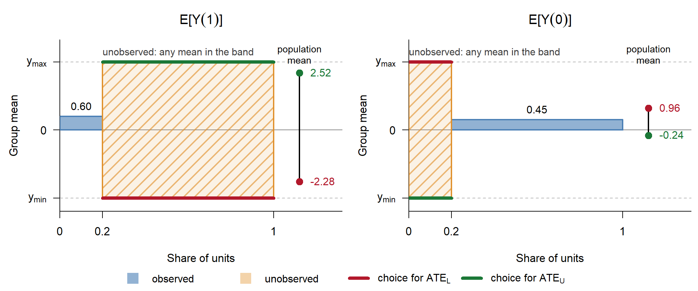
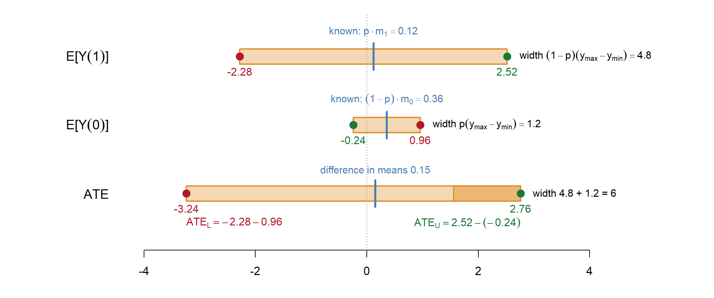
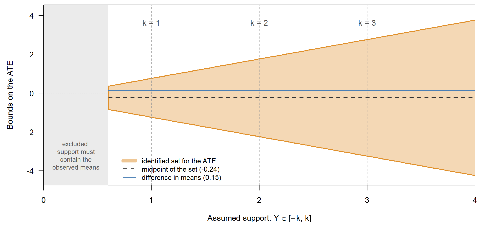
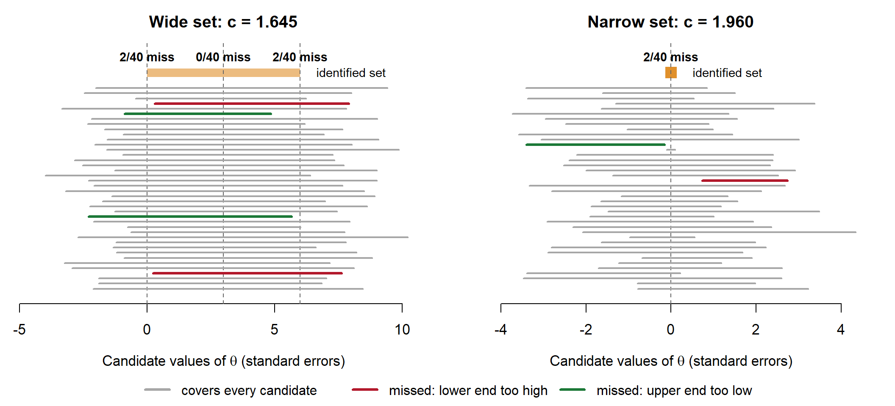
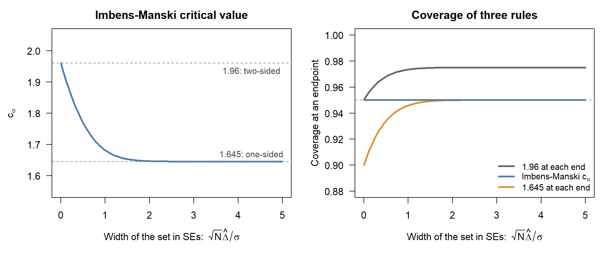
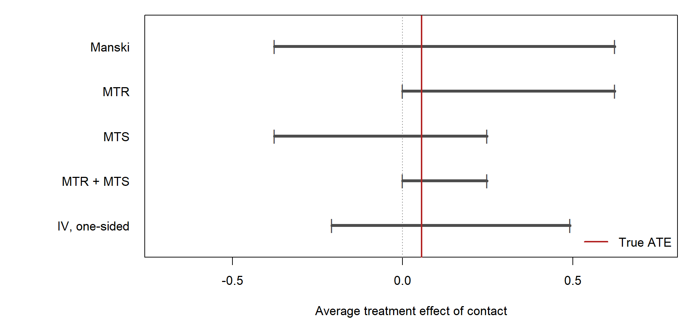
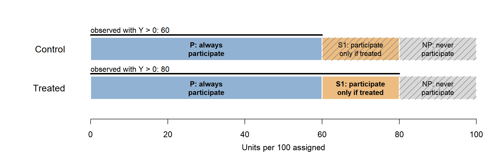
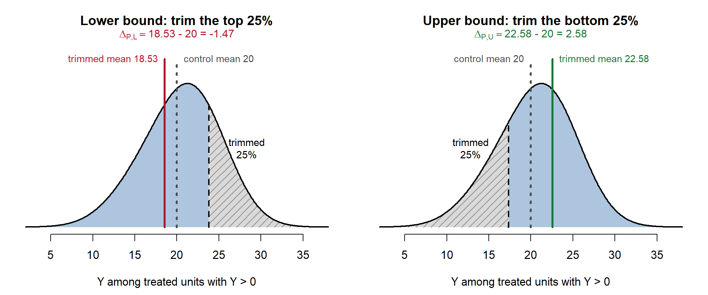
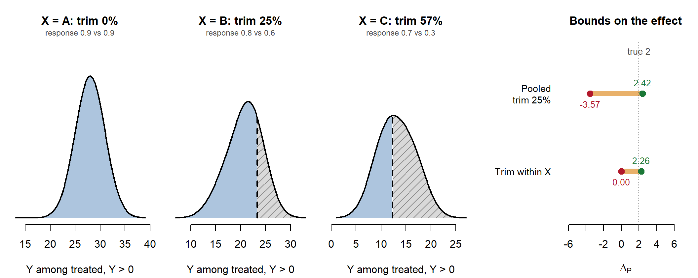

## Where we are going

Lectures 1–6 each delivered a point estimate by assuming enough to make one available: ignorability, overlap, exclusion, monotonicity.

> When the assumptions needed for a point estimate are not credible, what can the data still tell us?

Today:

- Point versus set identification
- Manski worst-case bounds, and how assumptions tighten them
- Bounds with an instrument
- Lee bounds for outcomes that are missing or zero for some units
- Inference for sets, and how bounds relate to sensitivity analysis

---

## Learning objectives

1. Distinguish point identification from set identification. Define the identified set.
2. Derive the Manski no-assumption bounds on the ATE for a bounded outcome.
3. State monotone treatment response (MTR) and monotone treatment selection (MTS). Say how each changes the bounds.
4. Explain what an instrument adds to the bounds, and state the one-sided noncompliance bound.
5. Define the extensive and intensive margins. Construct Lee trimming bounds.
6. Say what a confidence interval for a bounded parameter must cover.

# Part I: Motivation

## Point identification

Most results so far are point-identification results. Under stated assumptions, the parameter $\theta$ is uniquely determined by the distribution of the observables.

- Random assignment: $\text{ATE} = E[Y \mid D=1] - E[Y \mid D=0]$.
- LATE assumptions: $\rho_C = \text{ITT} / \text{First Stage}$.

Point identification usually requires strong assumptions.

- What if assignment is not random, or ignorability fails?
- What if monotonicity fails?
- What can we say under weaker assumptions?

---

## The identified set

Under weaker assumptions, the data restrict $\theta$ to an **identified set** $\Theta_I \subseteq \Theta$.

- If $\Theta_I$ is a single point, $\theta$ is point identified.
- If $\Theta_I$ is an interval $[\theta_L, \theta_U]$, $\theta$ is **partially identified**.

Stronger assumptions give a smaller identified set. Weaker assumptions give a wider identified set that is more credible.

The task is to report the set implied by assumptions we are willing to defend, and to say what each additional assumption buys.

---

## Running example: Arceneaux, Gerber, and Green (2010)

Problem Set 1 compared an observational matching estimate of the effect of phone contact on turnout with a randomized benchmark.

Randomization does not point-identify the effect of contact $D$ on turnout $Y$.

- Assignment $Z$ is randomized. Contact $D$ is not: only some assigned households answer.
- Randomization identifies the ITT, $E[Y \mid Z=1] - E[Y \mid Z=0]$.
- The LATE requires exclusion and monotonicity. The ATE of contact in the full population requires more still.

Today's question is what the same data say about the ATE of contact without assuming that point away.

---

## Bounds and sensitivity analysis

Sensitivity analysis (Lecture 2) starts from a point estimate and asks how wrong an assumption must be to overturn it.

Bounds start from the data and ask what can be concluded when the assumption is dropped, or weakened to a stated degree.

The two are closely related. The width of an identified set is a statement about how much the unverifiable assumption is doing.

# Part II: Manski bounds

## Setup

Following Manski (1990):

- Binary treatment $D \in \{0,1\}$.
- Outcome $Y \in [y_{\min}, y_{\max}]$, a bounded support.
- Potential outcomes $Y(1), Y(0)$.
- Target: $\text{ATE} = E[Y(1)] - E[Y(0)]$.

From the data, with SUTVA, we identify

$$
E[Y(1) \mid D=1] = E[Y \mid D=1], \qquad E[Y(0) \mid D=0] = E[Y \mid D=0], \qquad \Pr[D=1] = p.
$$

We cannot identify $E[Y(1) \mid D=0]$ or $E[Y(0) \mid D=1]$ without further assumptions.

---

## What the data show, and what they do not

Example: $Y$ is turnout (0 or 1) and $D$ is phone contact. 20% of units were contacted. Each unit has two potential outcomes, $Y(1)$ with contact and $Y(0)$ without, but we observe only the one for the treatment it received.

<table class="mt">
<tr><th></th><th>Share of units</th><th>Mean of $Y(1)$</th><th>Mean of $Y(0)$</th></tr>
<tr><th>Contacted ($D=1$)</th><td>$p = 0.2$</td><td class="obs">0.60<br><small>observed</small></td><td class="unk">?<br><small>unknown: between 0 and 1</small></td></tr>
<tr><th>Not contacted ($D=0$)</th><td>$1-p = 0.8$</td><td class="unk">?<br><small>unknown: between 0 and 1</small></td><td class="obs">0.45<br><small>observed</small></td></tr>
</table>

- Blue cells are observed: each group's mean outcome under the treatment it actually received.
- Hatched cells are counterfactual: the mean outcome each group would have had under the other treatment. The data say nothing about them, except that the mean of a 0/1 outcome must lie between 0 and 1.

The ATE compares the column means, $E[Y(1)] - E[Y(0)]$, and each column contains one unknown cell.

---

## Decomposing the marginal means

By total probability,

$$
E[Y(1)] = E[Y(1) \mid D=1]\,p + E[Y(1) \mid D=0]\,(1-p)
$$

$$
E[Y(0)] = E[Y(0) \mid D=1]\,p + E[Y(0) \mid D=0]\,(1-p)
$$

The terms $E[Y(1) \mid D=0]$ and $E[Y(0) \mid D=1]$ are unidentified. Because $Y$ is bounded,

$$
y_{\min} \leq E[Y(1) \mid D=0] \leq y_{\max}, \qquad y_{\min} \leq E[Y(0) \mid D=1] \leq y_{\max}.
$$

---

## The worst-case bounds

Substituting the bounds on the unidentified terms:

$$
E[Y(1)] \in \big[\, E[Y|D=1]\,p + y_{\min}(1-p),\;\; E[Y|D=1]\,p + y_{\max}(1-p) \,\big]
$$

$$
E[Y(0)] \in \big[\, y_{\min}\,p + E[Y|D=0](1-p),\;\; y_{\max}\,p + E[Y|D=0](1-p) \,\big]
$$

For the ATE, the lower bound pairs the smallest $E[Y(1)]$ with the largest $E[Y(0)]$, and the upper bound does the reverse:

$$
\text{ATE}_L = E[Y|D=1]\,p + y_{\min}(1-p) - y_{\max}\,p - E[Y|D=0](1-p)
$$

$$
\text{ATE}_U = E[Y|D=1]\,p + y_{\max}(1-p) - y_{\min}\,p - E[Y|D=0](1-p)
$$

---

## Properties of the Manski bounds

- The width is $\text{ATE}_U - \text{ATE}_L = y_{\max} - y_{\min}$, regardless of the data.
- For $Y \in [0,1]$, the ATE could lie anywhere in $[-1,1]$, an interval of length 2. The bounds have length 1.
- When $p$ is interior, the bounds always contain zero. The data cannot rule out a zero effect, or determine its sign.
- The bounds are **sharp**: every value in $[\text{ATE}_L, \text{ATE}_U]$ is produced by some distribution of potential outcomes consistent with the observed data.

Manski calls these the "no assumptions" bounds. They use only bounded outcomes. They are the tightest bounds available without further assumptions.

---

## Exercise

Suppose turnout is observed for contacted households and for those not contacted:

$$
p = \Pr[D=1] = 0.2, \quad E[Y|D=1] = 0.60, \quad E[Y|D=0] = 0.45, \quad Y \in [0,1].
$$

1. Compute $\text{ATE}_L$ and $\text{ATE}_U$.
2. What is the width? Is the sign of the ATE determined?
3. What is the naive difference in means?

---

## Exercise: answers

$$
\text{ATE}_L = 0.60(0.2) + 0 - 1(0.2) - 0.45(0.8) = 0.12 - 0.20 - 0.36 = -0.44
$$

$$
\text{ATE}_U = 0.60(0.2) + 1(0.8) - 0 - 0.45(0.8) = 0.12 + 0.80 - 0.36 = 0.56
$$

The bounds are $[-0.44, 0.56]$, with width 1. The sign of the ATE is not determined. The naive difference is $0.15$, which lies inside the bounds. Nothing in the data favors it over any other value in the interval.

---

## The same answer in the table

The amber cells are the unknown cells from before, filled with extreme values. For the lowest possible ATE, make $E[Y(1)]$ as small and $E[Y(0)]$ as large as the data allow. For the highest, do the reverse. Each column mean weights the two rows by their shares (0.2 and 0.8).

::: {.two}
::: {.col}
**Lower bound**

<table class="mt">
<tr><th></th><th>$Y(1)$</th><th>$Y(0)$</th></tr>
<tr><th>$D=1$ (0.2)</th><td class="obs">0.60</td><td class="set">1</td></tr>
<tr><th>$D=0$ (0.8)</th><td class="set">0</td><td class="obs">0.45</td></tr>
<tr class="sum"><th>Mean</th><td>0.12</td><td>0.56</td></tr>
</table>

$\text{ATE}_L = 0.12 - 0.56 = -0.44$
:::

::: {.col}
**Upper bound**

<table class="mt">
<tr><th></th><th>$Y(1)$</th><th>$Y(0)$</th></tr>
<tr><th>$D=1$ (0.2)</th><td class="obs">0.60</td><td class="set">0</td></tr>
<tr><th>$D=0$ (0.8)</th><td class="set">1</td><td class="obs">0.45</td></tr>
<tr class="sum"><th>Mean</th><td>0.92</td><td>0.36</td></tr>
</table>

$\text{ATE}_U = 0.92 - 0.36 = 0.56$
:::
:::

The two counterfactual cells always carry the full range $y_{\max} - y_{\min}$ between them. That is why the width of the bounds does not depend on the data.

---

## A continuous outcome

Suppose $Y$ is continuous, with a normal distribution on a standardized scale (standard deviation 1), and the same data summaries as before:

$$
p = 0.2, \qquad E[Y \mid D=1] = 0.60, \qquad E[Y \mid D=0] = 0.45.
$$

A normal has unbounded support, so the Manski bounds require an assumption: $Y$ lies in $[y_{\min}, y_{\max}]$. Take $[-3, 3]$, which holds about 99.7% of a standard normal.


::: {.cell}

```{.r .cell-code}
p <- 0.2; m1 <- 0.60; m0 <- 0.45; lo <- -3; hi <- 3
L <- m1*p + lo*(1-p) - hi*p - m0*(1-p)
U <- m1*p + hi*(1-p) - lo*p - m0*(1-p)
round(c(lower = L, upper = U, width = U - L), 2)
```

::: {.cell-output .cell-output-stdout}

```
lower upper width 
-3.24  2.76  6.00 
```


:::
:::


---

## What the data fix, and what they leave open


::: {.cell}
::: {.cell-output-display}
{width=1056}
:::
:::


Bar width is a group's share and bar height is its mean, so each population mean is the share-weighted area. The data fix the blue bars. The amber bar can sit anywhere in $[y_{\min}, y_{\max}]$, whatever distribution lies behind it. $\text{ATE}_L$ takes the red ends: $-2.28 - 0.96 = -3.24$. $\text{ATE}_U$ takes the green ends: $2.52 - (-0.24) = 2.76$.

---

## From the means to the ATE


::: {.cell}
::: {.cell-output-display}
{width=1056}
:::
:::


Each mean is the known contribution (blue tick) plus the unobserved share times a value in $[y_{\min}, y_{\max}]$. The ATE bounds pair opposite ends: the low end of $E[Y(1)]$ with the high end of $E[Y(0)]$, and the reverse. The width of the ATE interval is the sum of the two widths, $(1-p)(y_{\max}-y_{\min}) + p(y_{\max}-y_{\min}) = y_{\max}-y_{\min}$, and does not involve the observed means.

---

## The bounds depend on the assumed support


::: {.cell}
::: {.cell-output-display}
{width=1056}
:::
:::


# Part III: Tightening the bounds

## Additional assumptions

Manski bounds use only bounded outcomes. Additional assumptions shrink the identified set.

- **Monotone treatment response (MTR)**: $Y_i(1) \geq Y_i(0)$ for all $i$. Treatment cannot hurt (Manski 1997).
- **Monotone treatment selection (MTS)**: $E[Y(d) \mid D=1] \geq E[Y(d) \mid D=0]$ for $d = 0,1$. Units who select into treatment have weakly higher mean potential outcomes (Manski and Pepper 2000).

Each is an assumption about a different object. MTR restricts individual effects. MTS restricts selection.

---

## Monotone treatment response

Assume $Y_i(1) \geq Y_i(0)$ for all $i$.

- This implies $\text{ATE} \geq 0$, so the lower bound becomes $0$.
- MTR does not restrict the unidentified terms in the upper bound.

$$
\text{ATE}_L^{\text{MTR}} = 0
$$

$$
\text{ATE}_U^{\text{MTR}} = E[Y|D=1]\,p + y_{\max}(1-p) - y_{\min}\,p - E[Y|D=0](1-p)
$$

The upper bound is unchanged. The lower bound is tightened to zero.

---

## Monotone treatment selection

Assume $E[Y(d) \mid D=1] \geq E[Y(d) \mid D=0]$ for $d = 0,1$. This restricts the unidentified conditional means:

- $E[Y(1) \mid D=0] \leq E[Y(1) \mid D=1] = E[Y \mid D=1]$
- $E[Y(0) \mid D=1] \geq E[Y(0) \mid D=0] = E[Y \mid D=0]$

The resulting bounds are

$$
\text{ATE}_L^{\text{MTS}} = E[Y|D=1]\,p + y_{\min}(1-p) - y_{\max}\,p - E[Y|D=0](1-p)
$$

$$
\text{ATE}_U^{\text{MTS}} = E[Y|D=1] - E[Y|D=0]
$$

The lower bound is unchanged. The upper bound is the naive difference in means: under positive selection, the naive comparison overstates the effect.

---

## MTR and MTS together

When both hold:

- $E[Y(0) \mid D=1] \geq E[Y \mid D=0]$ (MTS)
- $E[Y(1) \mid D=0] \leq E[Y \mid D=1]$ (MTS)
- $\text{ATE} \geq 0$ (MTR)

$$
\text{ATE}^{\text{MTR+MTS}} \in \big[\,0,\; E[Y|D=1] - E[Y|D=0]\,\big]
$$

The interval is now informative about the sign. Its width is the naive difference in means. The cost is two assumptions, neither testable from the data.

# Part IV: Estimation and inference

## Estimation and inference for bounds

- Estimation: plug in sample analogues for $E[Y|D=d]$ and $p$ to obtain $\widehat{\text{ATE}}_L$ and $\widehat{\text{ATE}}_U$.
- Inference is less direct: the target is a confidence interval for a set-identified parameter.

Imbens and Manski (2004) construct $[C_L, C_U]$ such that

$$
\lim_{N\to\infty} \Pr\big[\theta \in [C_L, C_U]\big] \geq 1 - \alpha \quad \text{for all } \theta \in \Theta_I.
$$

- The interval needs to cover the true parameter with the stated probability, not the whole identified set.
- The width of the interval shrinks at the $\sqrt{N}$ rate toward the identified set, not toward a point.
- Chernozhukov, Lee, and Rosen (2013) give a general framework for intersection bounds with uniform inference.

---

## Imbens–Manski interval

With estimated bounds $\hat\theta_L, \hat\theta_U$, standard errors $\hat\sigma_L, \hat\sigma_U$, and $\hat\Delta = \hat\theta_U - \hat\theta_L$:

$$
\text{CI}_{1-\alpha} = \big[\, \hat\theta_L - c_\alpha \hat\sigma_L / \sqrt{N},\;\; \hat\theta_U + c_\alpha \hat\sigma_U / \sqrt{N} \,\big]
$$

where $c_\alpha$ solves

$$
\Phi\!\left( c_\alpha + \frac{\sqrt{N}\,\hat\Delta}{\max(\hat\sigma_L, \hat\sigma_U)} \right) - \Phi(-c_\alpha) = 1 - \alpha.
$$

- When $\hat\Delta$ is large relative to the standard errors, a true $\theta$ near either endpoint can only be missed through that endpoint, because the other is too far away to matter. Each side is a one-sided test, so $c_\alpha \to z_{1-\alpha} = 1.645$.
- When $\hat\Delta \to 0$, we are back to a point estimate. Either endpoint can miss, so $c_\alpha \to z_{1-\alpha/2} = 1.96$.

## Where could the true parameter be?


::: {.cell}
::: {.cell-output-display}
{width=1056}
:::
:::


## Why the critical value adapts


::: {.cell}
::: {.cell-output-display}
{width=1056}
:::
:::


# Part V: IV bounds

## IV without monotonicity

Binary instrument $Z$, treatment $D$, outcome $Y$.

- IV assumptions: (1) independence, (2) exclusion, (3) first stage.
- Adding (4) monotonicity, $D_i(1) \geq D_i(0)$, point-identifies the LATE.

If the target is the ATE:

- Assumptions (1)–(3) restrict the set of possible ATEs. The ATE is partially identified.
- Adding monotonicity restricts the set further.

An instrument does not point-identify the ATE, but it does narrow the Manski bounds.

---

## Balke–Pearl bounds: setup

Balke and Pearl (1997): $Z, D, Y$ all binary.

- We observe the joint distribution of $(Z, D, Y)$:
$$
p_{dyz} := \Pr[D=d, Y=y \mid Z=z], \qquad d, y, z \in \{0,1\}.
$$
- This gives 8 observable probabilities, 4 free parameters per value of $Z$.
- Each unit belongs to one of $4 \times 4 = 16$ response types:
  - treatment type $(D(1), D(0)) \in \{(0,0), (0,1), (1,0), (1,1)\}$,
  - outcome type $(Y(1), Y(0)) \in \{(0,0), (0,1), (1,0), (1,1)\}$.
- The observed distribution constrains the mixture over these 16 types.

---

## Balke–Pearl bounds: result

Under independence and exclusion, the observed $p_{dyz}$ impose linear constraints on the probabilities of the 16 types. The ATE is a linear function of those probabilities.

The sharp bounds on the ATE therefore solve a **linear program**:

$$
\text{ATE}_L = \min_{\pi} \sum_t \pi_t \tau_t \quad \text{subject to the observed-data constraints},
$$

where $\pi_t$ are type probabilities and $\tau_t$ are type-specific treatment effects.

- The solution has closed form in terms of the $p_{dyz}$. We state it in the reading (Balke and Pearl 1997; Swanson et al. 2018) rather than derive it.
- The bounds are generally tighter than Manski's, because the IV assumptions add structure.
- They can still be wide, especially when the first stage is weak.

---

## One-sided noncompliance

Suppose, in addition to the IV assumptions, monotonicity $D(1) \geq D(0)$ and **one-sided noncompliance** $D(0) = 0$.

- Only compliers and never-takers exist.
- $E[Y \mid Z=0] = E[Y(0)]$, since nobody in the control arm is treated.
- Treated units under $Z=1$ identify the compliers' $Y(1)$. The never-takers' $Y(1)$ is unidentified and lies in $[0,1]$.

$$
E[Y(1)] = E[Y(1) \mid D(1)=1]\Pr[D(1)=1] + E[Y(1) \mid D(1)=0](1 - \Pr[D(1)=1])
$$

Taking $Y \in [0,1]$:

$$
\text{ATE} \in \Big[\, E[Y|D=1,Z=1]\,\Pr[D=1|Z=1] - E[Y|Z=0],\;\; E[Y|D=1,Z=1]\,\Pr[D=1|Z=1] + \big(1 - \Pr[D=1|Z=1]\big) - E[Y|Z=0] \,\Big]
$$

The width is the never-taker share, $1 - \Pr[D=1 \mid Z=1]$. This is the case in most get-out-the-vote field experiments.

---

## Estimation and inference for IV bounds

- Plug in sample proportions, such as $\hat p_{dyz}$.
- Confidence intervals: Imbens and Manski (2004), or the intersection-bounds framework of Chernozhukov, Lee, and Rosen (2013).
- For non-binary outcomes, see Mogstad, Santos, and Torgovitsky (2018) and Swanson et al. (2018).

# Part VI: Comparing the bounds

## A simulated example

Randomized assignment $Z$, one-sided noncompliance, binary turnout $Y$. Compliers (30% of the sample) have higher baseline turnout than never-takers, so contact is positively selected.


::: {.cell}

```{.r .cell-code}
set.seed(136)   # a draw with the expected 2 misses per endpoint (5% of 40)
n <- 1e6
Z <- rbinom(n, 1, 0.5)
C <- rbinom(n, 1, 0.3)                      # complier
D <- Z * C                                  # one-sided noncompliance
Y0 <- rbinom(n, 1, ifelse(C == 1, 0.50, 0.35))
Y1 <- pmax(Y0, rbinom(n, 1, ifelse(C == 1, 0.25, 0.04)))   # MTR holds
Y  <- ifelse(D == 1, Y1, Y0)
c(true_ATE = mean(Y1 - Y0), naive = mean(Y[D==1]) - mean(Y[D==0]),
  ITT = mean(Y[Z==1]) - mean(Y[Z==0]))
```

::: {.cell-output .cell-output-stdout}

```
  true_ATE      naive        ITT 
0.05533300 0.24814378 0.03631001 
```


:::
:::


The true ATE is a population quantity. We know it here only because we simulated both potential outcomes.

---

## Bounds from the simulated data


::: {.cell}

```{.r .cell-code}
p  <- mean(D); m1 <- mean(Y[D==1]); m0 <- mean(Y[D==0])
manski <- c(m1*p + 0*(1-p) - 1*p - m0*(1-p),  m1*p + 1*(1-p) - 0*p - m0*(1-p))
mtr    <- c(0, manski[2])
mts    <- c(manski[1], m1 - m0)
both   <- c(0, m1 - m0)
q1 <- mean(D[Z==1]); a <- mean(Y[Z==1 & D==1]) * q1; y0 <- mean(Y[Z==0])
iv     <- c(a - y0, a + (1 - q1) - y0)
bounds <- rbind(Manski = manski, MTR = mtr, MTS = mts, `MTR + MTS` = both,
                `IV, one-sided` = iv)
colnames(bounds) <- c("lower", "upper"); round(bounds, 3)
```

::: {.cell-output .cell-output-stdout}

```
               lower upper
Manski        -0.377 0.623
MTR            0.000 0.623
MTS           -0.377 0.248
MTR + MTS      0.000 0.248
IV, one-sided -0.208 0.491
```


:::
:::


---

## Identified sets compared


::: {.cell}
::: {.cell-output-display}
{width=960}
:::
:::


MTR and MTS each narrow the Manski set from one side, and together give the tightest interval, at the cost of two untestable assumptions. The IV bound narrows the set using the randomization instead, and so does not rely on either. All sets contain the true ATE here because the simulation satisfies every assumption.

# Part VII: Lee bounds

## Extensive and intensive margins

Many outcomes are nonnegative with a mass at zero (Staub 2014): hours worked, expenditures, tax payments.

Treatment can act through two channels:

- **Extensive margin**: whether $Y > 0$ at all (participation).
- **Intensive margin**: the level of $Y$ given $Y > 0$ (amount).

These are distinct causal effects, and we often want the intensive margin. The same structure arises with sample selection and attrition: wages are observed only for the employed, and outcomes only for survey respondents.

---

## Potential outcomes decomposition

With $Y_i \geq 0$, joint potential outcomes $(Y_{0i}, Y_{1i})$ define four groups (Staub 2014):

| Group | Name | $(Y_{0i}, Y_{1i})$ |
|:--|:--|:--|
| NP | Non-participants | $(0,\ 0)$ |
| $S_1$ | Switchers (into) | $(0,\ Y_{1i} > 0)$ |
| $S_2$ | Switchers (out of) | $(Y_{0i} > 0,\ 0)$ |
| P | Participants | $(Y_{0i} > 0,\ Y_{1i} > 0)$ |

- The **intensive margin effect** is the ATE among group P.
- The **extensive margin effect** is the contribution of $S_1$ and $S_2$.

---

## The identification problem

Under randomization, the ATE is point-identified as $E[Y|D=1] - E[Y|D=0]$, but it mixes the two margins.

Group membership depends on the joint potential outcomes, which are not observed. The data show only $\Pr[Y>0 \mid D=d]$ and $E[Y \mid Y>0, D=d]$.

- Among treated units with $Y > 0$: groups $S_1$ and P.
- Among control units with $Y > 0$: groups $S_2$ and P.
- Comparing $E[Y \mid Y>0, D=1]$ with $E[Y \mid Y>0, D=0]$ confounds the intensive margin effect with compositional differences.
- $Y>0$ is affected by treatment, so conditioning on it is conditioning on a post-treatment variable. Randomization no longer guarantees comparable groups.

---

## Monotonicity

Assume (Lee 2009)

$$
\mathbf 1\{Y_i(1) > 0\} \geq \mathbf 1\{Y_i(0) > 0\} \quad \text{for all } i.
$$

Treatment never moves a unit out of participation. This holds for every unit, which is stronger than $p_1 \geq p_0$.

- This eliminates group $S_2$.
- Among control units with $Y > 0$: only group P.
- Among treated units with $Y > 0$: groups P and $S_1$.

The target is the intensive margin effect among always-participants,

$$
\Delta_P := E[Y_{1i} - Y_{0i} \mid Y_{0i} > 0, Y_{1i} > 0].
$$

It is not point-identified, but it can be bounded.

---

## Trimming logic

Let $p_1 = \Pr[Y>0 \mid D=1]$ and $p_0 = \Pr[Y>0 \mid D=0]$. Under monotonicity $p_1 \geq p_0$.

Among treated units with $Y>0$, the share who are switchers is

$$
q = \frac{p_1 - p_0}{p_1}.
$$

- The control group with $Y>0$ is pure P, so $E[Y \mid D=0, Y>0] = E[Y_{0i} \mid P]$.
- The treated group with $Y>0$ mixes P and $S_1$. Removing the $S_1$ units would leave pure P.
- We do not know which treated units are switchers, but we know the fraction $q$.

---

## Who participates in each arm?


::: {.cell}
::: {.cell-output-display}
{width=1056}
:::
:::


Of the 80 treated units with $Y>0$, 20 are switchers, so $q = 20/80 = 0.25$.

---

## Constructing the bounds

Trim a fraction $q$ from the treated $Y \mid D=1, Y>0$ distribution.

- Upper bound: trim the bottom $q$. If switchers have the lowest outcomes, removing them isolates P.
- Lower bound: trim the top $q$. If switchers have the highest outcomes, removing them isolates P.

$$
\Delta_{P,L} = E[Y \mid D=1, Y>0, Y \leq y_{1-q}] - E[Y \mid D=0, Y>0]
$$

$$
\Delta_{P,U} = E[Y \mid D=1, Y>0, Y \geq y_{q}] - E[Y \mid D=0, Y>0]
$$

where $y_q$ and $y_{1-q}$ are quantiles of $Y \mid D=1, Y>0$. We do not know where in the distribution the switchers fall, so we compute both.

---

## Lee bounds: a numerical example

Suppose $p_1 = 0.80$ and $p_0 = 0.60$, so $q = 0.25$. In this simulation the true $\Delta_P$ is 2.


::: {.cell}
::: {.cell-output-display}
{width=1056}
:::
:::


---

## Estimation and inference for Lee bounds

- Estimate $\hat p_1, \hat p_0$ from participation rates by treatment status.
- Compute $\hat q = (\hat p_1 - \hat p_0)/\hat p_1$.
- Trim the empirical distribution of $Y \mid D=1, Y>0$ and compute trimmed means.

Inference:

- Lee (2009) gives analytic standard errors.
- The bootstrap is also available.
- For sharp inference, use Imbens–Manski intervals.

With covariates $X$, one can weaken the monotonicity assumption and obtain tighter bounds (Samii, Wang, and Zhou 2026; Semenova 2025).

---

## Trimming within covariate groups


::: {.cell}
::: {.cell-output-display}
{width=1056}
:::
:::


Same pooled response rates as before (0.80 vs 0.60), split across three equal-sized groups (Samii, Wang, and Zhou).

# Part VIII: Remarks

## Summary

- Point identification is not always available.
- Partial identification gives honest answers under weaker assumptions. The cost is a set, not a number.
- Each assumption is a trade between credibility and width. Reporting the nested sets shows what each assumption purchases.
- Bounds are related to sensitivity analysis: both describe how conclusions depend on assumptions that the data cannot check.
- Decision-making under partial identification uses criteria such as minimax regret.

Problem Set 2B applies these tools to the Arceneaux, Gerber, and Green (2010) data.

---

## References

- Arceneaux, Gerber, and Green (2010). A cautionary note on the use of matching to estimate causal effects. *Sociological Methods & Research*.
- Balke and Pearl (1997). Bounds on treatment effects from studies with imperfect compliance. *JASA*.
- Chernozhukov, Lee, and Rosen (2013). Intersection bounds. *Econometrica*.
- Imbens and Manski (2004). Confidence intervals for partially identified parameters. *Econometrica*.
- Lee (2009). Training, wages, and sample selection. *Review of Economic Studies*.
- Manski (1990). Nonparametric bounds on treatment effects. *AER*.
- Manski (1997). Monotone treatment response. *Econometrica*.
- Manski and Pepper (2000). Monotone instrumental variables. *Econometrica*.
- Samii, Wang, and Zhou (2026). Trimming bounds with random forests.
- Swanson et al. (2018). Partial identification of the average treatment effect using instrumental variables.

The ordering and much of the content of Parts II, III, V and VII follow Cyrus Samii's lecture on partial identification (NYU, March 2026).

