```{r}
#| include: false
library(fixest)
blue <- "#4a7fb5"; amber <- "#e0902b"; red <- "#b2182b"; green <- "#1b7837"; grey <- "grey40"
```

# Two-period DiD

## Setup

- A sample of $N$ units from a large population, indexed by $i = 1, \dots, N$, observed in two periods $t = 0, 1$.
- Outcomes $Y_{it}$ and binary treatment $D_{it}$. No one is treated in period 0: $D_{i0} = 0$ for all $i$.
- In period 1, $D_{i1} = 1$ for "treated" units and $D_{i1} = 0$ for controls.
- Let $T_i = \mathbb{1}(\text{treated}_i)$ and $\text{Post}_t = \mathbb{1}(t = 1)$.
- Selection into treatment may depend on unobserved variables at $t = 0$.

---

## Potential outcomes

- Potential outcomes $Y_{it}(1)$, $Y_{it}(0)$. Observed outcome $Y_{it} = D_{it} Y_{it}(1) + (1 - D_{it}) Y_{it}(0)$.
- We observe $Y_{i0} = Y_{i0}(0)$ for everyone, $Y_{i1} = Y_{i1}(1)$ for treated units, and $Y_{i1} = Y_{i1}(0)$ for controls.
- The target is the ATT in period 1:

$$
\tau = E[Y_{i1}(1) - Y_{i1}(0) \mid T_i = 1].
$$

The challenge is that $Y_{i1}(0)$ is never observed for treated units.

---

## Parallel trends and no anticipation

**Assumption 1 (Parallel trends).**

$$
E[Y_{i1}(0) - Y_{i0}(0) \mid T_i = 1] = E[Y_{i1}(0) - Y_{i0}(0) \mid T_i = 0].
$$

The average trend in untreated potential outcomes is the same for treated and control groups.

**Assumption 2 (No anticipation).** $Y_{i0}(1) = Y_{i0}(0)$ for all $i$. Treatment has no causal effect before it is implemented.

Both assumptions are untestable, because they concern counterfactual outcomes.

---

## ATT identification

Under Assumptions 1 and 2,

$$
\begin{aligned}
\tau &= E[Y_{i1}(1) - Y_{i1}(0) \mid T_i = 1] \\
&= E[Y_{i1}(1) - Y_{i0}(0) \mid T_i = 1] - E[Y_{i1}(0) - Y_{i0}(0) \mid T_i = 1] \\
&= E[Y_{i1}(1) - Y_{i0}(0) \mid T_i = 1] - E[Y_{i1}(0) - Y_{i0}(0) \mid T_i = 0] \\
&= E[Y_{i1} - Y_{i0} \mid T_i = 1] - E[Y_{i1} - Y_{i0} \mid T_i = 0].
\end{aligned}
$$

- Line 2 adds and subtracts $Y_{i0}(0)$ and uses no anticipation.
- Line 3 applies parallel trends.
- Line 4 substitutes observed outcomes. This is the difference-in-differences of population means.

---

## Graphical intuition

$$
\tau = {\color{#4a7fb5}E[Y_{i1} - Y_{i0} \mid T_i = 1]} - {\color{#666666}E[Y_{i1} - Y_{i0} \mid T_i = 0]}
$$

```{r}
#| output: asis
drawg <- function(step) {
  par(mar = c(3, 4.5, 0.5, 1), cex = 1.1, xpd = NA)
  plot(NA, xlim = c(-0.3, 2.0), ylim = c(1.5, 5.6), xaxt = "n", xlab = "", ylab = expression(Y[it]), bty = "l")
  par(xpd = FALSE); abline(h = 2:5, v = 0:1, col = "grey90"); par(xpd = NA)
  axis(1, at = 0:1, labels = c("t = 0", "t = 1"))
  lines(0:1, c(3, 5), col = blue, lwd = 3); points(0:1, c(3, 5), pch = 19, col = blue, cex = 1.5)
  lines(0:1, c(2, 3), col = grey, lwd = 3); points(0:1, c(2, 3), pch = 19, col = grey, cex = 1.5)
  leg <- c("Treated (observed)", "Control"); lc <- c(blue, grey); lt <- c(1, 1)
  if (step >= 1) {                                   # naive change among the treated
    segments(0, 3, 1, 3, lty = 3, lwd = 2, col = blue)
    segments(1.04, 3, 1.04, 5, lwd = 4, col = blue)
    text(1.04, 5.3, expression(E*"["*Y[i1] - Y[i0]*" | "*T[i]==1*"] = 2"), adj = 0.5, col = blue, font = 2, cex = 1.0)
  }
  if (step >= 2) {                                   # the control group's change, and the same amount taken off the treated group
    segments(0, 2, 1, 2, lty = 3, lwd = 2, col = grey)
    segments(1.04, 2, 1.04, 3, lwd = 4, col = grey)
    text(1.1, 2.5, expression(E*"["*Y[i1] - Y[i0]*" | "*T[i]==0*"] = 1"), adj = 0, col = grey, font = 2, cex = 1.0)
    lines(0:1, c(3, 4), col = blue, lwd = 3, lty = 2); points(1, 4, pch = 1, col = blue, cex = 1.8)
    segments(1.1, 3, 1.1, 4, lwd = 4, col = grey)
    text(1.16, 3.5, "subtracted", adj = 0, col = grey, font = 2, cex = 1.0)
    leg <- c(leg, "Treated (counterfactual)"); lc <- c(lc, blue); lt <- c(lt, 2)
  }
  if (step >= 3) {                                   # what is left
    segments(1.1, 4, 1.1, 5, lwd = 4, col = red)
    text(1.16, 4.5, expression(tau == 1), adj = 0, col = red, font = 2, cex = 1.3)
  }
  legend("topleft", leg, col = lc, lty = lt, lwd = 3, bty = "n", cex = 0.9)
}
for (s in 0:3) {
  png(sprintf("figs_twfe/gi%d.png", s), width = 10, height = 4.6, units = "in", res = 150)
  drawg(s); invisible(dev.off())
}
cat('::: {.r-stack}\n')
cat('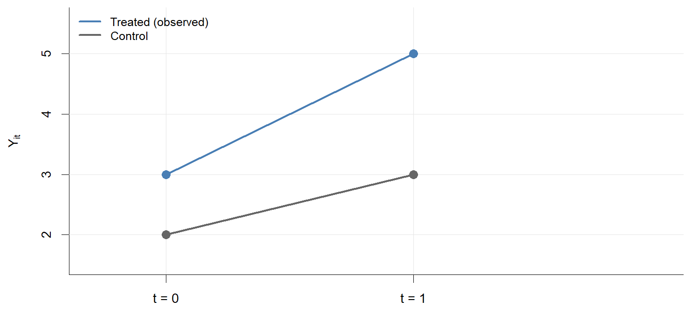{width=85%}\n\n')
for (s in 1:3) cat(sprintf('{.fragment width=85%%}\n\n', s))
cat(':::\n')
```

---

## Three DiD regressions

In two periods, each of the following produces the same $\hat\delta$:

$$
\begin{aligned}
Y_{it} &= \beta_0 + \beta_1 T_i + \beta_2 \text{Post}_t + \delta\, T_i \times \text{Post}_t + \epsilon_{it} \\
Y_{it} &= \alpha_i + \lambda_t + \delta D_{it} + \epsilon_{it} \\
\Delta Y_i &= \Delta\lambda + \delta\, T_i + \Delta\epsilon_i
\end{aligned}
$$

---

## The regression on the diagram

$$
Y_{it} = {\color{#555555}\beta_0} + {\color{#e0902b}\beta_1}\, T_i + {\color{#1b7837}\beta_2}\, \text{Post}_t + {\color{#b2182b}\delta}\, T_i \times \text{Post}_t + \epsilon_{it}
$$

```{r}
#| output: asis
dir.create("figs_twfe", showWarnings = FALSE)
cb <- "#555555"; c1 <- amber; c2 <- green; cd <- red
draw <- function(step) {
  par(mar = c(3, 4.5, 0.5, 1), cex = 1.1, xpd = NA)
  plot(NA, xlim = c(-0.45, 1.6), ylim = c(1.5, 5.5), xaxt = "n", xlab = "", ylab = expression(Y[it]), bty = "l")
  axis(1, at = 0:1, labels = c("Post = 0", "Post = 1"))
  lines(0:1, c(3, 5), col = blue, lwd = 3); points(0:1, c(3, 5), pch = 19, col = blue, cex = 1.5)
  lines(0:1, c(2, 3), col = grey, lwd = 3); points(0:1, c(2, 3), pch = 19, col = grey, cex = 1.5)
  if (step >= 1) {                                   # beta0
    points(0, 2, pch = 1, cex = 3, lwd = 3, col = cb)
    text(-0.07, 2, expression(beta[0]), adj = 1, col = cb, font = 2, cex = 1.1)
  }
  if (step >= 2) {                                   # beta1
    segments(0.04, 2, 0.04, 3, lwd = 4, col = c1)
    text(0.07, 2.5, expression(beta[1]), adj = 0, col = c1, font = 2, cex = 1.1)
    text(-0.07, 3, expression(beta[0] + beta[1]), adj = 1, col = c1, cex = 0.95)
  }
  if (step >= 3) {                                   # beta2
    segments(0, 2, 1, 2, lty = 3, lwd = 2, col = c2)
    segments(0.98, 2, 0.98, 3, lwd = 4, col = c2)
    text(0.95, 2.5, expression(beta[2]), adj = 1, col = c2, font = 2, cex = 1.1)
    text(1.07, 3, expression(beta[0] + beta[2]), adj = 0, col = grey, cex = 0.95)
  }
  if (step >= 4) {                                   # counterfactual
    lines(0:1, c(3, 4), col = blue, lwd = 3, lty = 2); points(1, 4, pch = 1, col = blue, cex = 1.8)
    text(1.07, 4, expression(beta[0] + beta[1] + beta[2] ~ "(counterfactual)"), adj = 0, col = blue, cex = 0.95)
  }
  if (step >= 5) {                                   # delta
    segments(1.02, 4, 1.02, 5, lwd = 4, col = cd)
    text(1.0, 4.5, expression(delta), adj = 1, col = cd, font = 2, cex = 1.1)
    text(1.07, 5, expression(beta[0] + beta[1] + beta[2] + delta), adj = 0, col = blue, cex = 0.95)
  }
  leg <- c("Treated (observed)", "Control"); lc <- c(blue, grey); lt <- c(1, 1)
  if (step >= 4) { leg <- c(leg[1], "Treated (counterfactual)", leg[2]); lc <- c(blue, blue, grey); lt <- c(1, 2, 1) }
  legend("topleft", leg, col = lc, lty = lt, lwd = 3, bty = "n", cex = 0.9)
}
for (s in 0:5) {
  png(sprintf("figs_twfe/step%d.png", s), width = 10, height = 4.6, units = "in", res = 150)
  draw(s); invisible(dev.off())
}
cat('::: {.r-stack}\n')
cat('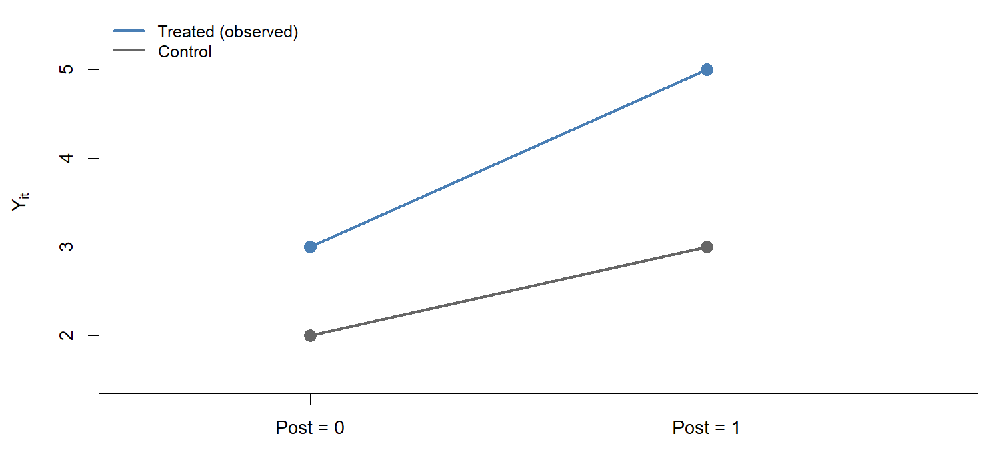{width=85%}\n\n')
for (s in 1:5) cat(sprintf('{.fragment width=85%%}\n\n', s))
cat(':::\n')
```

---

## From group dummies to unit and time effects

$$
\underbrace{{\color{#555555}\beta_0} + {\color{#e0902b}\beta_1}\, T_i}_{{\color{#555555}\alpha_i}} \;+\; \underbrace{{\color{#1b7837}\beta_2}\, \text{Post}_t}_{{\color{#1b7837}\lambda_t}} \;+\; {\color{#b2182b}\delta}\, \underbrace{T_i \times \text{Post}_t}_{D_{it}}
$$

```{r}
#| output: asis
set.seed(1)
y0c <- c(1.6, 2.0, 2.4); y0t <- c(2.7, 3.0, 3.3)    # unit levels at Post = 0
drawu <- function(step) {
  par(mar = c(3, 4.5, 0.5, 1), cex = 1.1, xpd = NA)
  plot(NA, xlim = c(-0.3, 2.1), ylim = c(1, 6), xaxt = "n", xlab = "", ylab = expression(Y[it]), bty = "l")
  par(xpd = FALSE); abline(h = 1:6, v = c(0, 1), col = "grey90", lwd = 1); par(xpd = NA)   # faint grid, clipped to the panel
  axis(1, at = 0:1, labels = c("Post = 0", "Post = 1"))
  for (y in y0c) { lines(0:1, c(y, y + 1), col = grey, lwd = 2); points(0:1, c(y, y + 1), pch = 19, col = grey, cex = 1.1) }
  for (y in y0t) { lines(0:1, c(y, y + 2), col = blue, lwd = 2); points(0:1, c(y, y + 2), pch = 19, col = blue, cex = 1.1) }
  if (step >= 1) {                                   # alpha_i: each unit's own level
    points(rep(0, 6), c(y0c, y0t), pch = 1, cex = 2.4, lwd = 2.5, col = "#555555")
    text(-0.08, mean(c(y0c, y0t)), expression(alpha[i]), adj = 1, col = "#555555", font = 2, cex = 1.3)
  }
  xs <- 1.04 + 0.035 * (0:5)                         # one bar per unit: controls first, then treated
  y0 <- c(y0c, y0t)
  if (step >= 2) {                                   # lambda_t: the same change for every unit
    for (y in y0t) { lines(0:1, c(y, y + 1), col = adjustcolor(green, 0.45), lwd = 2, lty = 2); points(1, y + 1, pch = 1, col = green, cex = 1.3) }
    segments(xs, y0, xs, y0 + 1, lwd = 3, col = green)
    text(1.3, 2.0, expression(lambda[1] - lambda[0] ~ "(same length for every unit)"), adj = 0, col = green, font = 2, cex = 0.95)
  }
  if (step >= 3) {                                   # delta: extra change for treated units after treatment
    segments(xs[4:6], y0t + 1, xs[4:6], y0t + 2, lwd = 3, col = red)
    text(1.3, 5.6, expression(delta ~ "(treated units, post only)"), adj = 0, col = red, font = 2, cex = 0.95)
  }
}
for (s in 0:3) {
  png(sprintf("figs_twfe/unit%d.png", s), width = 10, height = 4.3, units = "in", res = 150)
  drawu(s); invisible(dev.off())
}
cat('::: {.r-stack}\n')
cat('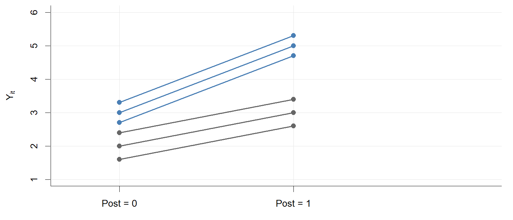{width=80%}\n\n')
for (s in 1:3) cat(sprintf('{.fragment width=80%%}\n\n', s))
cat(':::\n')
```

---

## The first-difference version

$$
Y_{i1} - Y_{i0} = \underbrace{(\alpha_i - \alpha_i)}_{=\,0} + \underbrace{(\lambda_1 - \lambda_0)}_{{\color{#1b7837}\Delta\lambda}} + {\color{#b2182b}\delta}\, \underbrace{(D_{i1} - D_{i0})}_{T_i} + \Delta\epsilon_i
$$

```{r}
#| output: asis
y0c <- c(1.6, 2.0, 2.4); y0t <- c(2.7, 3.0, 3.3)
ec  <- c(0, 0, 0);  et <- c(0, 0, 0)                          # same units as the previous slide: no idiosyncratic changes
y1c <- y0c + 1 + ec;     y1t <- y0t + 2 + et                    # Delta lambda = 1, delta = 1
dY  <- c(y1c - y0c, y1t - y0t); Ti <- rep(0:1, each = 3); cols <- rep(c(grey, blue), each = 3)
fit <- lm(dY ~ Ti)
drawd <- function(step) {
  par(mfrow = c(1, 2), mar = c(3.5, 4.5, 2, 1), cex = 1.05, xpd = NA)
  plot(NA, xlim = c(-0.2, 1.4), ylim = c(1, 6), xaxt = "n", xlab = "", ylab = expression(Y[it]), bty = "l", main = "Levels")
  par(xpd = FALSE); abline(h = 1:6, v = 0:1, col = "grey90"); par(xpd = NA)
  axis(1, at = 0:1, labels = c("Post = 0", "Post = 1"))
  for (j in 1:6) { y0 <- c(y0c, y0t)[j]; y1 <- c(y1c, y1t)[j]
    lines(0:1, c(y0, y1), col = cols[j], lwd = 2); points(0:1, c(y0, y1), pch = 19, col = cols[j], cex = 1.1) }
  if (step >= 1) for (j in 1:6) { y0 <- c(y0c, y0t)[j]; y1 <- c(y1c, y1t)[j]
    segments(1.05 + 0.04 * j, y0, 1.05 + 0.04 * j, y1, lwd = 3, col = cols[j]) }
  plot(NA, xlim = c(-0.4, 1.4), ylim = c(0, 3), xaxt = "n", xlab = "", ylab = expression(Y[i1] - Y[i0]), bty = "l", main = "Changes")
  par(xpd = FALSE); abline(h = 0:3, v = 0:1, col = "grey90"); par(xpd = NA)
  axis(1, at = 0:1, labels = c(expression(T[i] == 0), expression(T[i] == 1)))
  if (step >= 1) points(Ti + c(-0.06, 0, 0.06, -0.06, 0, 0.06), dY, pch = 19, col = cols, cex = 1.4)
  if (step >= 2) {
    segments(-0.4, coef(fit)[1] - 0.4 * coef(fit)[2], 1.4, coef(fit)[1] + 1.4 * coef(fit)[2], lwd = 3, col = "black")
    segments(-0.25, coef(fit)[1], 0.02, coef(fit)[1], lty = 3, col = green, lwd = 2)
    points(0, coef(fit)[1], pch = 1, cex = 2.5, lwd = 3, col = green)
    text(-0.3, coef(fit)[1], expression(Delta * lambda), adj = 1, col = green, font = 2, cex = 1.3)
    segments(1.2, coef(fit)[1], 1.2, sum(coef(fit)), lwd = 4, col = red)
    text(1.25, mean(c(coef(fit)[1], sum(coef(fit)))), expression(delta), adj = 0, col = red, font = 2, cex = 1.3)
  }
}
for (s in 0:2) {
  png(sprintf("figs_twfe/diff%d.png", s), width = 11, height = 4.2, units = "in", res = 150)
  drawd(s); invisible(dev.off())
}
cat('::: {.r-stack}\n')
cat('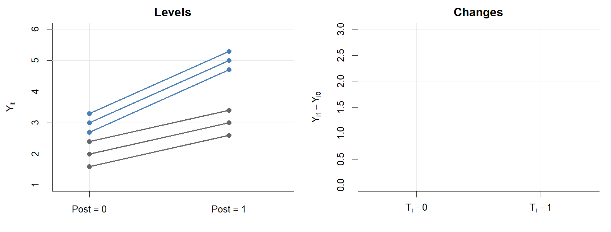{width=90%}\n\n')
for (s in 1:2) cat(sprintf('{.fragment width=90%%}\n\n', s))
cat(':::\n')
```

---

## What the 2×2 requires

Everything so far is correct in a **2×2 setting**: two groups, two periods.

It requires two assumptions.

- **Parallel trends:** absent treatment, the treated group's average change would equal the control group's.
- **No anticipation:** treatment has no effect before it is implemented.

Only under these assumptions does the coefficient $\delta$ equal the ATT.

> What if parallel trends did not hold? What if units responded before treatment began?

---

## What if parallel trends fails?

$$
E[\hat\delta] = \tau + \underbrace{E[Y_{i1}(0) - Y_{i0}(0) \mid T_i = 1] - E[Y_{i1}(0) - Y_{i0}(0) \mid T_i = 0]}_{\text{difference in counterfactual trends}}
$$

```{r}
#| output: asis
drawp <- function(step) {
  par(mar = c(3, 4.5, 0.5, 1), cex = 1.1, xpd = NA)
  plot(NA, xlim = c(-0.3, 1.7), ylim = c(1.5, 5.6), xaxt = "n", xlab = "", ylab = expression(Y[it]), bty = "l")
  par(xpd = FALSE); abline(h = 2:5, v = 0:1, col = "grey90"); par(xpd = NA)
  axis(1, at = 0:1, labels = c("Post = 0", "Post = 1"))
  lines(0:1, c(3, 5), col = blue, lwd = 3); points(0:1, c(3, 5), pch = 19, col = blue, cex = 1.5)
  lines(0:1, c(2, 3), col = grey, lwd = 3); points(0:1, c(2, 3), pch = 19, col = grey, cex = 1.5)
  # counterfactual assumed by the 2x2 specification: parallel to the control group
  lines(0:1, c(3, 4), col = blue, lwd = 3, lty = 2); points(1, 4, pch = 1, col = blue, cex = 1.8)
  segments(1.04, 4, 1.04, 5, lwd = 4, col = red)
  text(1.04, 5.25, expression(hat(delta) == 1), adj = 0.5, col = red, font = 2, cex = 1.2)
  leg <- c("Treated (observed)", "Control", "Counterfactual assumed by the 2×2"); lc <- c(blue, grey, blue); lt <- c(1, 1, 2)
  if (step >= 1) {                                   # the truth: treated group was on a steeper trend
    lines(0:1, c(3, 4.5), col = amber, lwd = 3, lty = 2); points(1, 4.5, pch = 1, col = amber, cex = 1.8)
    segments(1.1, 4, 1.1, 4.5, lwd = 4, col = amber)
    text(1.15, 4.25, "bias = 0.5", adj = 0, col = amber, font = 2, cex = 1.1)
    segments(1.1, 4.5, 1.1, 5, lwd = 4, col = "black")
    text(1.15, 4.75, expression(tau == 0.5), adj = 0, col = "black", font = 2, cex = 1.2)
    leg <- c(leg, "True counterfactual (steeper trend)"); lc <- c(lc, amber); lt <- c(lt, 2)
  }
  legend("topleft", leg, col = lc, lty = lt, lwd = 3, bty = "n", cex = 0.9)
}
for (s in 0:1) {
  png(sprintf("figs_twfe/pt%d.png", s), width = 10, height = 4.6, units = "in", res = 150)
  drawp(s); invisible(dev.off())
}
cat('::: {.r-stack}\n')
cat('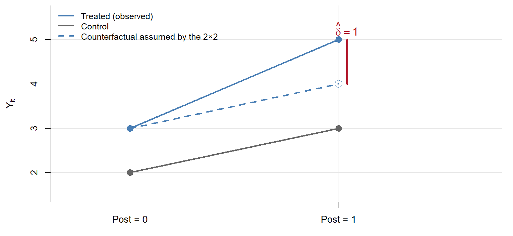{width=85%}\n\n')
cat('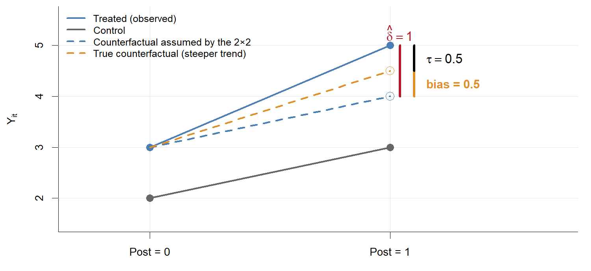{.fragment width=85%}\n\n')
cat(':::\n')
```

---

## What if there is anticipation?

$$
E[\hat\delta] = \tau - \underbrace{E[Y_{i0}(1) - Y_{i0}(0) \mid T_i = 1]}_{\text{anticipation effect in the pre-period}} \qquad \text{(parallel trends holding)}
$$

```{r}
#| output: asis
drawa <- function(step) {
  par(mar = c(3, 4.5, 0.5, 1), cex = 1.1, xpd = NA)
  plot(NA, xlim = c(-0.55, 1.7), ylim = c(1.5, 5.6), xaxt = "n", xlab = "", ylab = expression(Y[it]), bty = "l")
  par(xpd = FALSE); abline(h = 2:5, v = 0:1, col = "grey90"); par(xpd = NA)
  axis(1, at = 0:1, labels = c("Post = 0", "Post = 1"))
  lines(0:1, c(3.5, 5), col = blue, lwd = 3); points(0:1, c(3.5, 5), pch = 19, col = blue, cex = 1.5)
  lines(0:1, c(2, 3), col = grey, lwd = 3); points(0:1, c(2, 3), pch = 19, col = grey, cex = 1.5)
  # counterfactual assumed by the 2x2: starts from the observed pre-period level, parallel to control
  lines(0:1, c(3.5, 4.5), col = blue, lwd = 3, lty = 2); points(1, 4.5, pch = 1, col = blue, cex = 1.8)
  segments(1.04, 4.5, 1.04, 5, lwd = 4, col = red)
  text(1.04, 5.25, expression(hat(delta) == 0.5), adj = 0.5, col = red, font = 2, cex = 1.2)
  leg <- c("Treated (observed)", "Control", "Counterfactual assumed by the 2×2"); lc <- c(blue, grey, blue); lt <- c(1, 1, 2)
  if (step >= 1) {                                   # the truth: treated units already responded in period 0
    points(0, 3, pch = 1, col = amber, cex = 1.8, lwd = 2)
    segments(-0.05, 3, -0.05, 3.5, lwd = 4, col = amber)
    text(-0.1, 3.25, "anticipation = 0.5", adj = 1, col = amber, font = 2, cex = 1.0)
    lines(0:1, c(3, 4), col = amber, lwd = 3, lty = 2); points(1, 4, pch = 1, col = amber, cex = 1.8)
    segments(1.04, 4, 1.04, 4.5, lwd = 4, col = amber)
    text(1.04, 3.75, "bias = -0.5", adj = 0.5, col = amber, font = 2, cex = 1.0)
    segments(1.12, 4, 1.12, 5, lwd = 4, col = "black")
    text(1.17, 4.5, expression(tau == 1), adj = 0, col = "black", font = 2, cex = 1.2)
    leg <- c(leg, "True counterfactual (untreated baseline)"); lc <- c(lc, amber); lt <- c(lt, 2)
  }
  legend("topleft", leg, col = lc, lty = lt, lwd = 3, bty = "n", cex = 0.9)
}
for (s in 0:1) {
  png(sprintf("figs_twfe/ant%d.png", s), width = 10, height = 4.6, units = "in", res = 150)
  drawa(s); invisible(dev.off())
}
cat('::: {.r-stack}\n')
cat('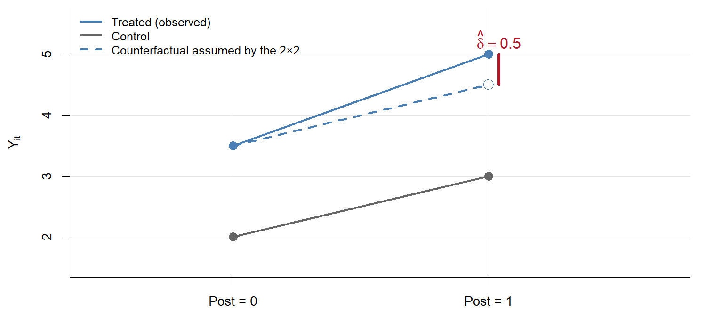{width=85%}\n\n')
cat('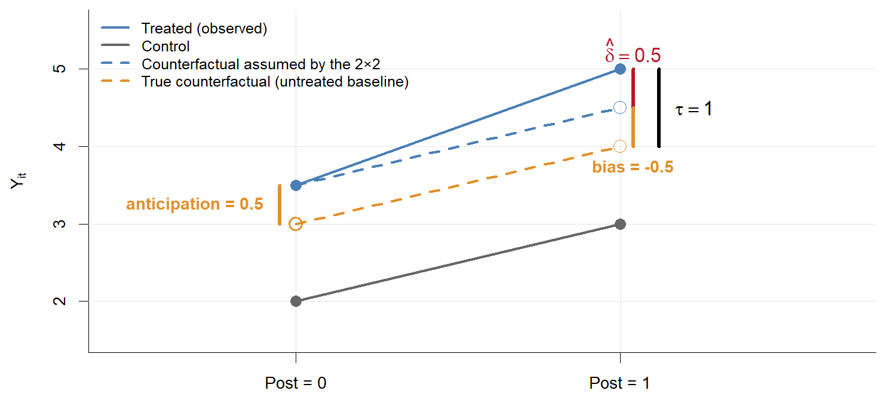{.fragment width=85%}\n\n')
cat(':::\n')
```

---

## The parallel trends assumption is untestable

- Parallel trends is about *counterfactual* outcomes for the treated. We can never directly verify what would have happened to the treated group absent treatment.
- Parallel pre-trends, when available, lend plausibility but do *not* guarantee parallel post-treatment trends.
- Trend assumptions are sensitive to the *scale* of the outcome: parallel on levels is not parallel on logs, and the reverse. The functional form needs a justification (Roth et al. 2023).

---

## Two-period DiD: estimation and inference

- Standard inference uses cluster-robust standard errors at the level of unit $i$.
- If treatment is assigned at a higher level (for example, states), cluster at that level. The rule of thumb is to cluster at the level at which treatment is independently assigned (Roth et al. 2023).
- **Few clusters:** standard cluster-robust SEs may perform poorly.
    - Wild cluster bootstrap (Cameron, Gelbach, and Miller 2008).
    - $t$-distribution with $J - 2$ degrees of freedom (Donald and Lang 2007).
    - Randomization inference approaches.

---

## Statistical power in DiD (Weiss 2024)

- DiD designs often have small effective sample sizes (for example, $N = 50$ US states).
- Weiss (2024) is a simulation study of modern DiD methods. It shows:
    - Many methods produce confidence intervals that fail to cover at nominal rates.
    - Block bootstrap can improve coverage.
    - Power is a serious concern, and large effect sizes are required for detection.
- Effective sample size is driven by the number of *units*, not by sub-units or time periods.
- Researchers should conduct power analyses *before* committing to a DiD design.

# Conditional DiD

## Conditional parallel trends

Standard parallel trends may be implausible unconditionally but plausible conditional on covariates $X_i$.

**Assumption 1$'$ (Conditional parallel trends).**

$$
\begin{aligned}
&E[Y_{i1}(0) - Y_{i0}(0) \mid T_i = 1, X_i] = E[Y_{i1}(0) - Y_{i0}(0) \mid T_i = 0, X_i]\\ 
&\Pr[T_i = 1 \mid X_i] < 1 \text{ for all } X_i \text{ (overlap).}
\end{aligned}
$$

- Among units with the same $X_i$, trends are parallel.
- This allows confounders with *time-invariant* additive effects on the outcome to differ across groups, as long as $X_i$ captures them.

---

## Controls in the three DiD regressions

Conditional parallel trends says that the *trend* in untreated outcomes depends on $X_i$, so covariates must enter interacted with time. In each of the three forms:

$$
\begin{aligned}
Y_{it} &= \beta_0 + \beta_1 T_i + \beta_2 \text{Post}_t + \delta\, T_i \times \text{Post}_t + X_i'\gamma_0 + X_i'\gamma_1 \text{Post}_t + \epsilon_{it} \\
Y_{it} &= \alpha_i + \lambda_t + \delta D_{it} + X_i'\gamma_1 \text{Post}_t + \epsilon_{it} \\
\Delta Y_i &= \Delta\lambda + \delta\, T_i + X_i'\gamma_1 + \Delta\epsilon_i
\end{aligned}
$$

- The term $X_i'\gamma_1 \text{Post}_t$ lets covariates shift the trend. It is the term that matters.
- The level term $X_i'\gamma_0$ is kept in the dummy form so that all three give the same $\hat\delta$. In the TWFE form it is absorbed by $\alpha_i$, and in the first-difference form it is differenced out.

---

## Conditional DiD: implementation

Three approaches.

1. **Regression adjustment.** Add $X_i$ interacted with time, as on the previous slide. An uninteracted $X_i$ is absorbed by $\alpha_i$ in the TWFE form, so it does nothing. This imposes a common slope $\gamma_1$ for treated and control, which can bias the ATT under heterogeneous effects (Roth et al. 2023, eq. 12).

2. **IPW.** Weight by the inverse propensity score $p(X_i) = \Pr[T_i = 1 \mid X_i]$ (Abadie 2005):
$$
\hat\tau = \frac{1}{N_1} \sum_i \left( T_i - \frac{(1 - T_i)\hat p(X_i)}{1 - \hat p(X_i)} \right) \Delta Y_i.
$$

3. **Doubly robust** (Sant'Anna and Zhao 2020). It combines outcome modeling and IPW, is consistent if *either* model is correct, and achieves the semiparametric efficiency bound.

---

## Caveat: conditioning on pre-treatment $Y$

- Common practice includes lagged outcomes $Y_{i0}$ in $X_i$ to make parallel trends more plausible.
- But this can induce regression to the mean bias (Daw and Hatfield 2018).
    - Matching on pre-treatment outcomes selects controls with unusually large "shocks" at $t = 0$.
    - These shocks mean-revert, creating a spurious trend difference.
- Whether to condition on lagged outcomes depends on which assumption is more credible: conditional unconfoundedness (given lagged $Y$) or parallel trends.
- The two assumptions are *not nested*. They point to different estimators and different biases.

# DiD with $t > 2$: event studies

## Setup

- There are multiple pre-event periods $t = -J, \dots, -1, 0$ and post-event periods $t = 1, \dots, K$.
- All treated units receive treatment at the same time (a single event).
- We are interested in the dynamic ATTs:

$$
\tau_k = E[Y_{i,k}(1) - Y_{i,k}(0) \mid T_i = 1], \qquad k = 1, \dots, K.
$$

How does the effect evolve over time since treatment?

---

## Event study specification

Estimate period-specific effects relative to a reference period (typically $t = 0$ or $t = -1$):

$$
Y_{it} = \alpha_i + \lambda_t + \sum_{\substack{k=-J \\ k \neq 0}}^{K} \delta_k \cdot T_i \times \mathbb{1}(t = k) + \epsilon_{it}.
$$

- $\delta_k$ for $k > 0$: dynamic treatment effects, relative to the reference period.
- $\delta_k$ for $k < 0$: pre-trend "placebo" coefficients.
- This is algebraically equivalent to the group-time interaction regression.

---

## An event study with dynamic effects

```{r}
#| output: asis
set.seed(11)
Nd <- 600; Td <- 15; td <- 7                                 # td = last pre-treatment year
dd <- expand.grid(unit = 1:Nd, year = 1:Td)
dd$T   <- as.integer(dd$unit <= Nd / 2)
dd$k   <- ifelse(dd$T == 1, dd$year - td, 0)
dd$D   <- as.integer(dd$T == 1 & dd$year > td)
tau_k  <- function(k) 1.5 * 0.6^(k - 1)                      # front-loaded effect that fades toward zero
dd$Y   <- rnorm(Nd)[dd$unit] + 0.1 * dd$year + ifelse(dd$D == 1, tau_k(dd$k), 0) + rnorm(nrow(dd), 0, 0.5)
esd    <- feols(Y ~ i(k, ref = 0) | unit + year, data = dd, cluster = ~unit)
pooled <- feols(Y ~ D | unit + year, data = dd, cluster = ~unit)
drawe <- function(step) {
  par(mar = c(4, 4.5, 0.5, 1), cex = 1.05)
  b <- coef(esd); s <- se(esd); x <- as.numeric(sub("k::", "", names(b)))
  plot(x, b, type = "n", ylim = c(-0.5, 2), xlab = "Periods since last pre-treatment period (k)", ylab = expression(hat(delta)[k]))
  par(xpd = FALSE); abline(h = seq(-0.5, 2, 0.5), v = 0, col = "grey90"); par(xpd = NA)
  segments(x, b - 1.96 * s, x, b + 1.96 * s, lwd = 2, col = blue)
  points(x, b, pch = 19, col = blue, cex = 1.3)
  abline(h = 0, lty = 3, col = "grey60"); abline(v = 0.5, lty = 3)
  leg <- "Event-study estimate (95% CI)"; lc <- blue; lp <- 19; ll <- NA
  if (step >= 1) {
    segments(1, coef(pooled), 8, coef(pooled), lwd = 4, col = red)
    leg <- c(leg, "Pooled TWFE"); lc <- c(lc, red); lp <- c(lp, NA); ll <- c(ll, 1)
  }
  legend("topright", leg, col = lc, pch = lp, lty = ll, lwd = c(NA, 4)[seq_along(lc)], bty = "n")
}
for (s in 0:1) {
  png(sprintf("figs_twfe/dyn%d.png", s), width = 10, height = 4.6, units = "in", res = 150)
  drawe(s); invisible(dev.off())
}
cat('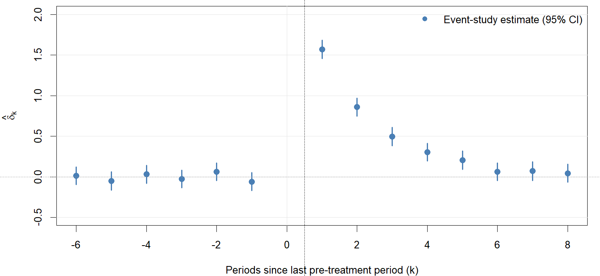{width=85%}\n')
```

---

## What does pooled TWFE estimate?

The pooled (static) TWFE regression is $Y_{it} = \alpha_i + \lambda_t + \delta \cdot D_{it} + \epsilon_{it}$.

- With a single event and homogeneous effects ($\tau_k = \tau$ for all $k$), $\hat\delta$ consistently estimates $\tau$.
- With *dynamic* effects ($\tau_k$ varying across $k$), $\hat\delta$ estimates a weighted average,

$$
\delta = \sum_{k=1}^{K} w_k \tau_k,
$$

where $w_k$ are regression weights, proportional to the variance of $D_{it}$ within period $k$.

- If effects grow over time, pooled TWFE may over- or under-weight certain periods depending on the data structure.
- The event study specification avoids this by estimating each $\delta_k$ separately.

---

## Pooled TWFE versus the event study

::: {.r-stack}
{width=85%}

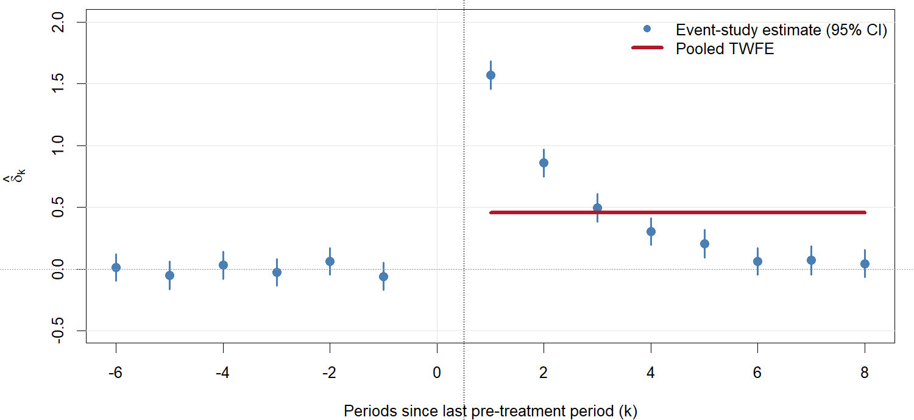{.fragment width=85%}
:::

---

## Reference period and anticipation

Common choices for the omitted reference period:

- $t = 0$ (the last pre-treatment period): pre-treatment coefficients measure differences relative to the period just before treatment.
- $t = -1$: allows $\delta_0$ to capture possible anticipation effects.

The choice matters for interpretation, because it shifts *what the post-treatment coefficients measure*. If there are anticipation effects at $t = 0$, using $t = 0$ as the reference absorbs them, and post-treatment estimates become relative to the anticipated state.

If anticipation effects are suspected, use an earlier reference period and test for effects at $t = 0$.

---

## An event study in a simulation

```{r}
#| echo: true
set.seed(8)
N <- 600; TT <- 15; t0 <- 7                               # t0 = last pre-treatment year
es_dat <- expand.grid(unit = 1:N, year = 1:TT)
es_dat$T   <- as.integer(es_dat$unit <= N / 2)
es_dat$k   <- ifelse(es_dat$T == 1, es_dat$year - t0, 0)    # controls sit at the reference
es_dat$tau <- ifelse(es_dat$T == 1 & es_dat$year > t0, 0.2 * (es_dat$year - t0), 0)
es_dat$Y   <- rnorm(N)[es_dat$unit] + 0.1 * es_dat$year + es_dat$tau + rnorm(nrow(es_dat), 0, 0.5)
es <- feols(Y ~ i(k, ref = 0) | unit + year, data = es_dat, cluster = ~unit)
```

Parallel trends and no anticipation hold by construction. The true effect is $0.2k$ for $k \geq 1$.

---

## The event study plot

```{r}
#| fig-width: 10
#| fig-height: 4
par(mar = c(4, 4.5, 0.5, 1), cex = 1.05)
b <- coef(es); s <- se(es); x <- as.numeric(sub("k::", "", names(b)))
plot(x, b, type = "n", ylim = range(c(b - 1.96 * s, b + 1.96 * s)),
     xlab = "Periods since last pre-treatment period (k)", ylab = expression(hat(delta)[k]))
segments(x, b - 1.96 * s, x, b + 1.96 * s, lwd = 2, col = blue)
points(x, b, pch = 19, col = blue, cex = 1.3)
kk <- -6:8; lines(kk, ifelse(kk >= 1, 0.2 * kk, 0), col = green, lwd = 3)
abline(h = 0, lty = 3, col = "grey60"); abline(v = 0.5, lty = 3)
legend("topleft", c("Estimate (95% CI)", "Truth"), col = c(blue, green), pch = c(19, NA),
       lty = c(NA, 1), lwd = c(NA, 3), bty = "n")
```

The pre-period coefficients are centered on zero and the post-period coefficients follow the true path. The reference period ($k=0$) has no coefficient because it is zero by construction.

# Pre-trends

## Pre-trends: what they tell us

- With multiple pre-periods, the event study coefficients $\hat\delta_k$ for $k < 0$ serve as a plausibility check.
- If $\hat\delta_k \approx 0$ for all $k < 0$, this lends support to parallel trends.
- If $\hat\delta_k \neq 0$, it raises concern that trends were already diverging before treatment.
- But pre-trends are suggestive, not conclusive:
    - Parallel pre-trends do not imply parallel post-treatment counterfactual trends.
    - Non-parallel pre-trends do not mean that treatment effect estimates are necessarily biased, because the divergence may not persist.

---

## The pre-trend testing fallacy

Common practice tests $H_0: \delta_{-1} = \delta_{-2} = \cdots = 0$ and, if not rejected, concludes that parallel trends hold. This commits a logical error: failure to reject is not evidence of equality.

Three problems (Rambachan and Roth 2023; Roth et al. 2023; de Chaisemartin and D'Haultfœuille 2026):

1. **Low power.** Pre-trend tests are often underpowered. A violation large enough to substantially bias estimates may go undetected.
2. **Pre-test bias.** Conditioning on "passing" the pre-test distorts the sampling distribution, potentially *increasing* bias relative to not testing at all.
3. **Wrong null.** The standard test sets $H_0$: parallel trends. For credibility, we want evidence *for* parallelism, not merely lack of evidence against it.

---

## Pre-test bias in a simulation

```{r}
#| echo: true
set.seed(3)
sims <- 20000; sig <- 0.05; trend <- 0.03          # true differential trend; true effect = 0
per <- -3:4
d <- matrix(trend * per, sims, length(per), byrow = TRUE) + matrix(rnorm(sims * 8, 0, sig), sims)
colnames(d) <- per
beta <- d - d[, "0"]                                 # event-study coefficients, ref = 0
pass <- apply(abs(beta[, c("-3", "-2", "-1")]) / (sig * sqrt(2)) < 1.96, 1, all)
c(pass_rate = mean(pass), bias_all = mean(beta[, "1"]), bias_if_passed = mean(beta[, "1"][pass]))
```

A violation that produces bias of `r trend` in the first post-period passes the pre-test in about `r round(100 * mean(pass))`% of samples. Among those samples, the bias is larger than in the full set of samples.

- Flat leads often mean the reference period drew low.
- Every coefficient is measured against that period, so the same draw pushes the post-period estimates up.
- Passing selects for the larger bias.

---

## Equivalence testing for pre-trends

The right framework is equivalence testing (Bilinski and Hatfield 2026; Dette and Schumann 2024). It reverses the null and alternative:

- $H_0$: pre-trend differences are at least as large as $c$ (non-parallel).
- $H_1$: pre-trend differences are smaller than $c$ (approximately parallel).

Reject $H_0$ only if the data provide strong evidence that pre-trends are small. This requires specifying $c$: how close to parallel is "close enough"? It is more demanding of the data, but it is the correct inferential question.

---

## Sensitivity analysis

The key idea of Rambachan and Roth (2023) is to restrict how different post-treatment violations can be from the pre-trends, instead of assuming $\delta_{\text{post}} = 0$ (exact parallel trends).

Decompose the event study coefficient:

$$
\beta_k = \underbrace{\tau_k}_{\text{causal effect}} + \underbrace{\delta_k}_{\text{trend bias}}.
$$

Under parallel trends, $\delta_k = 0$. Instead, assume the vector of violations lies in a set of allowed values, $\delta \in \Delta$. A larger $\Delta$ is a weaker assumption, and exact parallel trends is the special case $\delta_{\text{post}} = 0$. A common choice is *relative magnitudes*, $\Delta^{RM}(\bar M)$, which bounds the post-treatment violation by $\bar M$ times the maximum pre-treatment violation:

$$
|\delta_{t+1} - \delta_t| \leq \bar M \cdot \max_{s < 0} |\delta_{s+1} - \delta_s|, \qquad \forall\, t \geq 0.
$$

$\bar M = 0$ is exact parallel trends. $\bar M = 1$ allows a post-treatment violation as large as the largest pre-treatment violation.

---

## Rambachan and Roth: what you get

- For each $\bar M$, construct a **robust confidence set** for $\tau_k$ that is valid under all $\delta \in \Delta^{RM}(\bar M)$.
- It accounts for both statistical uncertainty (the pre-trend is noisily estimated) and identification uncertainty (even if we knew the pre-trend exactly, we would not know the post-treatment violation).
- It also allows **smoothness** restrictions, $\Delta^{SD}(M)$, which bound changes in the slope of the violation (second differences):

$$
|(\delta_{t+1} - \delta_t) - (\delta_t - \delta_{t-1})| \leq M.
$$

- Relative magnitudes suit confounding by *shocks*. Smoothness suits confounding by *secular trends*, such as differential growth. The choice should follow from what could plausibly violate parallel trends.
- Report results for a range of $\bar M$ values. The **breakdown value** is the smallest $\bar M$ at which the confidence set includes zero, a measure of robustness.
- R package: `HonestDiD`.

---

## An example with a pre-trend

```{r}
#| output: asis
set.seed(21)
N3 <- 600; T3 <- 15; t3 <- 10                           # t3 = last pre-treatment year
s3 <- expand.grid(unit = 1:N3, year = 1:T3)
s3$tr  <- as.integer(s3$unit <= N3 / 2)
s3$k   <- ifelse(s3$tr == 1, s3$year - t3, 0)
s3$Y   <- rnorm(N3)[s3$unit] + 0.1 * s3$year +
          0.03 * s3$tr * s3$year +                       # violation: differential trend
          0.25 * s3$tr * (s3$year > t3) + rnorm(nrow(s3), 0, 0.5)   # true effect 0.25
es3 <- feols(Y ~ i(k, ref = 0) | unit + year, data = s3, cluster = ~unit)
b3  <- coef(es3); names(b3) <- sub("k::", "", names(b3))
drawx <- function(step) {
  par(mar = c(4, 4.5, 0.5, 1), cex = 1.05)
  x <- as.numeric(names(b3)); s <- se(es3)
  plot(x, b3, type = "n", ylim = c(-0.5, 0.8), xlab = "Periods since last pre-treatment period (k)", ylab = expression(hat(delta)[k]))
  par(xpd = FALSE); abline(h = seq(-0.4, 0.8, 0.2), v = 0, col = "grey90"); par(xpd = NA)
  segments(x, b3 - 1.96 * s, x, b3 + 1.96 * s, lwd = 2, col = blue)
  points(x, b3, pch = 19, col = blue, cex = 1.3)
  abline(h = 0, lty = 3, col = "grey60"); abline(v = 0.5, lty = 3)
  leg <- "Event-study estimate (95% CI)"; lc <- blue; lp <- 19; ll <- NA; lw <- NA
  if (step >= 1) {
    kk <- c(-9, 5)
    pre <- c(b3[as.character(-9:-1)], `0` = 0)
    fit <- lm(pre ~ as.numeric(names(pre)))
    lines(kk, coef(fit)[1] + coef(fit)[2] * kk, col = amber, lwd = 3, lty = 2)
    segments(1, 0.25, 5, 0.25, col = green, lwd = 4)
    leg <- c(leg, "Pre-trend extrapolated", "True effect (0.25)"); lc <- c(lc, amber, green)
    lp <- c(lp, NA, NA); ll <- c(ll, 2, 1); lw <- c(lw, 3, 4)
  }
  legend("topleft", leg, col = lc, pch = lp, lty = ll, lwd = c(NA, lw[-1]), bty = "n")
}
for (s in 0:1) {
  png(sprintf("figs_twfe/ex%d.png", s), width = 10, height = 4.4, units = "in", res = 150)
  drawx(s); invisible(dev.off())
}
cat('::: {.r-stack}\n')
cat('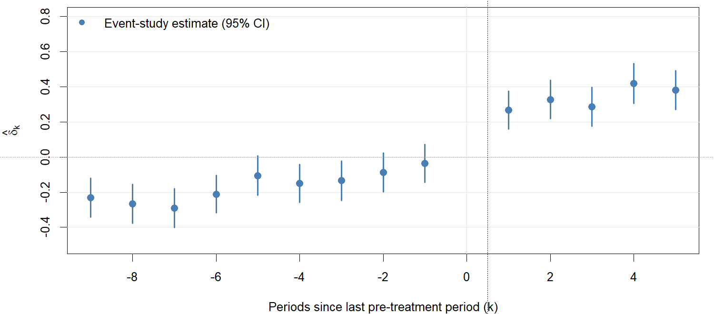{width=85%}\n\n')
cat('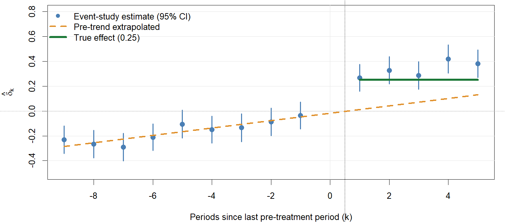{.fragment width=85%}\n\n')
cat(':::\n')
```

The pre-period coefficients drift upward, and the first post-period coefficient combines the true effect, $0.25$, with a bias of $0.03$.

---

## Modeling the trend: ITS

$$
Y_{it} = \alpha_i + \lambda_t + \gamma\, T_i \times t + \delta\, D_{it} + \epsilon_{it}.
$$

```{r}
#| output: asis
drawi <- function(step) {
  par(mar = c(4, 4.5, 0.5, 1), cex = 1.05)
  x <- as.numeric(names(b3)); s <- se(es3)
  pre  <- c(b3[as.character(-9:-1)], `0` = 0)
  fit  <- lm(pre ~ as.numeric(names(pre)))
  trend <- function(k) coef(fit)[1] + coef(fit)[2] * k
  plot(x, b3, type = "n", ylim = c(-0.5, 0.8), xlab = "Periods since last pre-treatment period (k)", ylab = expression(hat(delta)[k]))
  par(xpd = FALSE); abline(h = seq(-0.4, 0.8, 0.2), v = 0, col = "grey90"); par(xpd = NA)
  segments(x, b3 - 1.96 * s, x, b3 + 1.96 * s, lwd = 2, col = blue)
  points(x, b3, pch = 19, col = blue, cex = 1.3)
  lines(c(-9, 5), trend(c(-9, 5)), col = amber, lwd = 3, lty = 2)
  abline(h = 0, lty = 3, col = "grey60"); abline(v = 0.5, lty = 3)
  leg <- c("Event-study estimate (95% CI)", "Fitted pre-trend, extended"); lc <- c(blue, amber); lp <- c(19, NA); ll <- c(NA, 2); lw <- c(NA, 3)
  if (step >= 1) {
    post <- 1:5
    points(post, b3[as.character(post)] - trend(post), pch = 21, bg = "white", col = green, lwd = 3, cex = 1.6)
    segments(1, 0.25, 5, 0.25, col = green, lwd = 2, lty = 3)
    leg <- c(leg, "Estimate minus trend (point estimates)"); lc <- c(lc, green); lp <- c(lp, 21); ll <- c(ll, NA); lw <- c(lw, NA)
  }
  legend("topleft", leg, col = lc, pch = lp, lty = ll, lwd = lw, bty = "n", cex = 0.9)
}
for (s in 0:1) {
  png(sprintf("figs_twfe/its%d.png", s), width = 10, height = 4.2, units = "in", res = 150)
  drawi(s); invisible(dev.off())
}
cat('::: {.r-stack}\n')
cat('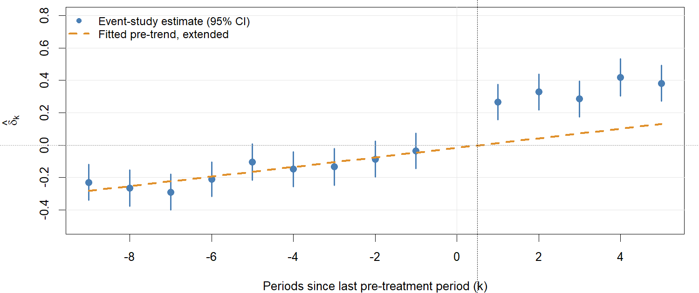{width=75%}\n\n')
cat('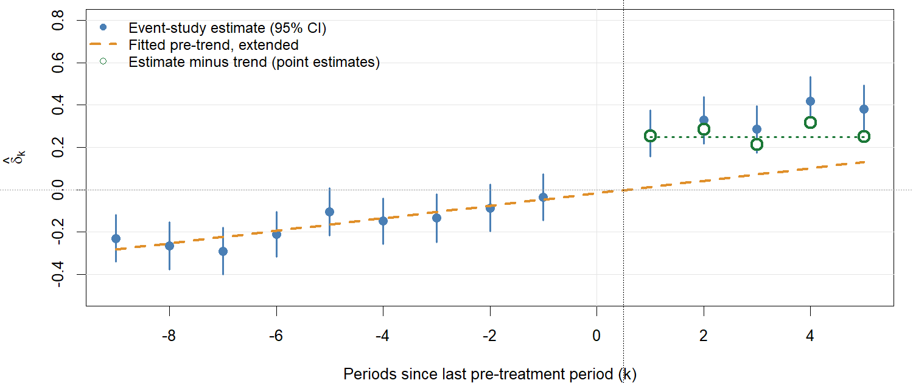{.fragment width=75%}\n\n')
cat(':::\n')
```

- Subtracting the fitted trend recovers an effect near the true 0.25, but identification now rests on extrapolating the trend.
- Error grows with the horizon, and an effect that builds gradually can be absorbed into the trend.

---

## Sensitivity sets in the example

```{r}
#| echo: true
pre  <- c(b3[as.character(-9:-1)], `0` = 0)
m    <- max(abs(diff(pre)))                     # largest pre-period jump
s    <- coef(lm(pre ~ as.numeric(names(pre))))[2]   # linear pre-trend slope
b1   <- b3["1"]; se1 <- se(es3)["k::1"]
Mbar <- seq(0, 2, by = 0.25)
rm_set <- cbind(lo = b1 - Mbar * m - 1.96 * se1, hi = b1 + Mbar * m + 1.96 * se1)
M <- seq(0, 0.15, by = 0.025)
sd_set <- cbind(lo = b1 - s - M - 1.96 * se1, hi = b1 - s + M + 1.96 * se1)
```

These are schematic versions that treat the pre-period coefficients as known. They are intended for intuition. `HonestDiD` accounts for estimation error in $\hat\delta_{\text{pre}}$ and gives confidence sets with correct coverage.

---

## Sensitivity plots

```{r}
#| fig-width: 12
#| fig-height: 3.8
par(mfrow = c(1, 2), mar = c(4.2, 4.5, 2, 1), cex = 1.05)
yl <- range(c(rm_set, sd_set, 0))
plot(NA, xlim = range(Mbar), ylim = yl, xlab = expression(bar(M)), ylab = "Effect at k = 1",
     main = "Relative magnitudes")
segments(Mbar, rm_set[, 1], Mbar, rm_set[, 2], lwd = 4, col = blue)
abline(h = 0, lty = 3); abline(h = 0.25, col = green, lwd = 2)
plot(NA, xlim = c(-0.005, 0.155), ylim = yl, xlab = "M", ylab = "", main = "Smoothness")
segments(M, sd_set[, 1], M, sd_set[, 2], lwd = 4, col = amber)
abline(h = 0, lty = 3); abline(h = 0.25, col = green, lwd = 2)
legend("topright", "True effect", col = green, lwd = 2, bty = "n")
```

Relative magnitudes treat the pre-trend as noise of bounded size. The set includes zero once $\bar M \gtrsim$ `r round((abs(b1) - 1.96 * se1) / m, 2)`. Smoothness extrapolates the trend, so at $M = 0$ it removes the bias and centers on the truth. The set includes zero once $M \gtrsim$ `r round(unname(b1 - s) - 1.96 * se1, 2)`; for scale, the pre-trend slope itself is `r round(unname(s), 2)` per period. The same data support different conclusions under different restrictions, which is why the restriction must be justified substantively.

---

## HonestDiD in practice

```{r}
#| echo: true
#| eval: false
library(HonestDiD)
betahat <- coef(es3); sigma <- vcov(es3)            # event-study coefs and vcov
res_rm <- createSensitivityResults_relativeMagnitudes(
  betahat = betahat, sigma = sigma,
  numPrePeriods = 9, numPostPeriods = 5,
  Mbarvec = seq(0, 2, by = 0.25))
res_sd <- createSensitivityResults(
  betahat = betahat, sigma = sigma,
  numPrePeriods = 9, numPostPeriods = 5,
  Mvec = seq(0, 0.15, by = 0.025))
orig <- constructOriginalCS(betahat, sigma, numPrePeriods = 9, numPostPeriods = 5)
createSensitivityPlot_relativeMagnitudes(res_rm, orig)
```

- Coefficients must be ordered pre then post, with the reference period omitted.
- Use `l_vec` to target an average of post-period effects instead of the first one.
- The procedure works with any event-study estimator that supplies a coefficient vector and covariance matrix, including Callaway–Sant'Anna and Sun–Abraham (Lecture 9).

---

## Covariates in the event study: specification

- With unit fixed effects $\alpha_i$, any time-invariant $X_i$ is absorbed, so including $X_i$ on its own does nothing.
- To allow covariates to control *trends*, interact $X_i$ with time indicators (Roth et al. 2023, eq. 12):

$$
Y_{it} = \alpha_i + \lambda_t + \sum_{k \neq 0} \delta_k\, T_i \times \mathbb{1}(t = k) + \sum_{t' \neq 0} X_i'\gamma_{t'} \times \mathbb{1}(t = t') + \epsilon_{it},
$$

where $\gamma_{t'}$ are period-specific covariate coefficients (reference period omitted).

- Equivalently, difference each period relative to the reference period $t = 0$ (the "long difference"):

$$
\tilde Y_{it} \equiv Y_{it} - Y_{i0} = (\lambda_t - \lambda_0) + \delta_t T_i + X_i'\gamma_t + (\epsilon_{it} - \epsilon_{i0}), \qquad t \neq 0.
$$

This eliminates $\alpha_i$ and is algebraically equivalent to the unit-FE event study. It is *not* the consecutive first difference $Y_{it} - Y_{i,t-1}$.

---

## Limitations and better approaches

**Problem.** The linear specification imposes that the covariate slope $\gamma_t$ is the *same* for treated and control units. If treatment effects are heterogeneous in $X_i$, OLS can be biased for the ATT (Roth et al. 2023; de Chaisemartin and D'Haultfœuille 2026, Ch. 4). The regression forces $E[\tilde Y_{it} \mid X_i]$ to have the same slope in $X_i$ regardless of $T_i$, so a conditional ATT that varies with $X_i$ gets mixed into the covariate coefficient and vice versa.

**Semi- and nonparametric methods** avoid the linearity restriction:

- **IPW:** model $p(X_i) = \Pr(T_i = 1 \mid X_i)$ and reweight long differences. Valid if the propensity score is correct.
- **Regression adjustment:** estimate $E[\tilde Y_{it} \mid T_i = 0, X_i]$ flexibly, then impute counterfactual trends for the treated.
- **Doubly robust:** combine both. Consistent if *either* model is correct (Sant'Anna and Zhao 2020; Callaway and Sant'Anna 2021).

**Caution:** do not "balance" on pre-treatment outcomes, which can induce regression-to-the-mean artifacts (Daw and Hatfield 2018), as in the two-period case.

---

## Inference in multi-period DiD

- The clustering principles are the same as in the two-period case: cluster at the level of treatment assignment.
- Serial correlation within units across time periods can severely understate standard errors if not accounted for (Bertrand, Duflo, and Mullainathan 2004). Cluster-robust SEs at the unit level handle arbitrary within-unit serial correlation.
- For event study plots, report *simultaneous* confidence bands, not pointwise intervals, to account for multiple testing across periods (Freyaldenhoven et al. 2021; Callaway and Sant'Anna 2021).
- With few clusters, the same remedies apply as before: wild cluster bootstrap and permutation inference.

# Extensions

## Triple differences

- A policy in state $S$ targets subgroup $G$ (for example, girls) but not subgroup $B$ (for example, boys).
- Under parallel trends, the effect on $G$ in $S$ is $\delta_S = \text{DID}(G, S)$.
- But $G$'s trend may differ from $B$'s for non-treatment reasons.
- Use another state $S'$ (untreated) to estimate the $G$-vs-$B$ trend difference: $\gamma = \text{DID}(G, S') - \text{DID}(B, S')$.
- The triple-difference estimator is $\tilde\delta = \delta_S - \gamma$. The regression form is

$$
Y_{it} = \beta_0 + \beta_1 G + \beta_2 S + \beta_3 GS + \phi_0 T + \phi_1 GT + \phi_2 ST + \tilde\delta\, GST + \epsilon_{it}.
$$

This requires that the $G$-vs-$B$ trend difference be the same across states absent treatment.

---

## Continuous treatment DiD

Treatment $D_i \in \mathbb{R}$ replaces the binary indicator. A common specification is

$$
Y_{it} = \alpha_i + \lambda_t + \delta\, D_i \times \text{Post}_t + \epsilon_{it}, \qquad \text{equivalently} \qquad \Delta Y_i = \Delta\lambda + \delta D_i + \Delta\epsilon_i.
$$

- This requires (1) $D_i$ uncorrelated with the outcome trend $\Delta\epsilon_i$, and (2) linearity in $D_i$.
- With a pure control group ($T_i = 0$), a revised parallel trends assumption identifies $\text{ATT}(d \mid d)$:

$$
E[Y_{i1}(0) - Y_{i0}(0) \mid D_i = d] = E[Y_{i1}(0) - Y_{i0}(0) \mid D_i = 0].
$$

- A flexible specification, $\Delta Y_i = \Delta\lambda + f(D_i) + \Delta\epsilon_i$, avoids imposing linearity.
- See Callaway, Goodman-Bacon, and Sant'Anna (2024) and de Chaisemartin et al. (2024).

---

## Remarks

- Key takeaways:
    - Parallel trends is not directly testable.
    - Pre-trend tests should use equivalence testing.
    - Pre-trend differences should inform sensitivity analysis or partial identification approaches.
    - Use conditional DiD methods when unconditional parallel trends is implausible.
    - Power is a real concern, especially in commonly encountered social science applications.
- Some packages (for recitation):
    - `fixest`: fast TWFE estimation.
    - `did`: Callaway and Sant'Anna and other estimators.
    - `DIDmultiplegt`: de Chaisemartin and D'Haultfœuille DiD methods.
    - `DRDID`: doubly robust DiD estimation.
    - `HonestDiD`: Rambachan and Roth sensitivity analysis.

---

## References

::: {style="font-size: 0.75em"}
- Abadie (2005). Semiparametric difference-in-differences estimators. *Review of Economic Studies*.
- Bertrand, Duflo, and Mullainathan (2004). How much should we trust differences-in-differences estimates? *Quarterly Journal of Economics*.
- Bilinski and Hatfield (2026). Nothing to see here? Non-inferiority approaches to parallel trends and other model assumptions.
- Callaway, Goodman-Bacon, and Sant'Anna (2024). Difference-in-differences with a continuous treatment.
- Callaway and Sant'Anna (2021). Difference-in-differences with multiple time periods. *Journal of Econometrics*.
- Cameron, Gelbach, and Miller (2008). Bootstrap-based improvements for inference with clustered errors. *Review of Economics and Statistics*.
- Daw and Hatfield (2018). Matching and regression to the mean in difference-in-differences analysis. *Health Services Research*.
- de Chaisemartin and D'Haultfœuille (2026). *Credible Answers to Hard Questions: Differences-in-Differences for Natural Experiments*.
- de Chaisemartin, D'Haultfœuille, Pasquier, and Vazquez-Bare (2024). Difference-in-differences for continuous treatments and instruments with stayers.
- Dette and Schumann (2024). Testing for equivalence of pre-trends in difference-in-differences estimation. *Journal of Business and Economic Statistics*.
- Donald and Lang (2007). Inference with difference-in-differences and other panel data. *Review of Economics and Statistics*.
- Freyaldenhoven, Hansen, Pérez Pérez, and Shapiro (2021). Visualization, identification, and estimation in the linear panel event-study design.
- Rambachan and Roth (2023). A more credible approach to parallel trends. *Review of Economic Studies*.
- Roth (2022). Pretest with caution: Event-study estimates after testing for parallel trends. *AER: Insights*.
- Roth, Sant'Anna, Bilinski, and Poe (2023). What's trending in difference-in-differences? A synthesis of the recent econometrics literature. *Journal of Econometrics*.
- Sant'Anna and Zhao (2020). Doubly robust difference-in-differences estimators. *Journal of Econometrics*.
- Weiss (2024). Statistical power in difference-in-differences designs.
- Ye, Keele, Hasegawa, and Small (2021). Bracketing in difference-in-differences.
:::
