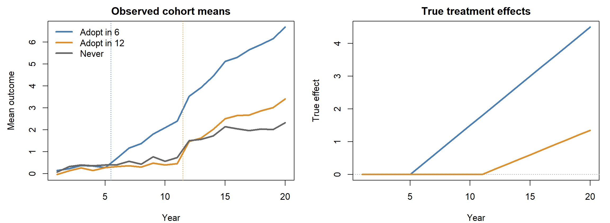
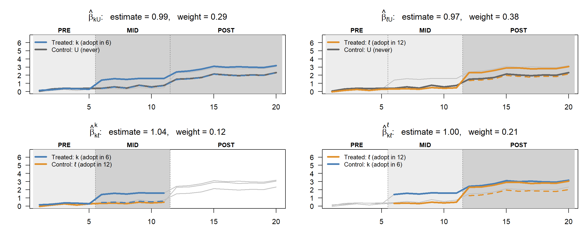
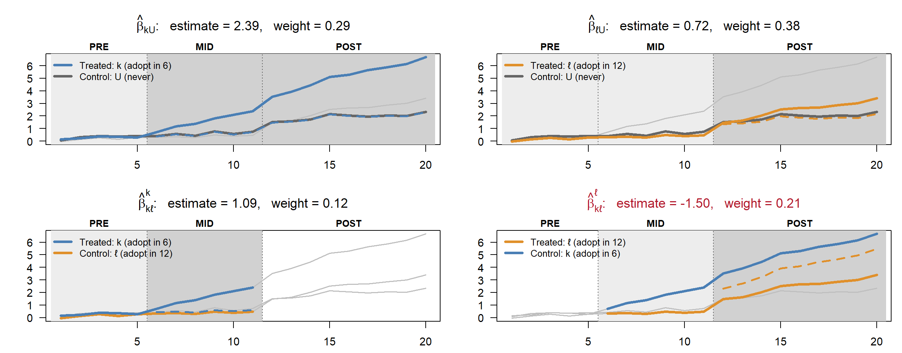
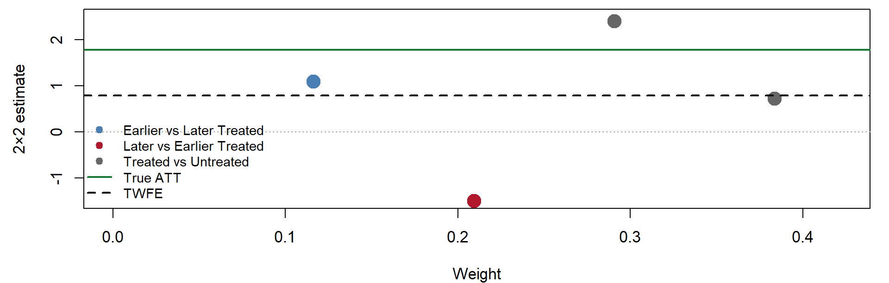
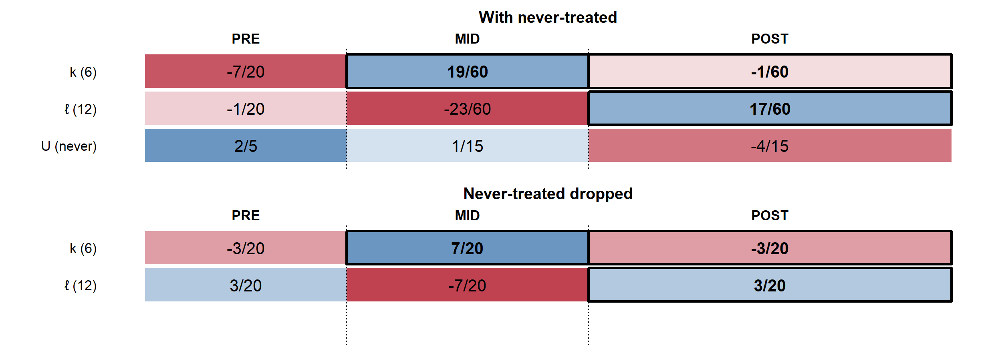
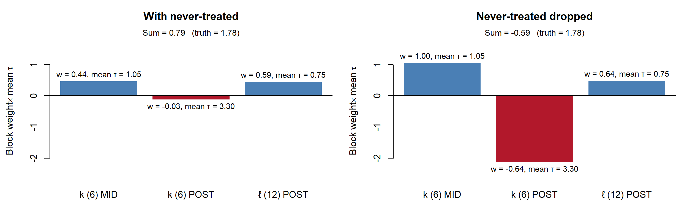
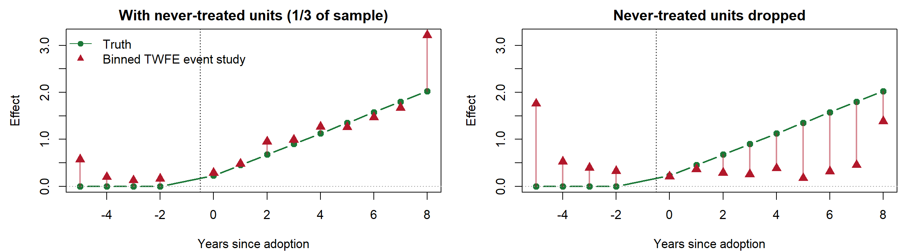
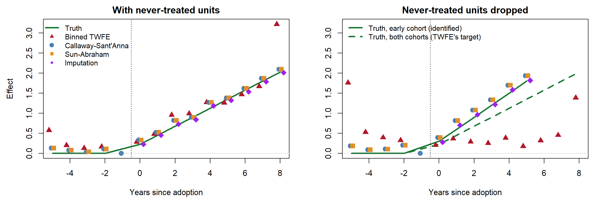

## Where we are going

Last week: 2×2 DiD, parallel trends, event studies.

> When units adopt at different times, does two-way fixed effects (TWFE) still estimate a DiD?

Today:

- Recap of Lecture 8
- Why TWFE became the default
- How it fails: forbidden comparisons, negative weights
- Robust alternatives: Callaway–Sant'Anna, Sun–Abraham, imputation
- Sensitivity analysis

---

## Learning objectives

1. State the estimand and assumptions for staggered adoption using $\text{ATT}(g,t)$.
2. Explain why TWFE equals DiD in the 2×2 case but not under staggered adoption.
3. Use the Goodman-Bacon decomposition; explain why "later vs. earlier" is forbidden.
4. Compute the de Chaisemartin–D'Haultfœuille weights.
5. Describe what the modern estimators share and where they differ.
6. Run a Rambachan–Roth sensitivity analysis on a robust event study.

# Part I: Recap of Lecture 8

## What difference-in-differences identifies

2×2: groups $D_i \in \{0,1\}$, periods $t \in \{0,1\}$, target $\text{ATT} = E[Y_{i1}(1) - Y_{i1}(0) \mid D_i = 1]$.

- **Parallel trends:** $E[Y_{i1}(0) - Y_{i0}(0) \mid D_i = 1] = E[Y_{i1}(0) - Y_{i0}(0) \mid D_i = 0]$.
- **No anticipation:** $Y_{i0}(1) = Y_{i0}(0)$ for treated units.

The missing cell $E[Y_{i1}(0) \mid D_i = 1]$ is the treated baseline plus the control change.

Every estimator today does this imputation for many cells. They differ in **which** changes they use.

---

## The regression and its equivalence

In the 2×2 case, both return the DiD:

$$
Y_{it} = \alpha + \gamma D_i + \lambda \mathbb{1}[t=1] + \beta \,(D_i \times \mathbb{1}[t=1]) + \varepsilon_{it}, \qquad Y_{it} = \alpha_i + \lambda_t + \beta D_{it} + \varepsilon_{it}.
$$

$\hat\beta = (\bar Y_{11} - \bar Y_{10}) - (\bar Y_{01} - \bar Y_{00})$ in both. With more periods, an event study estimates one DiD per event time against a common reference period.

# Part II: TWFE as the default

## The natural generalization

With staggered adoption, standard practice is

$$
Y_{it} = \alpha_i + \lambda_t + \beta D_{it} + X_{it}'\gamma + \varepsilon_{it}
$$

with $\hat\beta$ read as "the" DiD effect. The dynamic version:

$$
Y_{it} = \alpha_i + \lambda_t + \sum_{\ell \neq -1} \beta_\ell \, \mathbb{1}[t - G_i = \ell] + \varepsilon_{it}.
$$

Leads ($\ell < 0$): placebo tests. Lags ($\ell \geq 0$): dynamic effects. Each $\beta_\ell$ is shared by all cohorts.

---

## Why TWFE seemed sufficient

1. **Reduces to DiD** in the 2×2 case.
2. **Correct under a constant effect.** If $Y_{it}(1) - Y_{it}(0) = \beta$ for all $i, t$, TWFE is consistent under parallel trends.
3. **Convenient.** Unbalanced panels, covariates, continuous treatments, clustering.

Argument 2 is the problem. Effects are rarely constant across cohorts or exposure time.

---

## Staggered adoption: notation

- Periods $t = 1, \dots, T$. Treatment is **absorbing**: once on, it stays on.
- $G_i$: first treated period. Same $G_i$ = **cohort**. $G_i = \infty$: never treated.
- $Y_{it}(g)$: potential outcome in $t$ if first treated in $g$. $Y_{it}(\infty)$: never-treated outcome.

The **group-time ATT** (Callaway and Sant'Anna 2021):

$$
\text{ATT}(g, t) = E[Y_{it}(g) - Y_{it}(\infty) \mid G_i = g].
$$

Overall, cohort, and event-time ($e = t - g$) effects are weighted averages of these.

**2×2 analogue.** One cohort, $g = 1$; controls have $G_i = \infty$. So $Y(1) \to Y(g)$, $Y(0) \to Y(\infty)$, and the 2×2 ATT is $\text{ATT}(1,1)$.

---

## Assumptions under staggered adoption

**Parallel trends** (never-treated version). For all $g$ and $t \geq 2$,

$$
E[Y_{it}(\infty) - Y_{i,t-1}(\infty) \mid G_i = g] = E[Y_{it}(\infty) - Y_{i,t-1}(\infty) \mid G_i = \infty].
$$

Not-yet-treated version: replace $G_i = \infty$ with $G_i > t$.

*2×2:* one $g$, one $t$, one equation, with $Y(0)$ for $Y(\infty)$. Here it is one equation per cohort per period.

**No anticipation.** $Y_{it}(g) = Y_{it}(\infty)$ for all $t < g$.

*2×2:* $Y_{i0}(1) = Y_{i0}(0)$.

Then every $\text{ATT}(g,t)$ is identified. Does $\hat\beta^{\text{TWFE}}$ recover a sensible average of them?

---

## A running simulation


::: {.cell}

```{.r .cell-code}
set.seed(814)
N <- 300; TT <- 20
panel <- expand.grid(unit = 1:N, year = 1:TT)
panel <- panel[order(panel$unit, panel$year), ]
G     <- rep(c(6, 12, 0), each = N / 3)               # cohorts; 0 = never treated
slope <- c(`6` = 0.30, `12` = 0.15)                    # effect grows each year treated
panel$G   <- G[panel$unit]
panel$D   <- as.integer(panel$G > 0 & panel$year >= panel$G)
panel$e   <- ifelse(panel$G > 0, panel$year - panel$G, NA)          # event time
panel$tau <- ifelse(panel$D == 1, slope[as.character(panel$G)] * (panel$e + 1), 0)
alpha <- rnorm(N); lambda <- cumsum(rnorm(TT, 0.1, 0.2))
panel$Y <- alpha[panel$unit] + lambda[panel$year] + panel$tau + rnorm(nrow(panel), 0, 0.5)
c(true_ATT = mean(panel$tau[panel$D == 1]))
```

::: {.cell-output .cell-output-stdout}

```
true_ATT 
 1.78125 
```


:::
:::


Parallel trends and no anticipation hold by construction. Effects **grow with exposure** and **differ by cohort**.

---

## The simulated data


::: {.cell}
::: {.cell-output-display}
{width=1152}
:::
:::


# Part III: How TWFE fails

## TWFE in the simulation


::: {.cell}

```{.r .cell-code}
twfe <- feols(Y ~ D | unit + year, data = panel, cluster = ~unit)
c(TWFE = unname(coef(twfe)), true_ATT = mean(panel$tau[panel$D == 1]))
```

::: {.cell-output .cell-output-stdout}

```
    TWFE true_ATT 
 0.78496  1.78125 
```


:::
:::


Less than half the true ATT. All effects are nonnegative, parallel trends holds exactly, and there is no confounding. The bias comes entirely from how TWFE combines comparisons.

---

## Goodman-Bacon's setup

Three timing groups: early $k$, late $\ell$, untreated $U$. Group $k$ is first treated in period $k$. Their adoption dates cut the panel into three windows:

<table class="mt">
<tr><th></th><th>PRE($k$)</th><th>MID($k,\ell$)</th><th>POST($\ell$)</th></tr>
<tr><th>Periods</th><td>$1, \dots, k-1$</td><td>$k, \dots, \ell-1$</td><td>$\ell, \dots, T$</td></tr>
<tr><th>Early $k$</th><td>untreated</td><td class="obs">treated</td><td class="obs">treated</td></tr>
<tr><th>Late $\ell$</th><td>untreated</td><td>untreated</td><td class="obs">treated</td></tr>
<tr><th>Untreated $U$</th><td>untreated</td><td>untreated</td><td>untreated</td></tr>
</table>

$\bar D_j$: share of the panel group $j$ spends treated.

In the running simulation: $k = 6$, $\ell = 12$, $T = 20$. PRE = 1–5, MID = 6–11, POST = 12–20.

---

## The Goodman-Bacon decomposition

Each 2×2 uses two groups over two adjacent windows in which one group's treatment switches on and the other's does not.

<table class="mt cmp">
<tr><th>2×2</th><th>Treated</th><th>Control</th><th>Before → after</th><th></th></tr>
<tr><td>$\hat\beta^{2\times2}_{kU}$</td><td>$k$</td><td>$U$</td><td>PRE($k$) → MID + POST</td><td>clean</td></tr>
<tr><td>$\hat\beta^{2\times2}_{\ell U}$</td><td>$\ell$</td><td>$U$</td><td>PRE + MID → POST($\ell$)</td><td>clean</td></tr>
<tr><td>$\hat\beta^{2\times2,k}_{k\ell}$</td><td>$k$</td><td>$\ell$, not yet treated</td><td>PRE($k$) → MID($k,\ell$)</td><td>clean</td></tr>
<tr><td class="bad">$\hat\beta^{2\times2,\ell}_{k\ell}$</td><td>$\ell$</td><td>$k$, <strong>already treated</strong></td><td>MID($k,\ell$) → POST($\ell$)</td><td><strong>forbidden</strong></td></tr>
</table>

$$
\hat\beta^{\text{TWFE}} = \sum_{k \neq U} s_{kU}\,\hat\beta^{2\times2}_{kU} + \sum_{k \neq U} \sum_{\ell > k} \big[s^k_{k\ell}\,\hat\beta^{2\times2,k}_{k\ell} + s^\ell_{k\ell}\,\hat\beta^{2\times2,\ell}_{k\ell}\big]
$$

Weights $s \geq 0$ sum to one. Each is $\propto$ (subsample size)² × variance of $D$ within the subsample.

---

## Why the forbidden comparison is forbidden

Add and subtract untreated outcomes (Goodman-Bacon eq. 14):

$$
\hat\beta^{2\times2,k}_{k\ell} \to \text{ATT}_k(\text{MID}) + \underbrace{\big[\text{trend in } Y(0)\text{: } k \text{ vs. } \ell\big]}_{0 \text{ under parallel trends}}
$$

$$
\hat\beta^{2\times2,\ell}_{k\ell} \to \text{ATT}_\ell(\text{POST}) + \underbrace{\big[\text{trend in } Y(0)\text{: } \ell \text{ vs. } k\big]}_{0 \text{ under parallel trends}} - \underbrace{\big[\text{ATT}_k(\text{POST}) - \text{ATT}_k(\text{MID})\big]}_{\text{change in } k\text{'s effect}}
$$

Both are 2×2s between the same two groups. Only the second uses a treated control, so it also subtracts the **change in the control's effect**. Parallel trends does not remove this term. Growing effects push the estimate down, possibly below zero.

---

## Where each 2×2 is estimated: constant effects


::: {.cell}
::: {.cell-output-display}
{width=1248}
:::
:::


Effect fixed at 1; data otherwise unchanged. Every 2×2, forbidden included, is about 1; TWFE $=$ 0.99. $k$'s effect does not change, so it is a harmless control. Light/dark shading: before/after windows. Dashed: counterfactual from the control's change. The jump at year 12 is a common year shock, shared by $U$, and removed by the year fixed effects.

---

## Where each 2×2 is estimated: growing effects


::: {.cell}
::: {.cell-output-display}
{width=1248}
:::
:::


Same data and weights; effects grow with exposure. In $\hat\beta^{\ell}_{k\ell}$, $k$'s rise is its own treatment effect, not a failure of parallel trends in $Y(0)$. The 2×2 reads it as $\ell$'s counterfactual trend.

---

## Where the weights come from

The variance of $D$ in a subsample is large when

- the two groups are similar in size, and
- treatment is on for about half the subsample's periods ($\bar D \approx 1/2$).

So a group treated **mid-panel** gets the most weight, and groups treated near the start or end get little. They get *more* weight as controls than as treated groups.

Consequences:

- Weights depend on *when* groups adopt, not just how many units they have.
- Panel length alone changes the weights. Add periods to the end and later groups move toward the middle.

---

## The probability limit

$$
\beta^{\text{TWFE}} = \text{VWATT} + \text{VWCT} - \Delta\text{ATT}.
$$

- **VWATT**: variance-weighted average of cohort ATTs. Positive weights, but not sample shares.
- **VWCT**: variance-weighted differences in counterfactual trends. Zero under parallel trends.
- **$\Delta$ATT**: changes in effects within already-treated cohorts. Zero only if effects are constant over time.

Under parallel trends: an odd weighted average, minus a bias that grows with the dynamics.

---

## The decomposition in the simulation


::: {.cell}

```{.r .cell-code}
bd <- bacon(Y ~ D, data = panel, id_var = "unit", time_var = "year", quietly = TRUE)
agg <- sapply(split(bd, bd$type), function(d)
  c(weight = sum(d$weight), estimate = weighted.mean(d$estimate, d$weight)))
round(t(agg), 3)
```

::: {.cell-output .cell-output-stdout}

```
                         weight estimate
Earlier vs Later Treated  0.116    1.093
Later vs Earlier Treated  0.209   -1.502
Treated vs Untreated      0.674    1.442
```


:::
:::


::: {.cell}
::: {.cell-output-display}
{width=960}
:::
:::


---

## A sign reversal: drop the never-treated

Same data; the never-treated units are removed. Every unit is eventually treated.


::: {.cell}

```{.r .cell-code}
nn <- panel[panel$G != 0, ]
c(TWFE = unname(coef(feols(Y ~ D | unit + year, data = nn))), true_ATT = mean(nn$tau[nn$D == 1]))
```

::: {.cell-output .cell-output-stdout}

```
      TWFE   true_ATT 
-0.5753956  1.7812500 
```


:::

```{.r .cell-code}
bd_nn <- bacon(Y ~ D, data = nn, id_var = "unit", time_var = "year", quietly = TRUE)
bd_nn[, c("type", "estimate", "weight")]
```

::: {.cell-output .cell-output-stdout}

```
                      type  estimate    weight
2 Later vs Earlier Treated -1.502074 0.6428571
3 Earlier vs Later Treated  1.092626 0.3571429
```


:::
:::


Two comparisons remain. The forbidden one gets weight 0.64 and is negative. Every effect is positive; TWFE is negative.

---

## A second lens: negative weights

de Chaisemartin and D'Haultfœuille (2020). Under parallel trends,

$$
E[\hat\beta^{\text{TWFE}}] = \sum_{(i,t):\, D_{it} = 1} w_{it}\, \tau_{it}, \qquad w_{it} = \frac{\hat\varepsilon_{it}}{\sum_{(j,s):\, D_{js}=1} \hat\varepsilon_{js}},
$$

where $\hat\varepsilon_{it}$ is the residual from regressing $D_{it}$ on unit and period FEs.

- Weights sum to one but can be negative.
- $\hat\varepsilon_{it} < 0$ for units treated **many periods**, in periods when **most units are treated**.
- So $\hat\beta$ can fall outside the range of the $\tau_{it}$, with the wrong sign.
- Denominator: one constant, the sum of $\hat\varepsilon_{js}$ over all treated cells. It equals $\sum_{j,s} \hat\varepsilon_{js}^2 > 0$ (FWL), so the sign of $w_{it}$ is the sign of $\hat\varepsilon_{it}$.

---

## Residuals in the simulation {.nostretch}


::: {.cell}
::: {.cell-output-display}
{width=100%}
:::
:::


Residuals $\hat\varepsilon_{it}$, constant within cohort × window. Outlined: treated. $k$ in POST: $\hat D = \tfrac34 + \tfrac23 - \tfrac25 = \tfrac{61}{60}$ with never-treated, $\tfrac34 + 1 - \tfrac35 = \tfrac{23}{20}$ without. Never-treated units shrink the negative residual; they do not remove it.

---

## Weights and contributions


::: {.cell}
::: {.cell-output-display}
{width=1248}
:::
:::


Bars sum to TWFE (up to noise). With never-treated, $k$'s POST block, which holds the largest effects, gets weight -0.03: attenuation. Without, it gets -0.64: the sign flips.

---

## Computing the weights


::: {.cell}

```{.r .cell-code}
r <- resid(feols(D ~ 1 | unit + year, data = panel))
panel$w <- ifelse(panel$D == 1, r / sum(r[panel$D == 1]), 0)
c(n_treated_cells = sum(panel$D), n_negative = sum(panel$w < 0),
  sum_negative = round(sum(panel$w[panel$w < 0]), 3),
  weighted_tau = round(sum(panel$w * panel$tau), 3), TWFE = round(unname(coef(twfe)), 3))
```

::: {.cell-output .cell-output-stdout}

```
n_treated_cells      n_negative    sum_negative    weighted_tau            TWFE 
       2400.000         900.000          -0.035           0.794           0.785 
```


:::
:::


$\sum w_{it}\tau_{it}$ reproduces TWFE up to noise. The early cohort's late-panel cells have the largest effects and get negative weight.

---

## Dynamic specifications are not immune

Adding leads and lags doesn't fix it (Sun and Abraham 2021). With cohort heterogeneity,

$$
\beta_\ell = \underbrace{\sum_g \omega^{\ell}_{g,\ell}\, \text{CATT}_{g,\ell}}_{\text{own period}} \;+\; \underbrace{\sum_{\ell' \neq \ell} \sum_g \omega^{\ell}_{g,\ell'}\, \text{CATT}_{g,\ell'}}_{\text{contamination from other periods}}
$$

where $\text{CATT}_{g,\ell}$ is cohort $g$'s effect $\ell$ periods after adoption.

- Contamination weights sum to zero across $g$: they vanish only if cohorts share effect paths.
- Binning or dropping relative periods adds more contamination.
- Leads can be nonzero **even under parallel trends**.

---

## Dynamic TWFE in the simulation


::: {.cell}

```{.r .cell-code}
panel$rel <- ifelse(panel$G == 0, -1, pmin(pmax(panel$e, -5), 8))   # bin endpoints
es_twfe <- feols(Y ~ i(rel, ref = -1) | unit + year, data = panel)
truth   <- c(setNames(rep(0, 4), -5:-2),
             tapply(panel$tau[panel$D == 1], panel$e[panel$D == 1], mean)[as.character(0:8)])
```
:::


::: {.cell}
::: {.cell-output-display}
{width=1248}
:::
:::


- **Left.** A large never-treated group pins down the year effects. Close to the truth except at the binned endpoints, and much better than static TWFE (0.79 vs. 1.78).
- **Right.** Drop the never-treated. Late year effects now come from treated units and absorb their growing effects: lags flatten, and the $-5$ lead shows a spurious pre-trend. This is the usual case when everyone eventually adopts.

---

## When TWFE is fine, and how to check

TWFE is fine with either:

- **No staggering**: everyone adopts at once, or
- **Homogeneous effects** across cohorts and exposure time. Rarely credible when effects accumulate.

Diagnostics:

- `bacondecomp::bacon()`: weight on forbidden comparisons.
- `TwoWayFEWeights::twowayfeweights()`: number and mass of negative weights.

Chiu, Lan, Liu, and Xu (2023): many published political science TWFE estimates change under robust estimators.

# Part IV: Modern estimators

## The common principle

1. **Identification.** Estimate each $\text{ATT}(g,t)$ from **clean comparisons** only: units untreated in both periods. Already-treated units are never controls.
2. **Aggregation.** Combine with **explicit, nonnegative weights**.

$$
\theta = \sum_{g,t} \omega(g,t)\, \text{ATT}(g,t), \qquad \omega(g,t) \geq 0 .
$$

They differ in comparison group, pre-periods used, and covariates. These are choices of **identifying assumption**, not just efficiency.

---

## Callaway and Sant'Anna (2021)

Each $\text{ATT}(g,t)$ is a 2×2 against a clean group, with base period $g-1$:

$$
\text{ATT}(g,t) = E[Y_t - Y_{g-1} \mid G = g] - E[Y_t - Y_{g-1} \mid C],
$$

$C$: **never-treated** ($G = \infty$) or **not-yet-treated** ($G > t$).

- **Covariates**: outcome regression, IPW, or doubly robust (Sant'Anna and Zhao 2020). See Lectures 3–4.
- **Aggregation**: `simple`, `group`, `calendar`, `dynamic`.
- **Assumption**: parallel trends only from $g-1$ to $t$.
- **Inference**: multiplier bootstrap, simultaneous bands.

---

## Callaway–Sant'Anna in R


::: {.cell}

```{.r .cell-code}
cs <- att_gt(yname = "Y", tname = "year", idname = "unit", gname = "G",
             data = panel, control_group = "nevertreated",
             base_period = "universal", bstrap = FALSE, cband = FALSE)
cs_simple <- aggte(cs, type = "simple")
cs_dyn    <- aggte(cs, type = "dynamic", min_e = -5, max_e = 8)
c(CS_ATT = cs_simple$overall.att, SE = cs_simple$overall.se)
```

::: {.cell-output .cell-output-stdout}

```
    CS_ATT         SE 
1.85380012 0.07732048 
```


:::
:::


- `did` codes never-treated as `G = 0`.
- `base_period = "universal"` uses $g - 1$ throughout, so leads match TWFE leads. The default (`"varying"`) uses $t-1$ pre-treatment: short differences before, long differences after (Roth 2024).

---

## Sun and Abraham (2021)

**Interaction-weighted** estimator: TWFE saturated in cohort × relative time, with a clean comparison group.

$$
Y_{it} = \alpha_i + \lambda_t + \sum_{g \notin C} \sum_{\ell \neq -1} \delta_{g\ell}\, \mathbb{1}[G_i = g]\, \mathbb{1}[t - g = \ell] + \varepsilon_{it}
$$

- $\hat\delta_{g\ell}$ estimates $\text{CATT}_{g,\ell}$ without contamination: cohorts no longer share coefficients.
- Event-time effects: $\hat\delta_{g\ell}$ averaged by cohort share at $\ell$.
- Control: never-treated, or the **last-treated** cohort with its post-adoption periods dropped.
- With never-treated controls and a universal base period, equals Callaway–Sant'Anna without covariates.

---

## Sun–Abraham in R


::: {.cell}

```{.r .cell-code}
panel$G_sa <- ifelse(panel$G == 0, 10000, panel$G)       # never treated: far-future cohort
sa <- feols(Y ~ sunab(G_sa, year, ref.p = -1) | unit + year, data = panel, cluster = ~unit)
summary(sa, agg = "ATT")$coeftable
```

::: {.cell-output .cell-output-stdout}

```
    Estimate Std. Error  t value     Pr(>|t|)
ATT   1.8538 0.05505163 33.67385 9.36457e-104
attr(,"type")
[1] "Clustered (unit)"
```


:::
:::


`sunab()` returns event-time aggregates; `agg = "ATT"` averages post-treatment cells by observation count.

---

## Imputation: Borusyak, Jaravel, and Spiess (2024)

Part I's missing-data framing, taken literally.

1. Fit $Y_{it} = \alpha_i + \lambda_t + \varepsilon_{it}$ on **untreated observations only** ($D_{it} = 0$).
2. Impute $\hat Y_{it}(0) = \hat\alpha_i + \hat\lambda_t$ for treated observations.
3. $\hat\tau_{it} = Y_{it} - \hat Y_{it}(0)$; average with any weights.

- Relatives: Gardner (2021, two-stage DiD), Liu, Wang, and Xu (2024, FEct), Wooldridge (2021, saturated TWFE).
- Efficient under homoskedastic, serially uncorrelated errors.
- Uses **all** pre-periods to estimate $\alpha_i$, so needs parallel trends over the whole panel.
- FEct adds interactive FEs and matrix completion, and allows treatment to switch off.

---

## Imputation by hand


::: {.cell}

```{.r .cell-code}
fit0 <- feols(Y ~ 1 | unit + year, data = panel[panel$D == 0, ])   # untreated cells only
panel$Y0_hat  <- predict(fit0, newdata = panel)
panel$tau_hat <- panel$Y - panel$Y0_hat
c(imputation_ATT = mean(panel$tau_hat[panel$D == 1]))
```

::: {.cell-output .cell-output-stdout}

```
imputation_ATT 
      1.776392 
```


:::

```{.r .cell-code}
bjs_dyn <- tapply(panel$tau_hat[panel$D == 1], panel$e[panel$D == 1], mean)[as.character(0:8)]
round(bjs_dyn, 2)
```

::: {.cell-output .cell-output-stdout}

```
   0    1    2    3    4    5    6    7    8 
0.22 0.45 0.72 0.84 1.18 1.32 1.53 1.78 2.01 
```


:::
:::


Two lines for the point estimate. Standard errors must account for estimating $\hat Y(0)$: use `didimputation` (BJS) or `did2s` (Gardner).

---

## Other estimators you will encounter

- **Stacked** (Cengiz, Dube, Lindner, and Zipperer 2019). One dataset per adoption event with clean controls in a window; stack with event-specific FEs. Watch the implicit cross-event weights.
- **de Chaisemartin–D'Haultfœuille** ($\text{DID}_M$, `DIDmultiplegtDYN`). Switchers vs. stayers in adjacent periods. Allows switching on **and off** and non-binary treatment.
- **Local projections DiD** (Dube, Girardi, Jordà, and Taylor 2023). One regression of $Y_{i,t+h} - Y_{i,t-1}$ on adoption per horizon, clean controls only.
- **Continuous treatments** (Callaway, Goodman-Bacon, and Sant'Anna 2024). Negative weighting reappears; dose-response needs stronger parallel trends.
- **Factorial DiD** (Xu, Zhao, and Ding 2024). A second factor, not treatment, varies across units.

---

## Comparison

<table class="mt cmp">
<tr><th>Estimator</th><th>Comparison units</th><th>Parallel trends required</th><th>Treatment reversal</th><th>R</th></tr>
<tr><td class="bad">TWFE</td><td>All, including already treated</td><td>All periods, plus homogeneous effects</td><td>Yes (but biased)</td><td><code>fixest::feols</code></td></tr>
<tr><td>Callaway–Sant'Anna</td><td>Never- or not-yet-treated</td><td>From $g-1$ to $t$</td><td>No</td><td><code>did</code></td></tr>
<tr><td>Sun–Abraham</td><td>Never- or last-treated</td><td>All periods</td><td>No</td><td><code>fixest::sunab</code></td></tr>
<tr><td>Imputation (BJS, Gardner, FEct)</td><td>All untreated observations</td><td>All periods, including all pre-periods</td><td>FEct: yes</td><td><code>didimputation</code>, <code>did2s</code>, <code>fect</code></td></tr>
<tr><td>Stacked</td><td>Clean controls in window</td><td>Within event window</td><td>No</td><td>by hand</td></tr>
<tr><td>de Chaisemartin–D'Haultfœuille</td><td>Stayers in adjacent periods</td><td>Adjacent periods</td><td>Yes</td><td><code>DIDmultiplegtDYN</code></td></tr>
</table>

The robust estimators usually agree with each other and not with TWFE. When they disagree, parallel trends probably holds over some windows but not others.

---

## All estimators in the simulation: overall ATT


::: {.cell}

```{.r .cell-code}
data.frame(
  estimator = c("Truth", "TWFE", "Callaway-Sant'Anna", "Sun-Abraham", "Imputation"),
  ATT = round(c(mean(panel$tau[panel$D == 1]), coef(twfe), cs_simple$overall.att,
                summary(sa, agg = "ATT")$coeftable[1, 1],
                mean(panel$tau_hat[panel$D == 1])), 3))
```

::: {.cell-output .cell-output-stdout}

```
           estimator   ATT
1              Truth 1.781
2               TWFE 0.785
3 Callaway-Sant'Anna 1.854
4        Sun-Abraham 1.854
5         Imputation 1.776
```


:::
:::


---

## All estimators in the simulation: event study


::: {.cell}
::: {.cell-output-display}
{width=1248}
:::
:::


- **Left.** With clean controls, all agree except TWFE's binned endpoints. Static TWFE (0.79 vs. 1.78) is the bigger failure here.
- **Right.** Without never-treated units, the robust estimators report only what is identified (early cohort, event times 0–5) and get it right. TWFE reports every horizon and misses all of them by assuming homogeneous effects. SEs omitted.

---

## Choices the robust estimators still require

- **Comparison group.** Never-treated units may differ from adopters (why did they never adopt?). Not-yet-treated units may anticipate. The choice changes the assumption, not just precision.
- **Aggregation.** Long horizons come only from early cohorts, so a rising path may be **composition**, not dynamics. Use a **balanced** window (`balance_e` in `aggte`).
- **Pre-periods.** Imputation uses all; Callaway–Sant'Anna uses one. Disagreement tells you where parallel trends fails.
- **Event-study plots aren't interchangeable** (Roth 2024). Compare only with a common base period.

# Part V: Sensitivity analysis

## Pre-trends and sensitivity, revisited

From Lecture 8:

- **Pre-tests are weak.** Low power, and conditioning on passing them worsens bias (Roth 2022). Equivalence tests flip the burden (Hartman and Hidalgo 2018).
- **Rambachan and Roth (2023).** Bound the post-period violation by $\bar M$ × the largest pre-period violation (relative magnitudes), or by $M$ on changes in slope (smoothness). Report confidence sets over $\bar M$ or $M$ and the **breakdown value**.
- **Choose the restriction substantively.** Shocks: relative magnitudes. Secular trends: smoothness.

---

## Applying HonestDiD to a modern event study

Inputs: event-study coefficients and their covariance matrix, pre then post, reference period omitted.

- **Not** a staggered TWFE event study: its coefficients are contaminated.
- Use Callaway–Sant'Anna (dynamic), Sun–Abraham, or imputation. The vignette shows extraction from `did`.
- With Callaway–Sant'Anna, set `base_period = "universal"` (Roth 2024).
- Report the breakdown value for the average post-period effect, not just $\ell = 0$.

---

## Other robustness checks

- **Leave-one-cohort-out.** Does one cohort drive the result?
- **Never- vs. not-yet-treated controls.** Divergence suggests anticipation or selection into never adopting.
- **Placebos, functional form, covariates, inference.** Lecture 8. Few treated clusters is a concern with few cohorts.

# Part VI: Remarks

## A workflow for staggered DiD

1. **Estimand.** Which ATT, which aggregation (overall, cohort, balanced event time)?
2. **Timing.** Never-treated units? Does treatment switch off?
3. **Diagnose TWFE**: Bacon decomposition, negative weights.
4. **Re-estimate** with two or more robust estimators using different comparison groups or pre-periods.
5. **Event studies** with a common base period. Leads are diagnostics, not certification.
6. **Sensitivity** with `HonestDiD`; report the breakdown value.
7. **Inference.** Cluster at the assignment level; bootstrap with few treated clusters.

Problem Set 3: steps 1–6 on a published TWFE study.

---

## Summary

- DiD imputes the treated group's untreated trend from a comparison group, under parallel trends and no anticipation.
- TWFE = DiD in the 2×2 case. With staggered adoption and heterogeneous effects, it uses already-treated controls and can put negative weight on unit-period effects.
- This is not confounding. It happens under exact parallel trends and can flip the sign.
- Modern estimators: $\text{ATT}(g,t)$ from clean comparisons, aggregated with nonnegative weights. They differ in comparison group and pre-periods used.
- Passing a pre-test is weak evidence. Rambachan–Roth tells you how large a violation the result survives.

---

## References

::: {style="font-size: 0.8em"}
- Borusyak, Jaravel, and Spiess (2024). Revisiting event-study designs: Robust and efficient estimation. *Review of Economic Studies*.
- Callaway, Goodman-Bacon, and Sant'Anna (2024). Difference-in-differences with a continuous treatment.
- Callaway and Sant'Anna (2021). Difference-in-differences with multiple time periods. *Journal of Econometrics*.
- Cengiz, Dube, Lindner, and Zipperer (2019). The effect of minimum wages on low-wage jobs. *Quarterly Journal of Economics*.
- Chiu, Lan, Liu, and Xu (2023). What to do (and not to do) with causal panel analysis under parallel trends.
- de Chaisemartin and D'Haultfœuille (2020). Two-way fixed effects estimators with heterogeneous treatment effects. *American Economic Review*.
- Dube, Girardi, Jordà, and Taylor (2023). A local projections approach to difference-in-differences.
- Ferman and Pinto (2019). Inference in differences-in-differences with few treated groups and heteroskedasticity. *Review of Economics and Statistics*.
- Gardner (2021). Two-stage differences in differences.
- Goodman-Bacon (2021). Difference-in-differences with variation in treatment timing. *Journal of Econometrics*.
- Hartman and Hidalgo (2018). An equivalence approach to balance and placebo tests. *American Journal of Political Science*.
- Liu, Wang, and Xu (2024). A practical guide to counterfactual estimators for causal inference with time-series cross-sectional data. *American Journal of Political Science*.
:::

---

## References (cont.)

::: {style="font-size: 0.8em"}
- MacKinnon and Webb (2016). Difference-in-differences inference with few treated clusters.
- Rambachan and Roth (2023). A more credible approach to parallel trends. *Review of Economic Studies*.
- Roth (2022). Pretest with caution: Event-study estimates after testing for parallel trends. *AER: Insights*.
- Roth (2024). Interpreting event-studies from recent difference-in-differences methods.
- Roth and Sant'Anna (2023). When is parallel trends sensitive to functional form? *Econometrica*.
- Roth, Sant'Anna, Bilinski, and Poe (2023). What's trending in difference-in-differences? *Journal of Econometrics*.
- Sant'Anna and Zhao (2020). Doubly robust difference-in-differences estimators. *Journal of Econometrics*.
- Sun and Abraham (2021). Estimating dynamic treatment effects in event studies with heterogeneous treatment effects. *Journal of Econometrics*.
- Wooldridge (2021). Two-way fixed effects, the two-way Mundlak regression, and difference-in-differences estimators.
- Xu, Zhao, and Ding (2024). Factorial difference-in-differences.
:::

